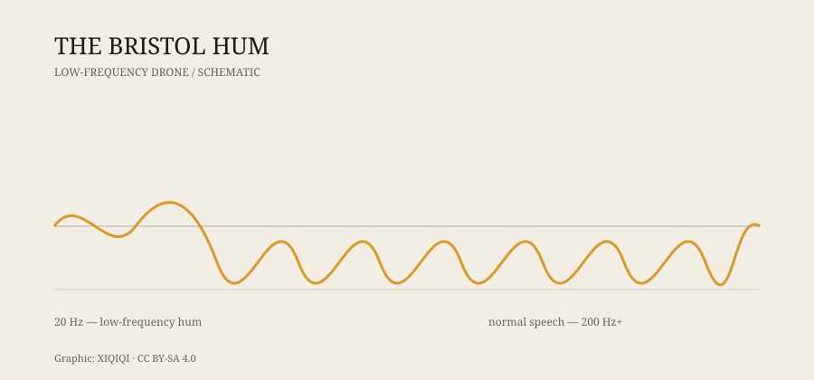

## 一、夜里的声音

布里斯托，英格兰西南部的一座城市。

1970 年代的某个晚上，一位居民躺在床上，听见一种很低、很稳的声音。不是卡车经过，也不是冰箱压缩机。它像远处有一台柴油机在空转，又像整栋房子在轻轻震动。

他起床检查。关掉电源，声音还在。换到另一个房间，声音还在。走到街上，声音好像更远了，又好像无处不在。

第二天，他问邻居。有人说听不见，有人说也听见了，只是不知道那是什么。

这种声音后来被叫作“布里斯托嗡鸣”。

## 二、它是什么

布里斯托嗡鸣不是一种单一的、固定的声音，而是一类低频噪音的统称。

听到的人描述各不相同：有人说像引擎，有人说像蜜蜂，有人说像远处的地铁，有人说像一种压力，直接压在耳朵后面。它通常在夜里更明显，在室内更明显，因为低频声音更容易穿过墙壁和地板。

低频噪音的特点是不容易定位。高音可以靠两只耳朵判断方向，低音不行。你很难说它从哪来，只能确定它在。

*原创示意图：低频嗡鸣与正常语音的频率范围对比。不是实测数据。稀奇奇编辑部，CC BY-SA 4.0。*

## 三、调查

1970 年代，布里斯托的居民开始向当地议会和媒体投诉。

调查人员考虑过很多来源：工厂机器、交通、燃气管道、电力设备、水泵、通风系统。有些投诉确实找到了具体的噪音源，有些没有。测量设备有时能记录到低频能量，有时什么也测不到。

这就是问题所在。如果仪器测不到，声音是否真的存在？如果只有部分人能听见，它是不是一种听觉现象，而不是环境噪音？

当地媒体、议会和研究人员做过调查，但没有给出一个让所有人都满意的结论。布里斯托嗡鸣从此成了一个“有记录、没答案”的案例。

## 四、为什么只有部分人听见

低频声音的传播和感知，比高频复杂。

一方面，低频噪音可以传播很远，穿过墙壁和窗户，衰减很慢。同一栋楼里，不同房间的低频分布可能不一样。

另一方面，人的听觉阈值不同。有人对低频特别敏感，有人几乎听不见。年龄、耳部状况、疲劳、压力，都会影响感知。

还有一种可能：部分“嗡鸣”来自耳朵本身。耳鸣、自发性耳声发射，都会让人听到没有外部声源的声音。这不是“想象”，而是听觉系统在产生信号。

所以，布里斯托嗡鸣可能不是单一原因造成的。它可能是环境噪音、建筑共振、个体听觉差异，甚至几种因素叠加的结果。

## 五、别的城市也有

布里斯托不是唯一。

美国新墨西哥州的陶斯嗡鸣（Taos Hum）在 1990 年代引起过广泛关注；加拿大温莎嗡鸣（Windsor Hum）在 2011 年前后被大量报道；美国印第安纳州的科科莫嗡鸣（Kokomo Hum）也有类似投诉。

这些案例的共同点是：只有一部分人能听见，来源难以确认，调查往往没有决定性结论。

## 六、它还在吗

布里斯托嗡鸣的报道在 1970 年代最集中，但类似的声音并没有消失。

今天，低频噪音仍然是一个真实的城市问题。风机、压缩机、变压器、交通、施工，都可能产生低频成分。对大多数人来说，它只是背景；对少数人来说，它是每天晚上都在的干扰。

布里斯托嗡鸣之所以留得住，不是因为它有一个惊人的答案，而是因为它把一个问题放在了桌面上：当只有你能听见一种声音，它算不算真的存在？

## 低频的声音

布里斯托尔嗡嗡声的关键，在“低频”两个字。

人耳能听到的频率大约是二十赫兹到两万赫兹。低于二十赫兹的声音叫次声，听不见，但身体能感觉到。布里斯托尔的报告里，很多人描述的不是“听到”，而是“感觉到”：窗户在抖，胸口发闷，夜里睡不着。

低频声音的来源很多：工厂、风机、压缩机、交通、远处的海浪。它能穿过墙壁和地面，衰减得慢，所以很难判断方向。一个人觉得声音来自窗外，另一个人可能觉得来自地下室。声音没有方向，人就容易把来源想得更远。

## 调查的方法

调查低频噪声，不能只靠耳朵。

研究者会用麦克风和频谱分析仪，记录不同位置的声压级和频率。他们也会关掉可疑的设备，一次只关一个，看声音是否消失。如果关掉某个机器后，嗡嗡声没了，来源就清楚了。

但调查经常失败，因为声音太弱，或者来源太多。一个小区里可能有几十台设备，每一台都贡献一点低频。合在一起，就成了一个说不清来源的“嗡”。

## 健康

低频噪声对健康的影响，研究结果并不一致。

一些人会出现烦躁、失眠、头痛和注意力下降。另一些人住在同样的环境里，却完全没有感觉。差异可能来自耳朵的敏感度、睡眠习惯和心理预期。

“嗡嗡声”还有一个社会维度。当一个人说自己听见了别人听不见的声音，周围人可能会怀疑他。这种不被相信的感觉，会让症状更重。声音的问题，最后变成了一个信任的问题。

## 城市

布里斯托尔嗡嗡声没有完全消失。

它成了一个城市传说，也成了一个环境议题。城市越密，机器越多，低频声音越难避免。完全安静的城市不存在，问题是多少算太多。

今天，研究者更关心的是“声音景观”：不是只有一个噪音源，而是很多声音叠在一起，形成一种持续的背景。人在这种背景里生活，时间长了，会把它当成安静。直到某天，它突然被听见。

---

**来源与许可**：本文的事实来源见条目底部来源台账 S1–S2。文字与原创示意图采用 CC BY-SA 4.0。布里斯托嗡鸣的具体声源仍有争议，本文区分了已记录的报告、调查和解释性假说。
