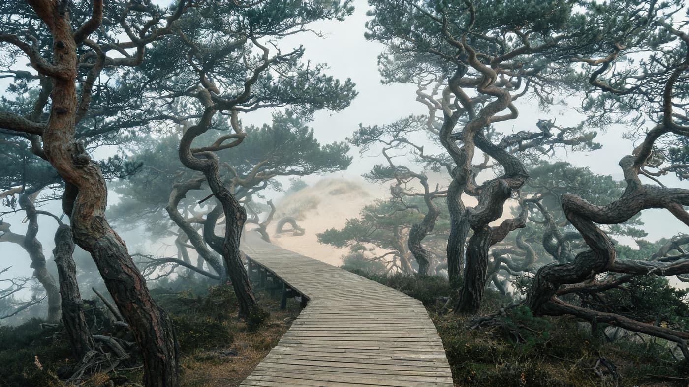
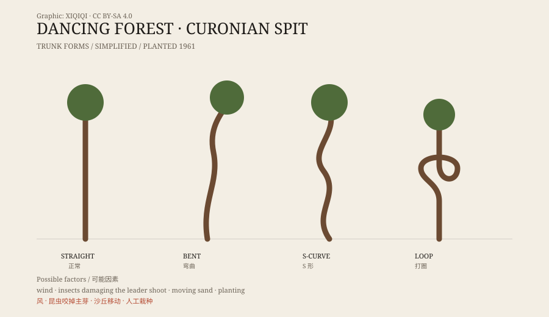

## 1. A forest on the spit

The Curonian Spit is a long, narrow strip of sand between the Baltic Sea and the Curonian Lagoon. It runs from Lithuania into Russia's Kaliningrad Oblast, and in places it is only a few hundred metres wide.

The wind is strong, the sand is soft, and trees struggle to hold on. To stabilise the dunes, large areas of pine were planted along the spit.

The Dancing Forest stands on the Russian side, near the village of Rybachy. It is a modest stand of pines, planted in 1961.

## 2. The shape of the trunks

Walk in, and the first thing you notice is the trunks.

A normal pine grows straight up, with its crown at the top. These do not. Some begin to bend near the base, like a drawn bow. Some turn sharply at mid-height and then continue upward. Some curl into a full circle, as if tied in a knot.

The bends do not all point the same way. Some lean east, some west, some spiral close to the ground. In the same stand there are perfectly straight trees. They grow among the others like a group of people in which a few have suddenly started dancing.

The boardwalk runs through the middle of the stand, narrow enough for one person at a time. Sand and pine needles lie on either side. Fog drifts in from the sea and wraps the lower trunks; the most twisted trees show a bent outline through the fog. Wind moves through the crowns with a muffled sound, like someone pushing an old door a long way off.

*Reconstruction: the boardwalk, sea fog, and knotted pines of the Dancing Forest. Not a photograph of the site. Oddity Archive, CC BY-SA 4.0.*

*Original schematic: several common trunk shapes in the Dancing Forest. Not a photograph. Oddity Archive, CC BY-SA 4.0.*

## 3. Why they bend

There are many explanations.

The most common is wind. The sea wind on the spit blows steadily from one direction, carrying salt spray and sand. Young trees grow in that wind and are pushed over; as the trunk thickens, the bend becomes fixed.

The explanation makes sense, but it does not cover everything. If wind alone were responsible, the bends should point the same way and appear on the windward side. What visitors actually see is more chaotic. Some trunks even curl.

## 4. The insect explanation

Another explanation involves insects.

A pine's main upward growth comes from a single leading shoot. If that shoot is damaged by an insect while the tree is young, the tree loses its “up” and lateral branches compete. The trunk then twists.

Supporters point out that this would explain why no two bends look alike: each tree loses its leader at a different time and place, so each grows into a different shape. Whether insect damage was widespread enough to explain the whole stand is still unclear.

## 5. Wind, sand, and people

There is also a factor that is easy to overlook: people.

The forest was planted by hand. The source of the seedlings, the planting method, and any later pruning or moving would all affect the shapes. The dunes themselves move; sand is blown away from or piled around the roots, the trunk tilts, and the tree grows back toward the light.

So the Dancing Forest may not have a single cause. Wind, insects, shifting sand, and human planting may all be part of the same story.

## 6. Now

The Dancing Forest is one of the best-known sites on the Curonian Spit. Visitors walk on wooden boardwalks and are asked not to leave the path, because the dunes and vegetation are fragile.

The trees keep growing. The bends will not disappear; they will only thicken with each ring. Which tree was shaped by wind and which by insects will probably never be settled.

---

**Sources and licenses**: the factual sources are listed in the source ledger S1–S3 at the bottom of this entry. Text and original diagrams are licensed under CC BY-SA 4.0. This article presents wind, insects, moving sand, and human planting side by side, without treating any one as the only cause.
