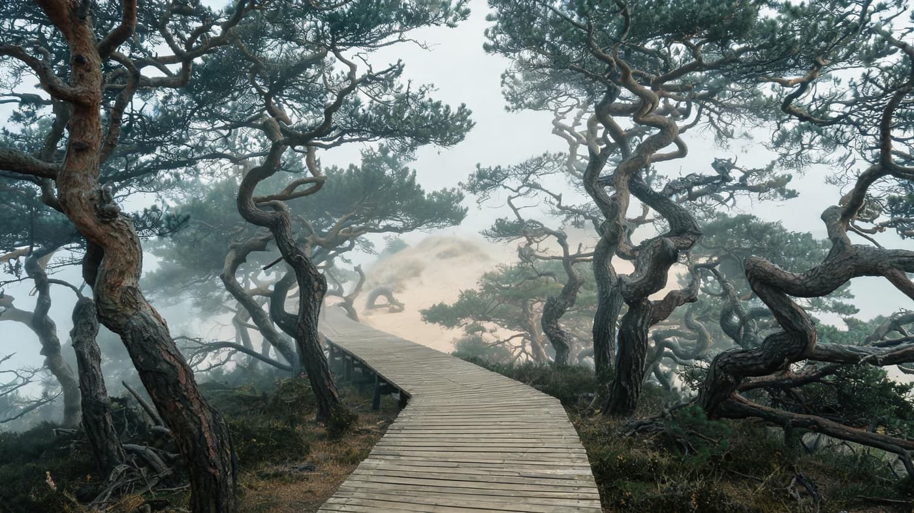
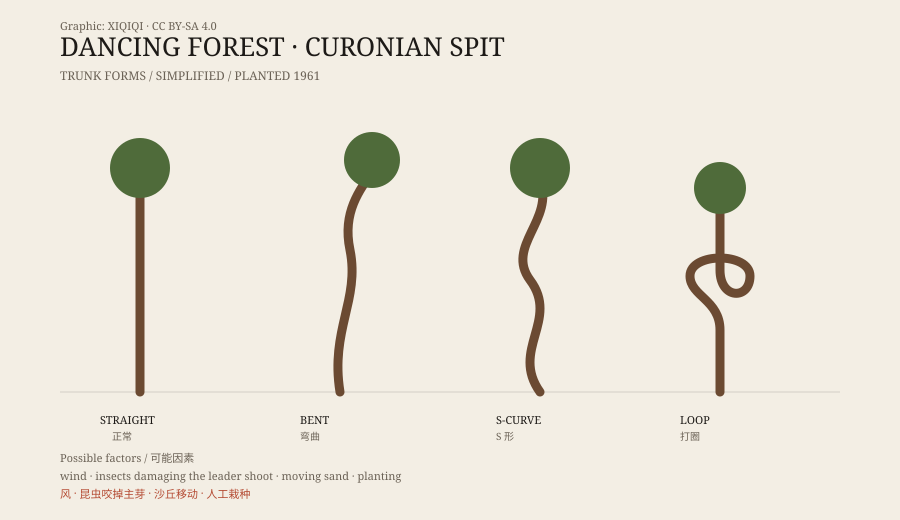

## 一、沙嘴上的林子

库尔斯沙嘴是一条狭长的沙洲，一边是波罗的海，一边是库尔斯潟湖。沙洲从立陶宛一直延伸到俄罗斯的加里宁格勒州，最窄的地方只有几百米宽。

这里风大，沙软，树很难站稳。为了固定沙丘，人们在沙嘴上种了大片松树。

跳舞森林就在沙嘴的俄罗斯一侧，靠近雷巴奇村。它是一片并不算大的松林，1961 年栽下。

## 二、树干的样子

走进去，最先看到的是树干。

普通的松树笔直向上，树冠在顶端。这里的松树不是。有的从根部附近就开始弯，像一张拉开的弓；有的在半腰突然转向，然后再往上长；有的干脆绕成一个圈，像打了个结。

这些弯曲没有统一的朝向。有的向东，有的向西，有的贴着地面转。同一片林子里，也有完全正常的树。它们混在一起，像一群人里突然有几个开始跳舞。

木栈道从林子中间穿过去，窄，只容一个人走。两边是沙地，落着松针。雾从海那边漫过来，缠在树干的下半截，弯得最厉害的那几棵，正好在雾里露出一段扭曲的轮廓。风穿过树冠，声音很闷，像有人在很远的地方推一扇旧门。

*场景复原：库尔斯沙嘴跳舞森林的木栈道、海雾与扭结的松树。不是实地照片。稀奇奇编辑部，CC BY-SA 4.0。*

*原创示意图：跳舞森林中常见的几种树干弯曲形态。不是实拍照片。稀奇奇编辑部，CC BY-SA 4.0。*

## 三、为什么弯

关于原因，说法很多。

最常见的是风。沙嘴上的海风长期从同一个方向吹，带着盐雾和沙粒。幼树在风里生长，树干会被推弯；等树长粗了，弯曲就固定下来。

这个解释有道理，但不能解释所有现象。如果只是风，弯曲应该朝同一个方向，而且应该出现在迎风面。实际看到的形态更乱，有些树甚至绕圈。

## 四、虫说

另一种解释是虫子。

松树的顶端有一个主芽，负责向上长。如果主芽在幼树阶段被昆虫咬掉，树就会失去“向上”的主导，侧枝开始竞争，树干随之扭曲。松梢蛾一类的小虫，就可能造成这种损伤。

支持者认为，这能解释为什么弯曲的形态各不相同：每棵树失去主芽的时间、位置不一样，长出来的形状也就不一样。但虫害是否普遍到能解释整片林子，还没有定论。

## 五、风、沙和人

还有一个容易被忽略的因素：人。

这片林子是人工栽种的。树苗的来源、栽种的方式、后来是否有人修剪或移动过，都会影响树的形态。沙丘本身也在移动，树根周围的沙被吹走或堆高，树干就会倾斜，然后为了追光重新向上。

所以，跳舞森林可能不是单一原因造成的。风、虫、沙、人工栽种，几件事叠在一起，长成了现在的样子。

## 六、现在

跳舞森林是库尔斯沙嘴最有名的景点之一。游客沿着木栈道走，不能随意离开路面，因为沙丘和植被都很脆弱。

这些树还会继续长。弯曲不会消失，只会随着年轮变粗。至于哪一棵是风造成的，哪一棵是虫造成的，大概永远不会有统一的答案。

## 时间线

- **1961 年**：它是一片并不算大的松林，1961 年栽下

## 来源与证据

本条目目前主要依赖公开综述与原创图；独立档案来源仍在补充中，正文中的年代、地点与人物按现有资料的最低共识处理。
原创插图只提供场景复原、结构示意或地图，不作为历史照片使用。正文把可核对记录、后来解释与传说分开叙述；同一件事在不同来源中的版本差异，保留在行文中，不强行合并。

## 档案空白

现有材料能说明现象被记录过，未必能说明它的成因；记录、仪器数据与解释之间仍有一段距离，这段距离就是档案要保留的空白。
这条档案把记录与未答的问题并排放置，不替读者做出超出证据的结论。
就可信度而言，本条目标为“disputed”。这个标签描述的是当前证据状态，不是对传说真伪的终审；新档案出现时，标签应随之调整。

## 档案补记

以下补记保留正文没有展开的档案侧面：来源、技术细节与后续影响。
**档案的位置**。 跳舞森林是“自然奇观”类档案。它不需要怪物，也不需要外星人。一片人工种下的松林，被风、雪和沙塑造成奇怪的形状，就足够让人停下来。自然的神秘，有时不需要超自然。
**补记**。 跳舞森林的树，弯曲的形状并不统一。有的像拱门，有的像螺旋，有的贴着地面。这种多样性说明，风、雪、沙和基因都在起作用。没有单一原因，也没有单一图案。自然很少给出整齐的答案。
**造林**。 跳舞森林不是原始林。

这片松林是二十世纪中叶人工种下的，用来固定沙丘、保护海岸。种树的人把幼苗排成行，没想到风、雪和沙会把它们塑造成另一种形状。

一个人工林，长成了一片看起来像自然奇观的地方。这本身就是一个提醒：自然和人工的界线，比我们想的要模糊。

---

**来源与许可**：本文的事实来源见条目底部来源台账 S1–S3。文字与原创示意图采用 CC BY-SA 4.0。文中并列呈现风、昆虫、沙丘移动和人工栽种等因素，不把其中任何一种当成唯一原因。
