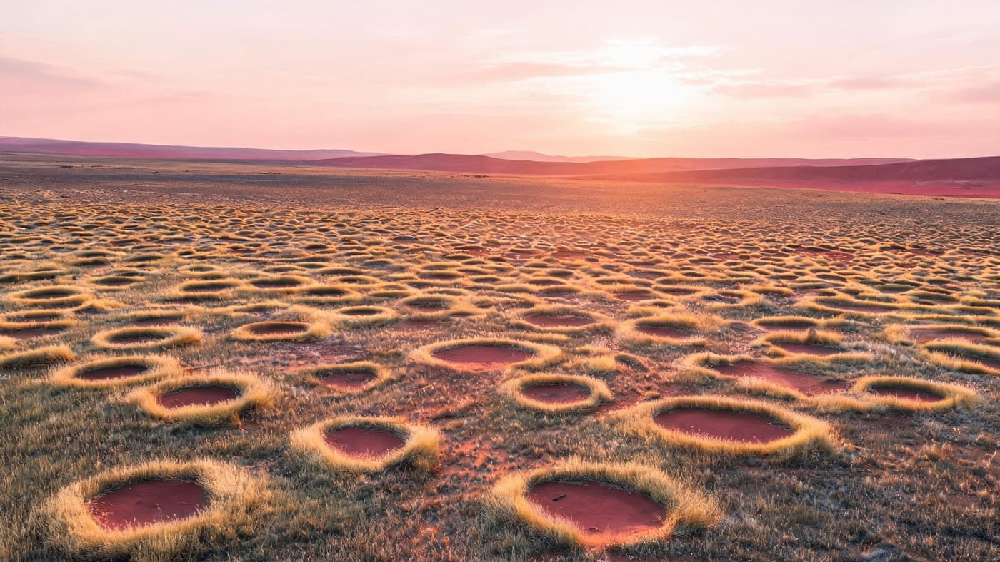
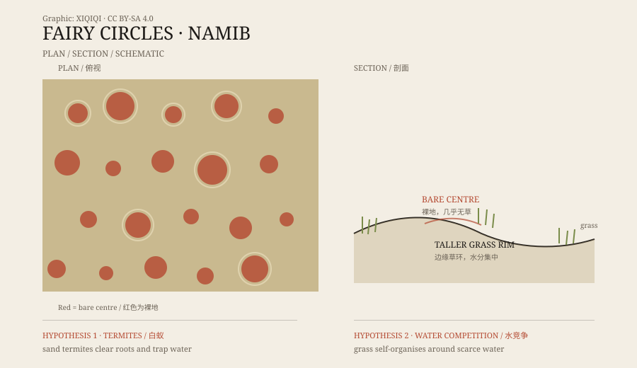

## 1. From the air

The Namib Desert runs along the coast of Namibia. Moving inland from the dunes, the sand gradually gives way to dry grassland and scattered trees.

In that transition zone, there is a stretch of grassland with an unusual pattern. From an aircraft, the ground appears to be covered by thousands of circular bare patches, of different sizes, not neatly aligned, but spaced apart from one another.

Local people had seen them long before researchers did. They are now known as fairy circles.

At sunrise, standing at the edge of the grassland, the circles run all the way to the horizon. Dew bends the rim grass white; the centre is dark red sand. The wind is light. The grass moves, the circles do not. Up close, the grass between circles stands taller, and dry stems crack underfoot.

*Reconstruction: a low aerial view of fairy circles and red sand at dawn. Not an aerial photograph of the site. Oddity Archive, CC BY-SA 4.0.*

## 2. The shape of a circle

A typical fairy circle is about two to twelve metres across.

The centre is bare sandy soil with almost no grass. Around it runs a rim of taller grass, like a clipped wreath. Between one circle and the next there is usually a stretch of ordinary grassland.

They do not appear every year, and they do not all behave the same way. Some expand, some disappear, and some reappear nearby. In wet years the grass creeps a little toward the centre; in dry years the centre opens up again.

*Original schematic: the plan arrangement of fairy circles and a section through the grassy rim. Not a precise survey. Oddity Archive, CC BY-SA 4.0.*

## 3. The termite explanation

One explanation holds that the circles are made by termites.

The Namib is home to a species of sand termite. The insects work underground, eating grass roots and organic matter and turning the centre of a circle into bare ground. Bare ground does not lose water through transpiration, so rain soaks in more easily and becomes available to the termites and the surrounding grass.

Supporters of this idea have found termite activity in circles in South Africa and Namibia, and have run experiments removing termites. To them, the circle is not a place where grass cannot grow. It is a place where termites have cleared the grass.

## 4. The water-competition explanation

Another explanation holds that the circles are made by the grass itself.

In a dry environment, grasses compete for limited water. The soil around one plant dries out, its neighbours struggle, and a gap opens. The larger the gap, the more water collects at its edge, where the grass grows taller and the centre becomes even less hospitable.

This feedback can amplify itself and produce regular circles. Supporters have reproduced similar patterns in computer models and found evidence in circles where termites were absent.

## 5. It may not be either-or

The two explanations sound opposed, but they need not be.

Termites can change the soil and the water, and grass can respond to what the termites do. In different regions and under different rainfall conditions, the dominant factor may differ. Australia has similar fairy circles, and the termite evidence found there does not match Namibia exactly.

So the question may not be “termites or grass,” but “where, and under what conditions, does one mechanism matter more?”

## 6. Now

Fairy circles remain one of the most striking features of the Namib. They do not require a mysterious force or an alien explanation. They require thin rainfall, poor sandy soil, slow growth, and a very long time.

A circle looks simple. Explaining it means understanding termites, grass, water, and soil at the same time.

---

**Sources and licenses**: the factual sources are listed in the source ledger S1–S3 at the bottom of this entry. Text and original diagrams are licensed under CC BY-SA 4.0. This article presents the termite hypothesis and the vegetation self-organisation hypothesis side by side, without treating either as the only answer.
