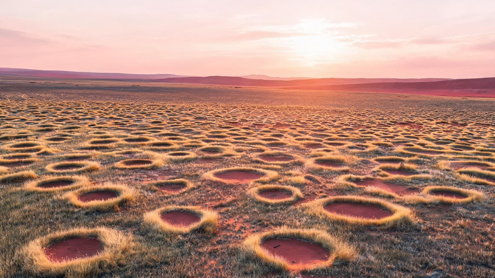
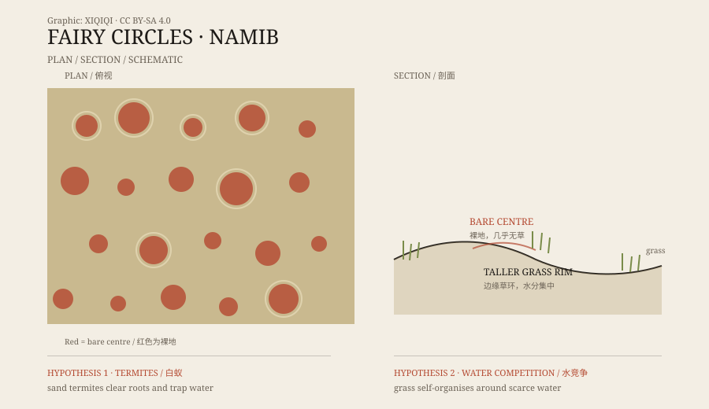

## 1. From the air

The Namib Desert runs along the coast of Namibia. Moving inland from the dunes, the sand gradually gives way to dry grassland and scattered trees.

In that transition zone, there is a stretch of grassland with an unusual pattern. From an aircraft, the ground appears to be covered by thousands of circular bare patches, of different sizes, not neatly aligned, but spaced apart from one another.

Local people had seen them long before researchers did. They are now known as fairy circles.

At sunrise, standing at the edge of the grassland, the circles run all the way to the horizon. Dew bends the rim grass white; the centre is dark red sand. The wind is light. The grass moves, the circles do not. Up close, the grass between circles stands taller, and dry stems crack underfoot.

*Reconstruction: a low aerial view of fairy circles and red sand at dawn. Not an aerial photograph of the site. Oddity Archive, CC BY-SA 4.0.*

## 2. The shape of a circle

A typical fairy circle is about two to twelve metres across.

The centre is bare sandy soil with almost no grass. Around it runs a rim of taller grass, like a clipped wreath. Between one circle and the next there is usually a stretch of ordinary grassland.

They do not appear every year, and they do not all behave the same way. Some expand, some disappear, and some reappear nearby. In wet years the grass creeps a little toward the centre; in dry years the centre opens up again.

*Original schematic: the plan arrangement of fairy circles and a section through the grassy rim. Not a precise survey. Oddity Archive, CC BY-SA 4.0.*

## 3. The termite explanation

One explanation holds that the circles are made by termites.

The Namib is home to a species of sand termite. The insects work underground, eating grass roots and organic matter and turning the centre of a circle into bare ground. Bare ground does not lose water through transpiration, so rain soaks in more easily and becomes available to the termites and the surrounding grass.

Supporters of this idea have found termite activity in circles in South Africa and Namibia, and have run experiments removing termites. To them, the circle is not a place where grass cannot grow. It is a place where termites have cleared the grass.

## 4. The water-competition explanation

Another explanation holds that the circles are made by the grass itself.

In a dry environment, grasses compete for limited water. The soil around one plant dries out, its neighbours struggle, and a gap opens. The larger the gap, the more water collects at its edge, where the grass grows taller and the centre becomes even less hospitable.

This feedback can amplify itself and produce regular circles. Supporters have reproduced similar patterns in computer models and found evidence in circles where termites were absent.

## 5. It may not be either-or

The two explanations sound opposed, but they need not be.

Termites can change the soil and the water, and grass can respond to what the termites do. In different regions and under different rainfall conditions, the dominant factor may differ. Australia has similar fairy circles, and the termite evidence found there does not match Namibia exactly.

So the question may not be “termites or grass,” but “where, and under what conditions, does one mechanism matter more?”

## 6. Now

Fairy circles remain one of the most striking features of the Namib. They do not require a mysterious force or an alien explanation. They require thin rainfall, poor sandy soil, slow growth, and a very long time.

A circle looks simple. Explaining it means understanding termites, grass, water, and soil at the same time.

## From the air

Fairy rings are round naked on the grass.

On the steppes of Namibia, they are like holes in a green blanket that are burned by smoke. Circles range from a few metres to a dozen metres, often with a higher circle of grass on the edge. The inner circle is without grass and the ground is bare.

From the plane, tens of thousands of circles are lined up like some kind of pattern.

## termites

The most common explanation is termites.

termites nest in the soil, eat, and move. They eat the grass in the circle, and they change the water and nutrients of the soil. The termite lives in a circle, the grass dies in the circle, and the outside of the circle is restored.

But termites say there's a problem: not all fairies have termites under them. Some circles are in the sand, few termites, some are outside termites.

## Water

Another explanation is the competition for water.

The roots of the grass compete for water in the soil. The grass in the center of the circle dies first, because the water there is sucked away by the surrounding grass; the grass on the edge of the circle is higher because they have a competitive advantage.

This interpretation requires specific soil: sand, rapid drainage, heavy rainfall. The pastures of Namibia match.

## Australia

Fairies are not only in Africa.

A similar structure is found in arid grasslands in western and northern Australia. Researchers compare soils, rainfall, and termites, and find that the mechanisms are not identical.

This suggests that the Fairy Circle may not be a phenomenon, but a phenomenon. Different places, different ecological processes, make similar patterns.

## Don't just pick one

In ecology, there's very little explanation for everything.

termites, water, grass, soil, and fire can work together. termites change the soil, water determines the life and death of grass, and fire cyclically clears the ground. Circles are the result of these forces, not a single cause.

The name of the fairy circle comes from legends. The answer to science is more complicated than legends, and more interesting than legends.

## Supplementary Notes

The fairy circle research turns out to be an interdisciplinary problem. Ecology, soil science, hydrology and termite behavior are all looking for answers in the same circle. A seemingly simple pattern, then a whole set of relationships. The beauty of nature, often comes from many invisible interactions.

## Location of the archives

The fairy circle is an ecological profile. It looks artificial, but it is the result of a variety of ecological processes. The archive is not kept to give an ultimate answer, but to show how many questions a simple circle can draw: water, worms, grass, fire, soil.

---

**Sources and licenses**: the factual sources are listed in the source ledger S1–S3 at the bottom of this entry. Text and original diagrams are licensed under CC BY-SA 4.0. This article presents the termite hypothesis and the vegetation self-organisation hypothesis side by side, without treating either as the only answer.
