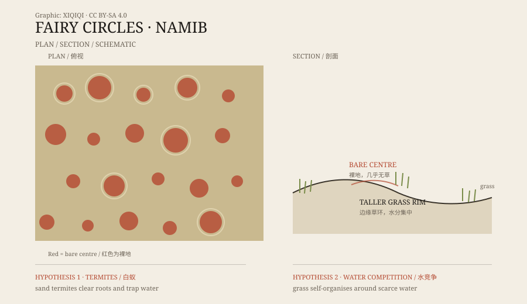

## 一、从空中看

纳米比亚的纳米布沙漠，靠海一侧是沙丘，向内陆走，沙地渐渐变成稀树草原。

在这条过渡带上，有一片草地很特别。从飞机上看，地面上分布着成千上万个圆形秃斑，大小不一，排列得并不整齐，但彼此之间又保持着距离。

当地人早就见过它们。后来，研究者给了它们一个名字：仙女圈。

## 二、圆圈的结构

一个典型的仙女圈，直径大约两到十二米。

中心是裸露的沙土，几乎没有草。边缘则长着一圈较高的草，像被修剪过的花环。圆圈与圆圈之间，通常隔着一段草地。

它们不是每年都出现，也不是每年都一样。有的会扩大，有的会消失，有的会在旁边重新长出来。雨多的时候，草会往圆圈中心推进一点；旱季一来，中心又空出来。

*原创示意图：仙女圈的俯视排列与边缘草环剖面。不是精确测绘图。稀奇奇编辑部，CC BY-SA 4.0。*

## 三、白蚁说

一种解释认为，圆圈是白蚁造成的。

纳米布沙漠里生活着一种沙白蚁。它们在地下活动，吃掉草根和有机物，把圆圈中心变成没有植被的裸地。裸地不蒸腾水分，雨水更容易渗到地下，被白蚁和周围的草利用。

支持这个说法的人在南非和纳米比亚的圆圈里找到了白蚁活动，也做过清除白蚁的实验。对他们来说，圆圈不是“草长不出来”，而是“白蚁把草清掉了”。

## 四、水竞争说

另一种解释认为，圆圈是草自己形成的。

在干旱环境里，草与草之间会争夺有限的水。一株草周围的土壤变干，旁边的草就长不好，于是形成一个空隙。空隙越大，水越容易集中到边缘的草上，边缘的草长得更高，中心的草更活不了。

这个反馈会自己放大，最后形成规则的圆圈。支持者用计算机模型模拟出了类似图案，也在一些没有白蚁的圆圈里找到了证据。

## 五、不一定只能选一个

两种解释听起来对立，其实不一定。

白蚁可以改变土壤和水分，草也会对白蚁的活动作出反应。在不同地区、不同降水条件下，主导因素可能不一样。澳大利亚也有类似的仙女圈，研究者在那边找到的白蚁证据，又和纳米比亚不完全相同。

所以，问题可能不是“到底是白蚁还是草”，而是“在什么地方、什么条件下，哪一种机制更重要”。

## 六、现在

仙女圈仍然是纳米布沙漠最引人注目的景观之一。它不需要神秘力量，也不需要外星人。它只需要很薄的降水、很贫瘠的沙土、很慢的生长，以及足够长的时间。

一个圆圈看起来很简单。把它解释清楚，却要同时读懂白蚁、草、水和土壤。

---

**来源与许可**：本文的事实来源见条目底部来源台账 S1–S3。文字与原创示意图采用 CC BY-SA 4.0。文中并列呈现白蚁说与植被自组织说，不把其中任何一种当成唯一结论。
