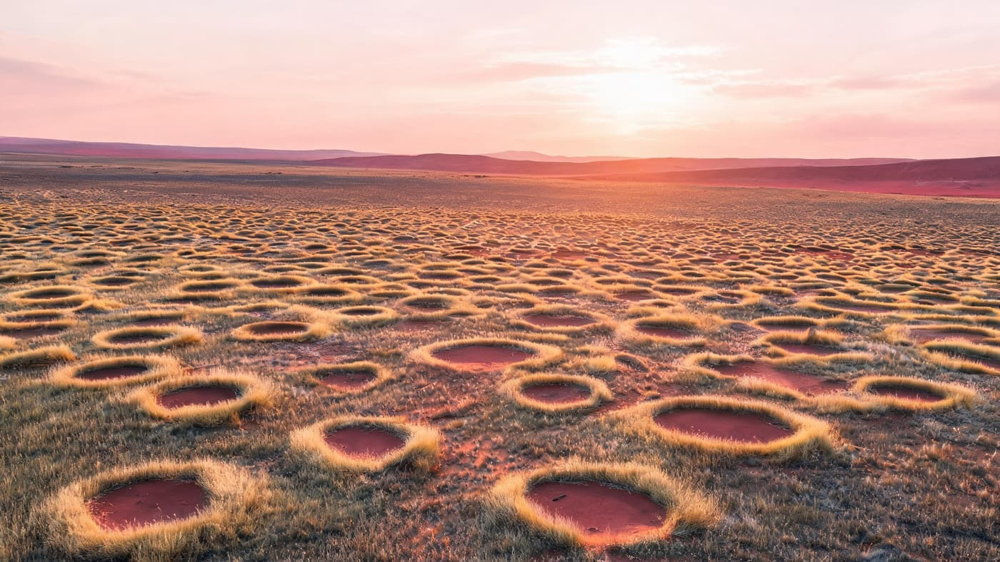
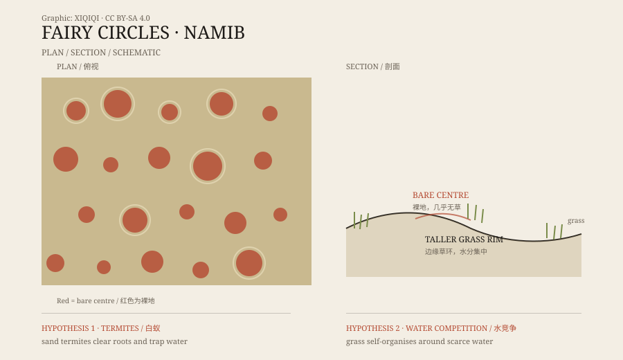

## 一、从空中看

纳米比亚的纳米布沙漠，靠海一侧是沙丘，向内陆走，沙地渐渐变成稀树草原。

在这条过渡带上，有一片草地很特别。从飞机上看，地面上分布着成千上万个圆形秃斑，大小不一，排列得并不整齐，但彼此之间又保持着距离。

当地人早就见过它们。后来，研究者给了它们一个名字：仙女圈。

清晨太阳刚出来的时候，站在草地边上，能看见圆圈一直铺到地平线。露水把边缘的草压弯，草尖发白，中心的沙土是暗红色的。风很小，草环轻轻动，圆圈却像钉在地上一样不动。走近看，圆与圆之间的草明显更高，脚踩上去，干草发出很脆的响声。

*场景复原：清晨低空视角下的纳米布仙女圈与红色沙土。不是实地航拍照片。稀奇奇编辑部，CC BY-SA 4.0。*

## 二、圆圈的结构

一个典型的仙女圈，直径大约两到十二米。

中心是裸露的沙土，几乎没有草。边缘则长着一圈较高的草，像被修剪过的花环。圆圈与圆圈之间，通常隔着一段草地。

它们不是每年都出现，也不是每年都一样。有的会扩大，有的会消失，有的会在旁边重新长出来。雨多的时候，草会往圆圈中心推进一点；旱季一来，中心又空出来。

*原创示意图：仙女圈的俯视排列与边缘草环剖面。不是精确测绘图。稀奇奇编辑部，CC BY-SA 4.0。*

## 三、白蚁说

一种解释认为，圆圈是白蚁造成的。

纳米布沙漠里生活着一种沙白蚁。它们在地下活动，吃掉草根和有机物，把圆圈中心变成没有植被的裸地。裸地不蒸腾水分，雨水更容易渗到地下，被白蚁和周围的草利用。

支持这个说法的人在南非和纳米比亚的圆圈里找到了白蚁活动，也做过清除白蚁的实验。对他们来说，圆圈不是“草长不出来”，而是“白蚁把草清掉了”。

## 四、水竞争说

另一种解释认为，圆圈是草自己形成的。

在干旱环境里，草与草之间会争夺有限的水。一株草周围的土壤变干，旁边的草就长不好，于是形成一个空隙。空隙越大，水越容易集中到边缘的草上，边缘的草长得更高，中心的草更活不了。

这个反馈会自己放大，最后形成规则的圆圈。支持者用计算机模型模拟出了类似图案，也在一些没有白蚁的圆圈里找到了证据。

## 五、不一定只能选一个

两种解释听起来对立，其实不一定。

白蚁可以改变土壤和水分，草也会对白蚁的活动作出反应。在不同地区、不同降水条件下，主导因素可能不一样。澳大利亚也有类似的仙女圈，研究者在那边找到的白蚁证据，又和纳米比亚不完全相同。

所以，问题可能不是“到底是白蚁还是草”，而是“在什么地方、什么条件下，哪一种机制更重要”。

## 六、现在

仙女圈仍然是纳米布沙漠最引人注目的景观之一。它不需要神秘力量，也不需要外星人。它只需要很薄的降水、很贫瘠的沙土、很慢的生长，以及足够长的时间。

一个圆圈看起来很简单。把它解释清楚，却要同时读懂白蚁、草、水和土壤。

## 从空中看

仙女圈是草地上的圆形裸地。

在纳米比亚的草原上，它们像一片绿色的毯子上被烟头烫出的洞。圆圈直径从几米到十几米，边缘往往长着一圈更高的草。圆圈内部没有草，地面裸露。

从飞机上看，成千上万个圆圈排成一片，像某种图案。

## 白蚁

最常见的解释是白蚁。

白蚁在土壤里筑巢、取食、搬运。它们会把圆圈内的草根吃掉，也会改变土壤的水分和养分。白蚁的活动范围形成一个圆，草在圆内死亡，圆外恢复。

但白蚁说有一个问题：并不是所有仙女圈下面都有白蚁。有些圆圈在沙地里，白蚁很少；有些圆圈在白蚁活动区之外。

## 水

另一种解释是水的竞争。

草的根在土壤里争夺水分。圆圈中心的草先死，因为那里的水被周围的草吸走；圆圈边缘的草长得更高，因为它们在竞争中有优势。

这个解释需要特定的土壤：沙、排水快、降雨集中。纳米比亚的草原正好符合。

## 澳大利亚

仙女圈不只在非洲。

澳大利亚西部和北部的干旱草地也有类似结构。研究者比较了两地的土壤、降雨和白蚁，发现机制不完全一样。非洲的圆圈更规则，澳大利亚的更分散。

这说明“仙女圈”可能不是一种现象，而是一类现象。不同的地方，用不同的生态过程，做出了相似的样子。

## 不要只选一个

生态学里，很少有一个原因能解释所有事。

白蚁、水、草、土壤、火，可能一起作用。白蚁改变土壤，水决定草的生死，火周期性清空地面。圆圈是这些力量叠加的结果，不是一个单一原因的作品。

仙女圈的名字来自传说。科学给出的答案，比传说复杂，也比传说有趣。

## 补记

仙女圈的研究，最后变成了一个跨学科问题。生态学、土壤学、水文学和白蚁行为学，都在同一个圆圈里找答案。一个看起来简单的图案，拆开之后是一整套关系。自然界的美，往往来自很多看不见的相互作用。

## 档案的位置

仙女圈是“生态图案”类档案。它看起来像人工的，其实是多种生态过程的结果。档案保留它，不是为了给一个终极答案，而是为了展示一个简单的圆圈可以牵出多少问题：水、虫、草、火、土壤。

---

**来源与许可**：本文的事实来源见条目底部来源台账 S1–S3。文字与原创示意图采用 CC BY-SA 4.0。文中并列呈现白蚁说与植被自组织说，不把其中任何一种当成唯一结论。
