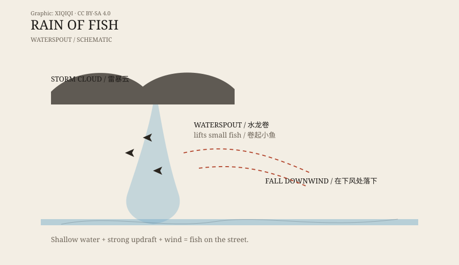

## 1. After the rain

The storm has passed, but water is still running down the street.

Someone opens the door and finds fish on the ground. Not one or two, but a scattering. Some are still moving. Some are washed into drains; some lie in the mud. The sky is clear. There is no river nearby, and no fish pond.

The scene sounds like a story, but it has appeared in different countries and different decades. People gave it a plain name: rain of fish.

## 2. The fish rain of Yoro

Yoro, Honduras.

A claim has persisted here for more than a century: every spring and summer, after heavy rain, fish appear on the ground. Locals call it “Lluvia de Peces,” the rain of fish. Some residents go out with baskets and search the muddy roads.

Local legend connects the event to a nineteenth-century priest. He prayed for the village, and the fish began to appear. That story is part of local faith, not a scientific explanation.

The source of Yoro's fish remains disputed. Some believe the fish come from underground streams or seasonal channels, pushed up by heavy rain. Others believe a waterspout carried them there. Both explanations are possible. Neither has been fully proven.

## 3. Lajamanu, 2010

Lajamanu, northern Australia.

In 2010, after a storm, residents found fish on the ground. The fish were small, and some were still alive. The town is far from the coast, with no suitable water nearby.

Meteorologists explained it with a waterspout: the spout lifted fish from the water, wind carried them to the town, and they fell with the rain. The explanation matched what residents saw.

Similar reports have come from India, Sri Lanka, the United States, and elsewhere. The size, species, and number of fish vary, but the pattern is similar: storm, strong wind, fish, downwind.

## 4. How a waterspout lifts fish

The key to fish rain is not the cloud. It is the waterspout.

A waterspout is a rotating column of air over water. It lifts water into a column. If the water is shallow and contains fish, frogs, or other small animals, they can be lifted too.

The updraft carries the fish into the air, and the wind moves them sideways. When the updraft weakens, the fish fall to the ground or onto roofs. The landing point is usually tens of metres to several kilometres away, depending on wind and height.

The fish do not always die. A short trip through the air can leave them stunned or stressed, and some are still moving when they land. That is the most surprising part of the fish rain stories: the fish do not just fall. Some are still alive.

*Original schematic: a waterspout lifts fish from shallow water and drops them downwind. Not to scale. Oddity Archive, CC BY-SA 4.0.*

## 5. Why not every fish rain is credible

Fish rain is a real phenomenon, but not every “fish rain” report is reliable.

Some reports have no photographs and no samples, only oral accounts. Some describe fish from a flood or a drain as if they fell from the sky. Some are exaggerated to attract tourists or attention.

Yoro is a complex case. It has a long community tradition and real records of events, but the mechanism is still unclear. It could be a waterspout, an underground channel, or both.

When judging a fish rain report, look for three things: a sample, independent witnesses, and a suitable water source near the landing site.

## 6. Next time it rains

Fish rain is uncommon, but it is a reminder that the atmosphere and water can move things farther than we expect.

If you see a fish on the ground after a storm, do not rush to invent a story. Take a photo, note the place and time, and check whether there were waterspout reports nearby. It may really have fallen from the sky.

---

**Sources and licenses**: the factual sources are listed in the source ledger S1–S3 at the bottom of this entry. Text and original diagrams are licensed under CC BY-SA 4.0. The mechanism of fish rain is broadly understood, but individual cases vary in credibility; this article separates verified phenomena, local legend, and unconfirmed reports.
