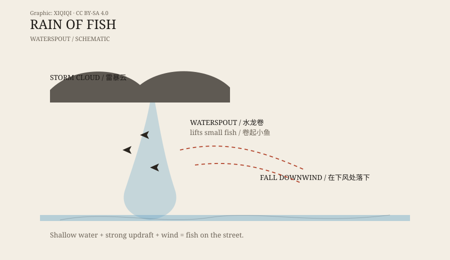

## 一、雨停之后

一场暴雨过去，街上的水还在流。

有人推开门，发现地上有鱼。不是一两条，而是一片。鱼还在动，有的被水冲进排水沟，有的躺在泥里。天空已经放晴，周围没有河流，也没有鱼塘。

这种场景听起来像故事，但它在不同国家、不同年代都出现过。人们给它起了一个直白的名字：鱼雨。

## 二、约罗的鱼雨

洪都拉斯，约罗。

这里有一个持续了一百多年的说法：每年春夏，暴雨之后，地上会出现鱼。当地人叫它“Lluvia de Peces”，意思是“鱼雨”。有的居民会拿着篮子出门，沿着泥路找鱼。

当地的传说把这件事和一位 19 世纪的神父联系在一起。神父为村庄祈祷，之后鱼就开始出现。这个说法是信仰的一部分，不是科学解释。

约罗的鱼雨到底怎么来的，仍有争议。有人认为鱼来自地下暗河或季节性水道，暴雨把鱼冲上来；有人认为是一次水龙卷把鱼带到了这里。两种解释都可能，但都没有被完全证实。

## 三、拉贾马努的 2010 年

澳大利亚北部，拉贾马努。

2010 年，一场暴雨之后，当地居民发现地上有鱼。鱼不大，有些还活着。这个小镇离海岸很远，附近没有合适的水域。

气象学家给出的解释是：水龙卷把鱼从水里卷起来，风把它们带到了镇上，然后随着雨落下来。这个解释和当地居民看到的情况对得上。

类似的报道还出现在印度、斯里兰卡、美国和其他地方。鱼的大小、种类、数量各不相同，但模式很像：暴雨、强风、鱼、下风处。

## 四、水龙卷怎么把鱼带上去

鱼雨的关键，不是云，而是水龙卷。

水龙卷是水面上的一种旋转气流。它把水吸起来，形成一根水柱。如果水很浅，里面有鱼、青蛙或其他小动物，它们也可能被一起卷起来。

上升气流把鱼带到空中，风把它们横向带走。等气流减弱，鱼就掉下来，落在地面或屋顶上。落点通常在几十米到几公里之外，取决于风力和高度。

鱼不一定死。短时间的空中运输，可能让它们处于昏迷或应激状态，落地后有些还能动。这也是鱼雨故事里最让人惊讶的部分：鱼不仅掉下来，有的还活着。

*原创示意图：水龙卷把浅水里的鱼卷起，再在下风处落下。不是实测比例。稀奇奇编辑部，CC BY-SA 4.0。*

## 五、为什么不是所有鱼雨都可信

鱼雨是真实存在的现象，但不是每一条“鱼雨新闻”都可信。

有些报告没有照片、没有样本，只有口述；有些把普通的洪水、排水沟里的鱼，说成“从天上掉下来”；有些是为了吸引游客或流量，故意夸大。

约罗的鱼雨就是一个复杂案例。它有长期的社区传统，也有真实的事件记录，但具体机制仍不清楚。它可能是水龙卷，也可能是地下水道，甚至可能是两种情况叠加。

所以，判断鱼雨报道时，要看三件事：有没有样本、有没有独立目击者、落点附近有没有合适的水源。

## 六、下次下雨时

鱼雨不常见，但它提醒我们：大气和水的力量，比我们想象的更会搬运东西。

下次暴雨之后，如果你在地上看到一条不该出现的鱼，先别急着编故事。拍张照，记下地点和时间，看看附近有没有水龙卷的报道。它可能真的是从天上掉下来的。

---

**来源与许可**：本文的事实来源见条目底部来源台账 S1–S3。文字与原创示意图采用 CC BY-SA 4.0。鱼雨的机制已有合理解释，但具体案例的可信度不一；本文区分了已验证的现象、地方传说和未经证实的报道。
