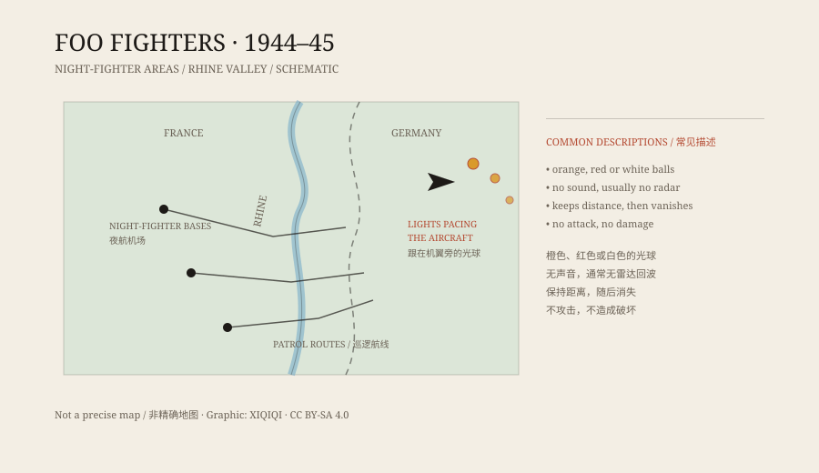

## 1. A winter night in 1944

In November 1944, night operations over Europe were intense. Allied night fighters took off from airfields in eastern France, crossed the front, and searched for German aircraft and ground targets.

Visibility was poor. Pilots flew on instruments, radar, and ground control. It was on those night missions that some of them began to report a light that belonged to neither side.

It appeared near the aircraft, sometimes off a wingtip, sometimes dead ahead. It did not flash a signal, did not call, and did not fire. It simply followed.

## 2. The name

Pilots of the US Army Air Forces' 415th Night Fighter Squadron called these lights “foo fighters.”

“Foo” was not a military term. It came from the popular comic strip Smokey Stover, whose characters used the word as a catchphrase. The pilots used it with a mix of humour and irritation: the thing was a tag-along that would not go away.

The name made it into reports, and from there into newspapers. A word from a comic strip became the official nickname for a wartime mystery.

## 3. What they looked like

The pilots did not all describe the same thing.

Some saw an orange ball like a small fire. Some saw red or white light with a soft edge. Some saw a row of lights like the navigation lights of a large aircraft. Some said the light suddenly accelerated, then stopped in place.

There were common features: the lights usually made no sound, generally did not appear on radar, and could not be approached. They did not attack, but they did not leave either.

*Original schematic: night-fighter areas and witness descriptions around the Rhine valley in the winter of 1944. Not a precise map. Oddity Archive, CC BY-SA 4.0.*

## 4. Impossible to catch

Some pilots turned, dived, or climbed to get a better look. The light moved with them but kept its distance. Sometimes it vanished and reappeared somewhere else.

In a night sky, that is hard to judge. With no reference points, the eye can mistake a distant light, a star, or another aircraft's tail lamp for something else. Fatigue makes it worse. The pilots knew this, which is why many of them were cautious in their reports.

But the reports did not come from one man. Different squadrons, different nights, and different routes produced similar descriptions. That made it harder to dismiss as a single illusion.

## 5. Post-war explanations

When the war ended, no German weapon called a “foo fighter” was found. There was no matching project in the archives, and Allied technical investigations found no hardware.

Several explanations are usually offered.

First, aircraft lights. On night missions, navigation lights, exhaust flames, and reflections from distant aircraft are easy to misread.

Second, atmospheric optics. Ball lightning, St Elmo's fire, and ice-crystal reflections can produce strange lights in certain weather.

Third, fatigue and stress. Pilots stared into darkness for hours; the eye and brain are good at turning a faint point of light into a shape.

Fourth, secret weapons. Both sides were testing new equipment, and the pilots had reason to suspect one. No evidence survived the war.

Each explanation covers some reports. None covers all of them. That is why foo fighters remain on the unresolved list.

## 6. Afterwards

The name “Foo Fighters” was later adopted by an American rock band. Dave Grohl has said the name came from the strange lights seen by Second World War pilots.

For a wartime nickname, that is an odd afterlife: it once described a group of unsettling lights, and now more people hear it and think of a song.

---

**Sources and licenses**: the factual sources are listed in the source ledger S1–S3 at the bottom of this entry. Text and original diagrams are licensed under CC BY-SA 4.0. This article keeps the pilots' descriptions, the wartime investigation, and the post-war explanations in separate layers rather than treating any one of them as final.
