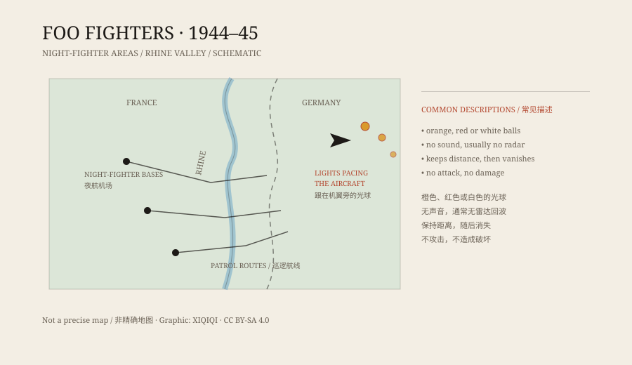

## 一、1944 年冬夜

1944 年 11 月，欧洲战场的夜间任务正密集。盟军的夜间战斗机从法国东部的机场起飞，越过前线，寻找德军的飞机和地面目标。

夜里能见度很差，飞行员靠仪表、雷达和地面引导飞行。就在这样的夜航中，一些人开始报告一种不属于任何一方的光。

它出现在飞机附近，有时在机翼一侧，有时在正前方。它不闪灯，不呼叫，也不开火。它只是跟着。

## 二、名字

美国陆军航空队第 415 夜间战斗机中队的一些飞行员，把这些光叫作“foo fighters”。

“Foo”不是军事术语。它来自当时流行的漫画《Smokey Stover》，里面的人物常把“foo”挂在嘴边。飞行员用这个词，带着一点玩笑，也带着一点说不清的烦躁：它像个跟屁虫，甩不掉。

这个名字后来被写进报告，又被记者写进报纸。于是，一个漫画里的词，成了一种战时谜团的正式绰号。

## 三、它们长什么样

飞行员的描述不完全一致。

有人说是一个橙色的小球，像一团火；有人说是红色或白色的光，边缘模糊；有人说它们排成队，像一架大飞机的航行灯；也有人说它们会突然加速，然后停在原地。

共同点有几个：它们出现时通常没有声音，雷达上一般看不到，飞行员也无法靠近。它们不攻击，但也不离开。

*原创示意图：1944 年冬季莱茵河谷一带的夜航区域与目击描述。不是精确地图。稀奇奇编辑部，CC BY-SA 4.0。*

## 四、追不上，也打不着

有飞行员尝试转向、俯冲、爬升，想看清楚它是什么。光会跟着动，但始终保持距离。有时它突然消失，过一会儿又出现在别处。

这在夜空中很难判断。没有参照物，人的眼睛会把远处的灯光、星星、另一架飞机的尾灯看错。疲劳也会放大这种感觉。飞行员自己也知道这一点，所以很多人在报告时并不肯定。

但报告不是一个人写的。不同中队、不同夜晚、不同航线，都出现了类似的描述。这让它不像单纯的个人幻觉。

## 五、战后的解释

战争结束后，没有人找到一种叫“foo fighter”的德国武器。德国的档案里没有对应项目，盟军的技术调查也没有发现实物。

常见的解释有几种。

第一，是其他飞机的灯光。夜间编队飞行时，远处的航行灯、尾焰和反射光很容易被看成不明物体。

第二，是大气光学现象。球状闪电、圣艾尔摩之火、冰晶反射，都能在特定天气下产生诡异的光。

第三，是疲劳和紧张。夜间任务的飞行员长时间盯着黑暗，眼睛和大脑都容易把微弱光点补成形状。

第四，是秘密武器。战争期间双方都在试验新装备，飞行员有理由怀疑。但战后没有证据支持这一点。

这些解释各自能覆盖一部分报告，却没有一个能覆盖全部。foo fighters 因此留在了“未解”名单里。

## 六、后来

“Foo fighters”这个名字后来被一支美国摇滚乐队用作了队名。乐队主唱戴夫·格罗尔说过，这个名字来自那些二战飞行员看到的不明光。

对一个战时绰号来说，这算是一种奇怪的延续：它原本描述的是一群让人不安的光，现在更多人听到它，想到的是一首歌。

---

**来源与许可**：本文的事实来源见条目底部来源台账 S1–S3。文字与原创示意图采用 CC BY-SA 4.0。文中把飞行员的目击描述、战时调查和战后解释分开叙述，不把任何单一解释当成定论。
