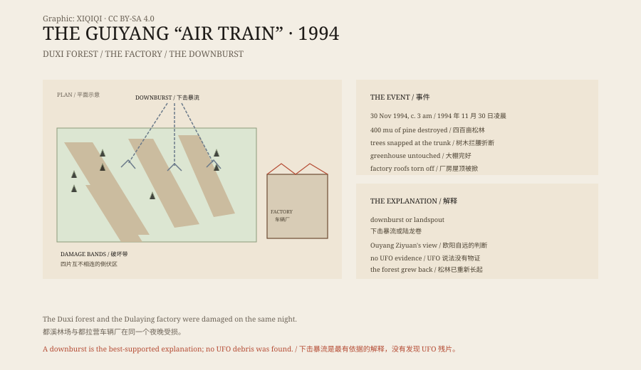

## 1. Three in the morning

On 30 November 1994, a little after three in the morning.

At Duxi Forest Farm north of Guiyang, it was thundering and raining. The forestry workers and nearby villagers were mostly asleep.

Suddenly a huge roar passed overhead. Some said it was like a train, some like an aircraft, some like a machine with no wheels. Someone saw a fireball come down out of the clouds.

After the sound passed, the forest was quiet.

## 2. The forest

At daylight people saw a forest that had been torn open.

More than four hundred mu of masson pine at Duxi were destroyed. The trees had not been uprooted. They were snapped at the trunk and laid in the same direction. The fallen trees formed several separate bands running across the hillside.

Strangely, some trees were broken while the layer of pine needles beneath them was not disturbed. A plastic greenhouse nearby was untouched. Some concrete power poles were snapped, but simple nearby buildings were not.

## 3. The vehicle factory

Next to the forest was the Dulaying vehicle factory.

Roofs were torn off, workshops damaged, and some equipment and vehicles destroyed. The damage was selective: one roof flew away while the building beside it was fine.

Workers said they heard the same roar in the night and saw lights in the sky.

## 4. Witnesses

The name “air train” came from the witnesses.

Some said the thing was like a train, with carriages and lights, passing under the clouds. Some said it was a huge fireball trailing smoke. Some said it stopped, then accelerated.

The descriptions contradict each other, but they point in the same direction: something flying low, making a great noise, carrying light.

## 5. The investigation

The event was in the news quickly.

The Guizhou Meteorological Society, the seismological bureau and the forestry department all sent people. UFO enthusiasts came too, with cameras and instruments.

Investigators measured the direction of the fallen trees, the height at which they broke and their distribution, and examined the factory damage. They found that the direction of the damage bands roughly matched the wind and the movement of the thunderstorm that night.

## 6. The downburst

The most widely accepted explanation is a downburst.

A downburst is a powerful downdraft inside a thunderstorm. When it reaches the ground it spreads outwards, producing a short, localised wind. The speed can exceed that of a typhoon, but the area is only a few hundred metres to a few kilometres across.

Such a wind can snap trees and tear off roofs, but its effects are highly local. That fits the pattern: broken trees beside an intact greenhouse, one roof gone and the next one fine.

Another suggestion is a landspout. A tornado has higher wind speeds and more concentrated damage, but it usually has a visible funnel. The witnesses that night did not describe a funnel.

Ouyang Ziyuan, a member of the Chinese Academy of Sciences, said publicly that the event could be explained by a downburst or a landspout, and that no UFO was needed.

## 7. The “air train”

The story of the “air train” did not disappear.

It appeared on television, in popular books and in online videos. Some said it was an alien spacecraft, some a secret weapon, some that there was a military base under the forest.

None of these claims has physical evidence: no debris, no photograph, no radar record, no observation that can be repeated.

## 8. Now

Duxi Forest Farm is still there, and the pines have grown back.

The damage bands are hard to see today. Older villagers still tell the story of the “strange vehicle”; younger people mostly know it from short videos.

A thunderstorm, a downburst, a forest broken in half, and lights and noise in the night — enough to make a story that has lasted thirty years.

*Original schematic: the damage bands at Duxi, the location of the factory and the wind of a downburst. Not a photograph of the site. Oddity Archive, CC BY-SA 4.0.*

---

**Sources and licenses**: the factual sources are listed in the source ledger S1–S3 at the bottom of this entry. Text and original diagrams are licensed under CC BY-SA 4.0. This article separates the physical damage, the witness accounts, the meteorological investigation and the UFO claims; the event left extensive physical traces, a downburst or landspout is the best-supported explanation, and the UFO claims have no physical evidence. The illustration is a scene reconstruction, not a photograph of the site.
