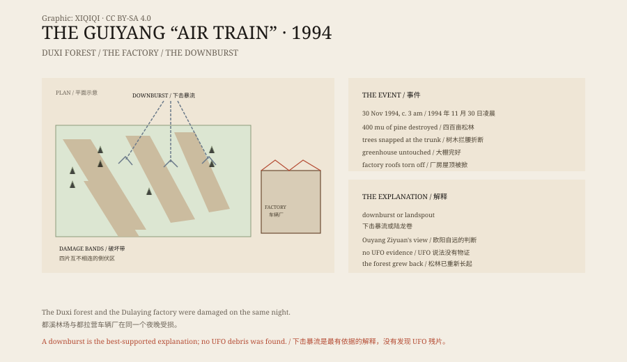

## 一、凌晨三点

1994 年 11 月 30 日，凌晨三点多。

贵阳北郊的都溪林场，天上打雷，下着雨。林场的工人和附近的村民大多在睡觉。

突然，一阵巨大的轰鸣声从头顶过去。有人说像火车，有人说像飞机，有人说像一台没有轮子的机器。有人看见一个火球从云里落下来。

声音过去以后，林子安静了。

## 二、林场

天亮以后，人们看见了一片被撕开的森林。

都溪林场的四百多亩马尾松被毁。树不是被连根拔起，而是从腰部折断，树干倒向同一方向。倒下的树形成几个互不相连的区域，像几条带子穿过山坡。

奇怪的是，有些树断了，树下的针叶层却没有被吹动。旁边的塑料大棚完好无损。一些水泥电线杆被折断，但附近的简易房没有倒。

## 三、车辆厂

林场旁边是都拉营车辆厂。

厂区的屋顶被掀开，厂房受损，一些设备和车辆被破坏。厂房的破坏也有选择性：有的屋顶整片飞走，旁边的建筑却没事。

工人们说，夜里听见了同样的轰鸣声，看见天上有光。

## 四、目击

“空中怪车”这个名字，来自目击者的描述。

有人说，那个东西像一列火车，车厢一节一节，带着灯光，从云层下面开过去。有人说，它像一个巨大的火球，后面拖着烟。还有人说，它停了一下，然后突然加速。

这些描述互相矛盾，但都指向同一个方向：一个低空飞行的、发出巨响的、带光的东西。

## 五、调查

事件很快上了新闻。

贵州省气象学会、地震部门和林业部门都派人来看。UFO 爱好者也来了，带着相机和仪器。

调查者测量了树木倒伏的方向、折断的高度和分布，也查看了厂房的破坏情况。他们发现，破坏带的方向和当夜的风向、雷暴的移动方向大致一致。

## 六、下击暴流

最被接受的解释是“下击暴流”。

下击暴流是雷暴云中一股强烈的下沉气流。它到达地面后，会向四周扩散，形成短时、局部的强风。风速可以超过台风，范围却只有几百米到几公里。

这种风可以把树拦腰折断，也可以掀掉屋顶，但它的影响有强烈的局地性。这能解释为什么树断了、大棚还在，为什么一片屋顶飞了、旁边没事。

另一种说法是“陆龙卷”。龙卷风的风速更高，破坏更集中，但通常有明显的漏斗云。当晚的目击者没有描述漏斗云。

中国科学院院士欧阳自远也公开表示，这件事可以用下击暴流或陆龙卷解释，不需要 UFO。

## 七、怪车

“空中怪车”的说法没有消失。

它出现在电视节目、地摊读物和网络视频里。有人说那是外星飞船，有人说那是秘密武器，有人说林场下面有军事基地。

这些说法都没有物证：没有碎片，没有照片，没有雷达记录，没有可以重复的观测。

## 八、现在

都溪林场还在，松树已经重新长起来。

当年的破坏带，现在看不出太多痕迹。当地的老人还会讲起那辆“怪车”，年轻人大多是在短视频里知道的。

一场雷暴，一阵下击暴流，一片被折断的林子，加上夜里的光和声音，就变成了一个传了三十年的故事。

*原创示意图：都溪林场破坏带、车辆厂位置与下击暴流的风向。不是现场照片。稀奇奇编辑部，CC BY-SA 4.0。*

---

**来源与许可**：本文的事实来源见条目底部来源台账 S1–S3。文字与原创示意图采用 CC BY-SA 4.0。文中把当夜的破坏、目击描述、气象调查与 UFO 说法分开叙述；事件本身有大量实物痕迹，下击暴流或陆龙卷是目前最被接受的解释，UFO 说法没有物证。插图是场景复原，不是现场照片。
