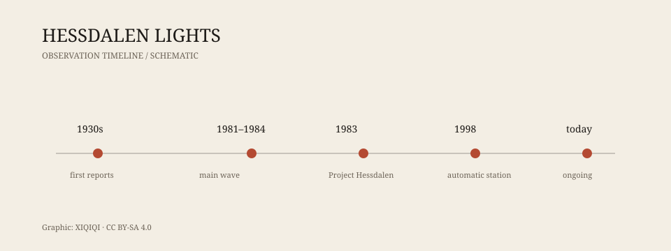

## 1. The valley

Hessdalen is a valley in central Norway.

It is not long and not wide. Mountains rise on both sides. A river runs along the floor, with scattered farms and houses. Winters are long, the nights come early, and the population is small. From the valley floor, the sky is a narrow band between the ridges.

This is where the lights began to appear.

They are not the aurora, not car headlights, and not the windows of a distant village. They appear above the valley, sometimes close to the ground, sometimes halfway up the slope. They are white, yellow, red, and green; spherical, oval, or spindle-shaped. They hover, move, vanish, and sometimes split in two.

Locals were not unfamiliar with them. Some say sightings go back to the 1930s.

## 2. 1981–1984

The years that made Hessdalen famous were 1981 to 1984.

During that period, the lights appeared especially often. Sometimes several times a week, sometimes several times a night. Witnesses included locals, passing drivers, journalists, and researchers. Some took photographs, some shot video, but most images were blurry.

The lights did not behave like known aircraft. They could hover for a long time, then accelerate suddenly. They could leave radar returns, or make no sound at all. Some described them as “breathing lanterns.”

After 1984 the frequency dropped, but the lights did not disappear. People still report them today.

*Original schematic: the main observation milestones at Hessdalen. Not a complete record. Oddity Archive, CC BY-SA 4.0.*

## 3. Project Hessdalen

In 1983, the Norwegian researcher Erling Strand started Project Hessdalen.

He set up an observation station in the valley with cameras, spectrometers, radar, magnetometers, and other instruments. Volunteers took shifts, waiting for the lights. In 1998 an automatic station went into operation, allowing cameras to record without anyone present.

The project continues today. It has not produced a final answer, but it turned Hessdalen from a local legend into an object of sustained scientific observation.

## 4. Possible explanations

There are many explanations for the Hessdalen lights. None is universally accepted.

**Plasma**: air in the valley becomes ionized and glows. This can explain the colours and movement, but it requires an energy source.

**Combustion**: dust, microbes, or gases from the valley floor burn when they meet oxygen. This can explain some low-altitude lights, but not the high, fast-moving ones.

**Piezoelectricity**: rocks under stress produce electrical charge and discharge as light. This is tied to the geology, but direct evidence is lacking.

**Ball lightning**: ball lightning is itself unexplained, but Hessdalen lights last longer and behave in more complex ways.

**Misidentification**: car lights, aircraft, helicopters, distant village lights, and camera artifacts can explain some sightings. They cannot explain all of them, especially those seen by multiple independent witnesses at the same time.

## 5. Why it is hard

Hessdalen is difficult to study for several reasons.

First, it is unpredictable. Researchers do not know when a light will appear, so they wait.

Second, it is brief. Many lights last only seconds, disappearing before instruments can be aimed.

Third, the environment is harsh. The valley is remote, the weather is cold, winter roads close, and equipment is hard to maintain.

Fourth, witness reports and instrument data often fail to line up. Someone sees a light and the camera misses it; the camera records a light and no one is there to see it.

These difficulties do not mean the phenomenon is not real. They mean Hessdalen is a difficult subject to catch.

## 6. Today

People still live in Hessdalen, and the lights still appear.

There is a research station in the valley, automatic cameras, and the occasional journalist or tourist. Locals have grown used to the lights. Some treat them as part of the weather; some treat them as a tourist attraction.

What are they? There is no settled answer.

What is clear is this: they are not proven alien spacecraft, and they are not pure invention. They are a set of lights that have been repeatedly recorded, observed, and discussed, and still have not been fully explained.

---

**Sources and licenses**: the factual sources are listed in the source ledger S1–S2 at the bottom of this entry. Text and original diagrams are licensed under CC BY-SA 4.0. The cause of the Hessdalen lights remains disputed; this article separates recorded observations and research projects from interpretive hypotheses.
