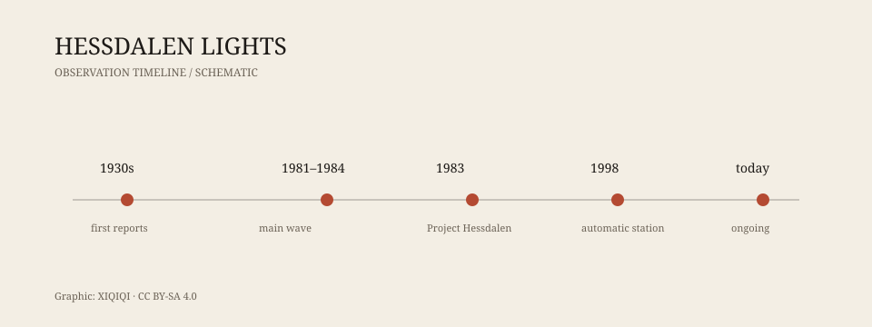

## 一、山谷

赫斯达伦是挪威中部的一条山谷。

它不长，也不宽，两边是山，谷底有一条河，散落着一些农场和房屋。冬天很长，天黑得早，人口很少。站在谷底往上看，天空被山脊切成一条窄窄的带子。

就是在这样的地方，人们开始看到光。

不是极光，不是车灯，也不是远处村庄的窗户。它们出现在山谷上空，有时靠近地面，有时悬在半山腰。颜色有白、黄、红、绿，形状有球状、椭圆、纺锤形。它们会停，会移动，会突然熄灭，也会分裂成两个。

当地人对这些光并不陌生。有人说，早在 1930 年代，就有人见过。

## 二、1981–1984

真正让赫斯达伦出名的是 1981 到 1984 年。

那几年，光出现得特别频繁。有时一周几次，有时一夜几次。目击者不只是当地人，还有路过的司机、记者、研究人员。有人拍到了照片，有人录到了视频，但大多数影像都很模糊。

光的行为很不像已知的飞行器。它们可以悬停很长时间，也可以突然加速；可以在雷达上留下回波，也可以完全无声。有人形容它们像“会呼吸的灯笼”。

1984 年之后，光的频率下降，但没有消失。直到今天，仍有人报告看到它们。

*原创示意图：赫斯达伦光的主要观测节点。不是完整记录。稀奇奇编辑部，CC BY-SA 4.0。*

## 三、Project Hessdalen

1983 年，挪威研究者埃尔林·斯特兰德（Erling Strand）发起了“赫斯达伦计划”。

他在山谷里搭起观测站，装上相机、光谱仪、雷达、磁力计和其他设备。志愿者轮流值班，等待光出现。1998 年，自动观测站投入使用，相机可以在没有人的情况下持续拍摄。

这个项目一直持续到今天。它没有给出最终答案，但它把赫斯达伦从“当地传说”变成了一个可以持续观测的科学对象。

## 四、可能的解释

赫斯达伦光有很多解释，但没有一个被普遍接受。

**等离子体说**：山谷里的空气被电离，形成发光的等离子体。这个解释能说明光的颜色和运动，但需要解释能量从哪里来。

**燃烧说**：谷底有含金属的尘埃、微生物或气体，遇到氧气后燃烧发光。这个解释能说明一些低空光球，但很难说明高空、快速移动的光。

**压电效应说**：山谷的岩石在压力下产生电荷，放电发光。这个解释和地质结构有关，但缺乏直接证据。

**球状闪电说**：球状闪电也是一种未完全解释的发光现象，但赫斯达伦的光持续时间更长，行为也更复杂。

**误认说**：车灯、飞机、直升机、远处村庄的灯光、相机伪影，都能解释一部分目击。但不能解释全部，尤其是那些被多个独立目击者同时看到的光。

## 五、为什么难

赫斯达伦光难研究，有几个原因。

第一，它不可预测。研究者不知道它什么时候出现，只能等。

第二，它持续时间短。很多光只出现几秒，设备还没来得及对准就消失了。

第三，它很挑环境。山谷偏远，天气寒冷，冬季道路封闭，设备维护困难。

第四，目击报告和仪器数据之间经常对不上。有人看到了光，相机没拍到；相机拍到了光，现场没人看到。

这些困难不代表现象不存在。它们只说明，赫斯达伦是一个很难被“抓住”的研究对象。

## 六、今天

今天的赫斯达伦仍然有人住，也仍然有光。

山谷里有研究站，有自动相机，有偶尔来访的记者和游客。当地人已经习惯了这些光，不再像 1980 年代那样惊慌。有人把它们当成天气的一部分，有人把它们当成旅游招牌。

它们是什么？目前没有定论。

可以确定的是：它们不是已经被证明的外星飞船，也不是完全的虚构。它们是一组被反复记录、反复观测、反复讨论，但仍然没有被完全解释的光。

---

**来源与许可**：本文的事实来源见条目底部来源台账 S1–S2。文字与原创示意图采用 CC BY-SA 4.0。赫斯达伦光的成因仍有争议，本文区分了已记录的观测、研究项目和解释性假说。
