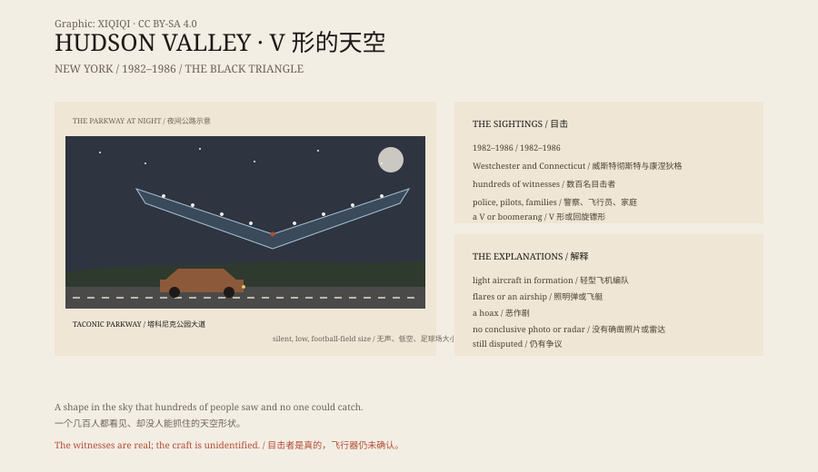

## 1. 17 March 1983

Brewster, New York. A man was outside his house at night.

He saw a V-shaped object coming slowly across the sky. It was silent, very large, and pointed downward at the centre.

It stopped about forty feet above him, hovering over a telephone pole.

## 2. The Years

It did not happen once.

Between 1982 and 1986, hundreds of people in Westchester County and Connecticut reported a huge V-shaped or boomerang-shaped craft, flying low and silent along the Taconic Parkway.

Some said it was as large as a football field. Some said it had three rows of lights.

## 3. The Witnesses

The witnesses included police officers, pilots, journalists and families.

Some stopped their cars to watch. Some called the police. Some followed it.

## 4. The Explanations

The most common explanation is a formation of light aircraft flying at night, their lights making them look like a single object.

Others have suggested flares, an airship or a hoax.

But hundreds of witnesses over several years make that explanation less than satisfying.

## 5. No Answer

There is no clear close-up photograph, no wreckage and no radar record that settles it.

It became a classic "black triangle" case, alongside the Belgian triangle wave and the Phoenix lights.

## 6. The Sky

Today the night sky over the Hudson Valley is ordinary.

Aircraft, helicopters, stars.

But if you see a row of lights in a V formation, moving slowly at night, you may think of 1983.

*Original schematic: the 1982–1986 sightings, the V-shaped lights and the main explanations. Not a photograph of the site. Oddity Archive, CC BY-SA 4.0.*

---

**Sources and licenses**: the factual sources are listed in the source ledger S1–S3 at the bottom of this entry. Text and original diagrams are licensed under CC BY-SA 4.0. This article separates the witnesses' descriptions and timeline from explanations such as a light-aircraft formation; there is no public conclusive evidence for the nature of the craft. The illustration is a scene reconstruction, not a photograph of the site.
