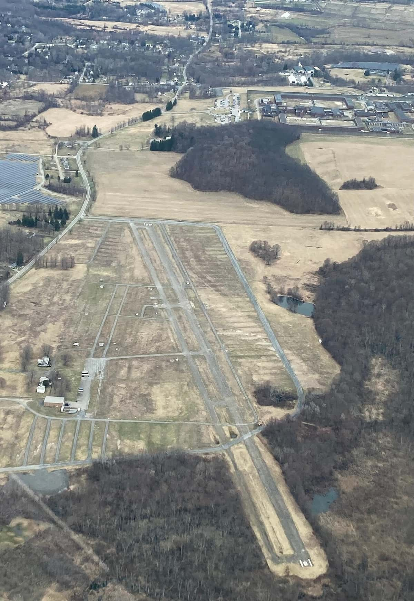
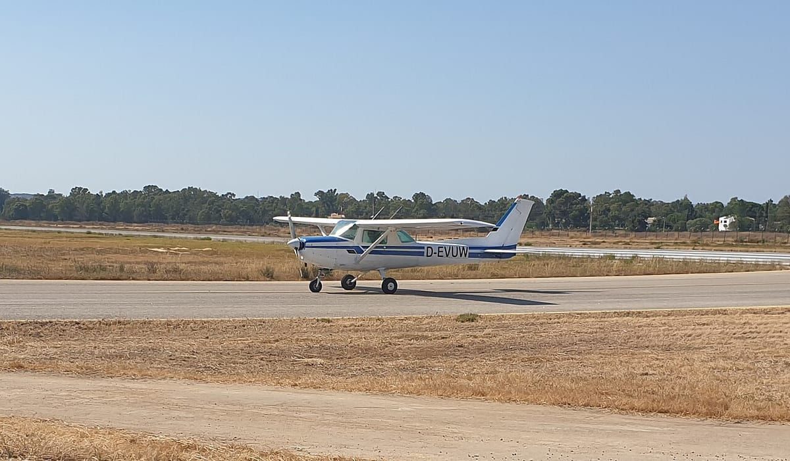
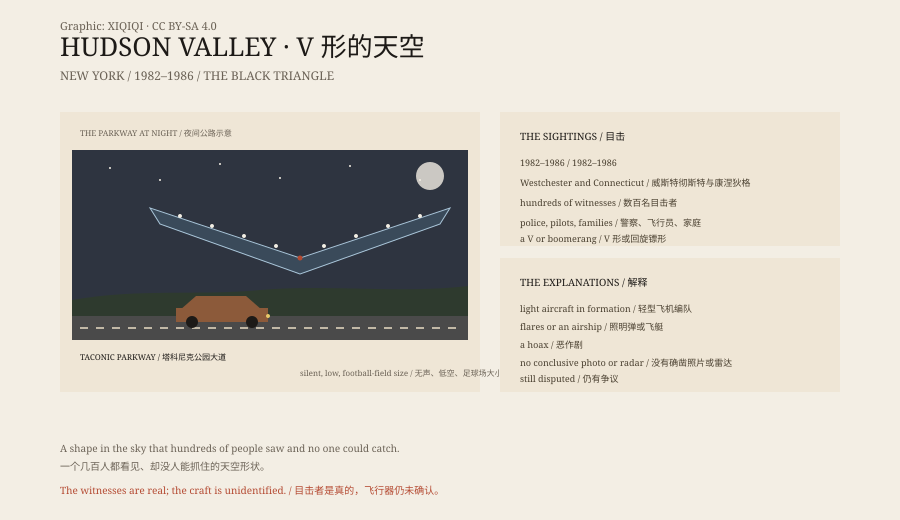

## 1. March 1983

Westchester County, New York, March 1983. On a road at night, a driver stopped the car and looked up.

A V-shaped thing came over the treetops, large, low, silent. Lights ran along both arms, white, red and green, like a formation of something in flight. It travelled along the road, not fast, as if it knew where the road was.

From that spring until the summer of 1984, reports came in from Westchester, Dutchess and Putnam counties in New York and from Fairfield County in Connecticut. Hundreds of people in all: police officers, pilots, reporters, families with children.

The New York Times summed up the descriptions: witnesses reported an object "usually in a V-shape or a circle", "about the size of an American football field", "absolutely noiseless" and "outlined in brilliant lights of white, red or green". It could also shoot straight up into the sky and hover for a long time.

*Site photograph: Stormville Airport (N69), New York, 2025. Indefatigable2, CC BY-SA 4.0 (Wikimedia Commons). This is where the state trooper followed the lights.*

## 2. Indian Point

On 14 June and 24 July 1984, guards at the Indian Point nuclear power plant reported something hovering over the plant for fifteen minutes. One guard said it was long and low, "like helicopters in a V formation".

The UFO researcher Philip Imbrogno said the guards broke out shotguns and called for support from Camp Smith. He also conceded: "we have no documentation".

John Branciforte, a security coordinator for the power authority, denied the guns. "As far as I'm concerned, it's pure speculation," he said. Spokesmen for the New York Power Authority and for Troop K of the state police gave a different account: the lights were Cessna 152s from Stormville Airport, flown by pranksters.

## 3. The Airport

A state trooper followed the lights to Stormville Airport and reported back to Sergeant Kenneth V. Spiro of Troop K. Spiro told reporters there were five or six such aircraft.

"The trooper spoke to a couple of the pilots, and they're getting a big kick out of it," Spiro said. "There's no violation of the law here."

Timothy Hartnett, deputy director of the FAA's eastern region, explained the technical possibility: aircraft may fly as close together as the pilots feel safe, and in sparsely populated areas they may fly very low. In February 1984 a pilot told the Poughkeepsie Journal that he and others were practising a V formation with a rotating beacon and navigation lights. The formation could look motionless because it was so wide and seen from so far away.

Discover magazine reported the same year that the pilots began in daylight and moved to night flying as their confidence grew, closing the formation tighter and tighter. Brian Dunning later supplied the decisive detail: the pilots switched off their exterior lights at the same moment, so that from the ground the object seemed to vanish. They varied the formation — crescent, circle, cross — and from below it looked like a diamond or a V. When local papers began printing stories about strange lights, the pilots were first baffled, then amused. They called themselves the Martians.

*Site photograph: a Cessna 152, taken at Portimão Airport, Portugal, in 2020. Robbie Klinkenberg, CC BY-SA 4.0 (Wikimedia Commons). The type the state police identified.*

## 4. The Witnesses

Not everyone accepted the aircraft.

On 24 July 1984, Brewster resident Bob Pozzuoli videotaped a luminous phenomenon whose lights rotated counter-clockwise. No sound was audible on the audio track.

At about nine in the evening on 20 August 1984, Irene Lunn of Mahopac reported an object heading south over a pond, "just clearing the trees... There was no sound at all, you could hear the crickets... about three-quarters the size of my house, with an L-shaped structure suspended underneath it... At one point, all the lights went green, then red, then they went back to a pattern of green and red and white. I felt like it was letting us know it knew we were watching it. That was scary. It went on for about 10 minutes."

William A. Pollard, driving on Interstate 84, told the New York Times he saw an object hovering above a field, "a gigantic triangle with lights". When the lights went dark it shot straight up. He had seen the lights many times, he said, but the first sighting was different from everything later; it was "rigid".

## 5. Hynek

J. Allen Hynek, once the scientific adviser to the Air Force's Project Blue Book, heard the reports and said: "Absolutely weird. There's no logical explanation for it."

On 28 August 1984, ufologists met in Brewster to discuss the sightings. In 1987 Ballantine Books published Night Siege: The Hudson Valley UFO Sightings, by Hynek, Imbrogno and Bob Pratt. Imbrogno said he had seen the object himself for five minutes, and compared it with the recently declassified stealth bomber.

In 1992 the case was an episode of Unsolved Mysteries. In 2017 the director Joe Miale told Dunning that the "triangular craft with coloured lights moving slowly over our houses" that he saw as a child in the Hudson Valley fixed his lifelong fascination with science fiction.

## 6. A Formation of Aircraft

Put the two sides together and the picture is not complicated.

On one side are hundreds of people without flight training, seeing a few lights in formation at night, low, slow and silent. On the other are five or six small aircraft from the same airport, practising the same formation, sometimes flying close, sometimes switching off their lights together. The first group saw a shape. The second knew a registration number.

Dunning's judgement is sharp: the "UFO" existed only at the time and place where the pilots were doing their night formation flying. The same look, the same behaviour, the same route. "Would that not be a staggering coincidence?"

Hynek said there was no logical explanation. The state police said there was a formation of aircraft. The pilots said it was funny.

## 7. The Airport Is Still There

Stormville Airport is still there, a grass runway with small aircraft parked beside it. On a clear day you can watch them take off from the road, one after another, turn, and line up.

At night, with the lights bright enough, the formation tight enough and the altitude low enough, people on the ground will still see the V. It was never a spacecraft. It was always a few aircraft, and nobody had told the people watching.

The pilot who said he was getting a big kick out of it probably never imagined that one practice formation would become a story told for thirty years.

*Original schematic: the sightings of 1983–1984, the V of lights and the Cessna formation explanation. Not a site photograph. XIQIQI Editorial, CC BY-SA 4.0.*

---

**Sources and licenses**: Text and original diagrams are licensed CC BY-SA 4.0; third-party image and source licences are listed in the source ledger below.
