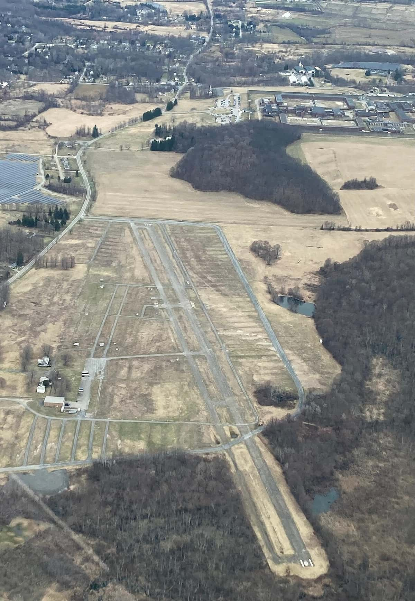
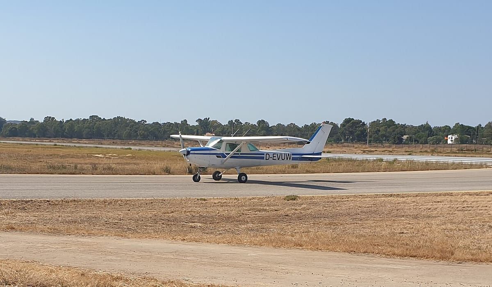
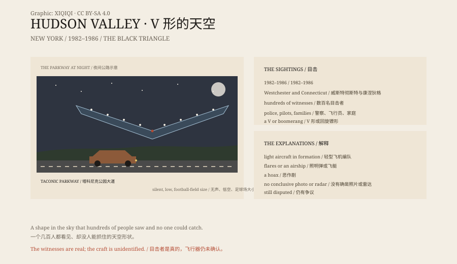

## 一、1983 年 3 月

纽约州西切斯特县，1983 年 3 月。夜里的公路上，有人把车停下，抬头看天。

一个 V 形的东西从树梢上过来，很大，低，没有声音。灯排在两边，白、红、绿，像一支飞行的队伍。它沿着公路走，速度不快，像是知道路在哪里。

那一年的春天到第二年夏天，这样的报告从威斯特彻斯特、达奇斯、帕特南三个县，一直延伸到康涅狄格州的费尔菲尔德县。前后几百人，有警察、飞行员、记者、带着孩子的家庭。

《纽约时报》后来这样归纳：目击者说它“通常呈 V 形或圆形”，有“足球场那么大”，“完全没有声音”，轮廓由“白、红、绿的亮灯”勾出来。它还能笔直地蹿上天空，或者在空中停很久。

*现场照片：纽约州斯特姆维尔机场（N69），2025 年。Indefatigable2，CC BY-SA 4.0（Wikimedia Commons）。州警追到的就是这里。*

## 二、印第安角

1984 年 6 月 14 日和 7 月 24 日，印第安角核电站的守卫报告，一个东西在电站上空悬了十五分钟。一个守卫说，它很长，飞得很低，“像排成 V 形的直升机”。

UFO 研究者菲利普·因布罗尼奥（Philip Imbrogno）说，守卫们当时把霰弹枪拿了出来，还叫了坎普·史密斯的支援。但他也承认：“我们没有文件。”

电站安全协调员约翰·布兰奇福特（John Branciforte）否认了持枪的说法：“据我所知，这纯粹是猜测。”纽约州电力局和州警 K 队的发言人则给出另一个版本：那些灯是 Cessna 152，从斯特姆维尔机场起飞，飞行员在恶作剧。

## 三、机场

一名州警跟着灯，一直跟到斯特姆维尔机场。他把看到的情况报告给 K 队的肯尼思·斯皮罗警佐（Kenneth V. Spiro）。斯皮罗对记者说，那样的飞机有五六架。

“那名警员和几个飞行员聊过，”斯皮罗说，“他们觉得这件事很好笑。这里没有违法。”

联邦航空局东部副局长蒂莫西·哈特尼特（Timothy Hartnett）解释了技术上的可能：飞机之间可以按飞行员认为安全的距离飞，在人口稀疏的地区，高度可以压得很低。1984 年 2 月，《波基普西日报》采访的一名飞行员说得更直接：他和同伴在练 V 形编队，用旋转信标和航行灯；编队太宽，从远处看，会像是停在空中不动。

《发现》杂志同年报道，这群飞行员先是在白天练，有了信心之后改到夜里，队形越飞越紧。布莱恩·邓宁（Brian Dunning）后来补充了关键的一幕：飞行员们会同时关掉外部灯光，地面的人看到的就是一个东西突然消失。他们换队形，月牙、圆圈、十字，从地面看就成了菱形或 V 形。当地报纸开始印“不明飞行物”的报道时，飞行员先是莫名其妙，然后觉得好笑，给自己起了个名字：“火星人”。

*现场照片：一架 Cessna 152，2020 年摄于葡萄牙波尔蒂芒机场。Robbie Klinkenberg，CC BY-SA 4.0（Wikimedia Commons）。州警认定的机型。*

## 四、目击者

不是每个人都接受飞机的解释。

1984 年 7 月 24 日，布鲁斯特的居民鲍勃·波祖利（Bob Pozzuoli）拍下一段录像：一个发光的现象，灯在逆时针旋转，录像的声轨里没有声音。

8 月 20 日晚上九点左右，马霍帕克的艾琳·伦恩（Irene Lunn）说，一个东西从池塘上空往南走，“刚好擦过树梢……一点声音都没有，能听见蟋蟀叫……有我房子四分之三大，下面挂着一个 L 形的结构……有一刻灯全变绿，然后变红，再回到绿红白的样子。我觉得它是在让我们知道它看见我们在看它。那很吓人。持续了大约十分钟。”

在 84 号州际公路上开车的威廉·波拉德（William Pollard）对《纽约时报》说，他看见一个东西悬在田地上方，“一个巨大的三角形，带着灯”。灯一灭，它就笔直地升上去。他说，那种灯他见过很多次，但第一次和后来都不一样，第一次是“僵硬的”。

## 五、海尼克

J. 艾伦·海尼克（J. Allen Hynek）曾是空军“蓝皮书计划”的科学顾问。他听过这些描述后说：“绝对古怪。没有合乎逻辑的解释。”

1984 年 8 月 28 日，UFO 研究者在布鲁斯特开了一次会，讨论这一连串目击。1987 年，巴兰坦出版社出了《夜间围困》（Night Siege），作者是海尼克、因布罗尼奥和鲍勃·普拉特。因布罗尼奥说他自己也看见过五分钟，还把它和当时刚解密的隐形轰炸机做了比较。

1992 年，这件事上了《未解之谜》节目。2017 年，独立导演乔·米亚莱（Joe Miale）在接受邓宁采访时说，他童年在哈德逊河谷看见的“带彩灯、慢慢移动的三角形”，让他一辈子迷上了科幻。

## 六、一队飞机

把两边放在一起，画面并不复杂。

一边是几百个没有受过航空训练的人，在夜里看见几盏灯排成队形，低、慢、无声；另一边是五六架小飞机，从同一个机场起飞，练同一个队形，有时贴着飞，有时一起关灯。前者看到的是形状，后者知道的是机号。

邓宁的判断很尖：这个“UFO”只出现在飞行员练夜间编队的时间和地方；样子一样，动作一样，航线一样。“这难道不是一个惊人的巧合吗？”

海尼克说没有逻辑解释。州警说有一队飞机。飞行员说很好笑。

## 七、机场还在

斯特姆维尔机场还在，草地跑道，停着一些小飞机。晴天的时候，从公路上能看见它们起飞，一架跟着一架，转弯，排成队。

到了夜里，如果灯开得够亮，队形够紧，飞得够低，地面上的人还是会看见那个 V。它从来不是一只飞船。它一直是几架飞机，只是一直没人告诉看的人。

那个说自己“很好笑”的飞行员，大概没有想过：他练的一次编队，会变成别人讲三十年的故事。

*原创示意图：1983–1984 年的目击、V 形灯光与 Cessna 编队解释。不是现场照片。稀奇奇编辑部，CC BY-SA 4.0。*

---

**来源与许可**：事实来源见条目底部来源台账 S1–S5。文字与原创示意图采用 CC BY-SA 4.0。文中把目击者的描述、核电站守卫的说法、州警与联邦航空局的调查分开叙述；事件有明确的飞机解释，但仍有目击者不接受。机场与飞机照片为现场拍摄，示意图不是现场照片。
