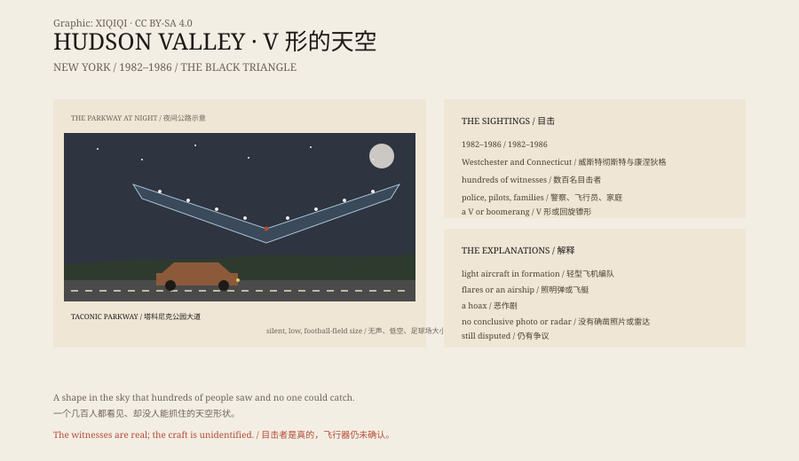

## 一、1983 年 3 月 17 日

纽约州，布儒斯特。夜里，一个男人在自家门外。

他看见一个 V 形的东西，从天空慢慢过来。它没有声音，很大，中间朝下。

它在他头顶四十英尺的地方停下，悬在一根电线杆上方。

## 二、几年

这不是一次。

1982 到 1986 年，威斯特彻斯特县和康涅狄格州有数百人报告：一个巨大的 V 形或回旋镖形飞行器，低空、无声，沿着塔科尼克公园大道滑行。

有人说它像足球场那么大。有人说它有三排灯。

## 三、目击者

目击者里有警察、飞行员、记者、家庭。

有人停下车看。有人打电话报警。有人追着它开。

## 四、解释

最常见的解释是：一小队轻型飞机在夜间编队飞行，灯光让它们看起来像一个整体。

也有人说是照明弹、飞艇，或者恶作剧。

但几百个目击者、几年时间，让这个解释不那么有说服力。

## 五、没有答案

没有清晰的近距离照片，没有残骸，没有雷达记录能一锤定音。

它成了一个经典的“黑色三角形”案例，和比利时的三角形飞行器、凤凰城的灯光并列。

## 六、天空

今天，哈德逊河谷的夜空很普通。

飞机、直升机、星星。

但如果你在夜里看见一排灯，排成 V 形，慢慢移动，你可能会想起 1983 年。

*原创示意图：1982–1986 年的目击、V 形灯光与主要解释。不是现场照片。稀奇奇编辑部，CC BY-SA 4.0。*

---

**来源与许可**：本文的事实来源见条目底部来源台账 S1–S3。文字与原创示意图采用 CC BY-SA 4.0。文中把目击者的描述、时间线与“轻型飞机编队”等解释分开叙述；没有公开的确凿证据能确认飞行器的性质。插图是场景复原，不是现场照片。
