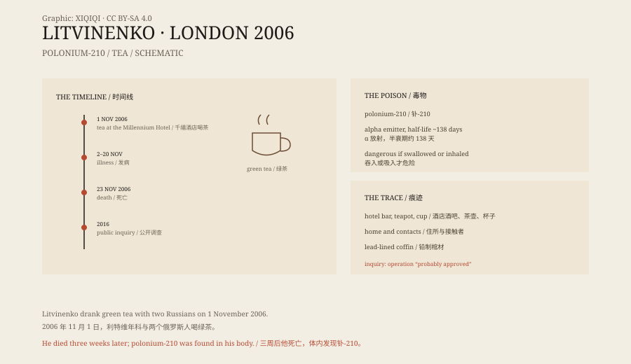

## 1. 1 November 2006

London, Grosvenor Square, the Millennium Hotel.

Litvinenko walked into the hotel's Pine Bar to meet two Russians: Andrei Lugovoi and Dmitry Kovtun. They talked about business and about Litvinenko's work.

He ordered a cup of green tea. No sugar.

A few days later he began vomiting and suffering abdominal pain. His hair started to fall out. He was taken to hospital, and his condition deteriorated quickly.

## 2. Three weeks

At first the doctors suspected food poisoning or an infection.

His white blood cell count fell, his platelets dropped, and he bled from his throat and digestive tract. They ran tests but could not find a common cause.

On 23 November, Litvinenko died. Autopsy and later tests found a large amount of polonium-210 in his body. It is an artificially produced radioactive isotope with a half-life of about 138 days, releasing energy mainly as alpha particles.

If polonium-210 is swallowed, it deposits in the liver, spleen, and bone marrow and causes severe radiation damage.

*Original schematic: the decay properties of polonium-210, how it enters the body, and the timeline of 2006. Not a photograph. Oddity Archive, CC BY-SA 4.0.*

## 3. Polonium

Polonium is not a common poison.

It barely occurs naturally; it has to be made in a reactor or accelerator. Its radioactivity is intense, but alpha particles travel only a few centimetres in air and are not dangerous outside the body. The danger is swallowing or inhaling them.

The polonium in Litvinenko's body was traced to the tea. Investigators found traces in the hotel bar, the teapot, the cup, his home, and on people who had been in contact with him.

## 4. The investigation

British police named Lugovoi and Kovtun as suspects.

The investigation found polonium traces on the same table where Litvinenko had drunk his tea. The two men had flown from Moscow to London, stayed a few days, and flown back.

Britain requested their extradition. Russia refused, citing a constitutional ban on extraditing its own citizens. Lugovoi later won a seat in the State Duma and gained political immunity.

## 5. The 2016 inquiry

In 2016, Britain published the report of a public inquiry.

The report concluded that the operation was planned by the Russian Federal Security Service and carried out by Lugovoi and Kovtun, and that it was “probably approved” by Putin. The report had no direct evidence that Putin gave the order, but reached that conclusion from intelligence and witness testimony.

The Russian government rejected the finding, calling the inquiry politicised.

## 6. Now

Litvinenko is buried in north London. His coffin is lined with lead to contain the radiation.

The case is the first known fatal polonium poisoning. It changed the way states thought about radioactive assassination, and it forced London's public spaces through a large-scale radiation screening for the first time.

One cup of tea, three weeks, a former agent dead in a foreign country. The case has a legal conclusion. Politically, it is still open.

---

**Sources and licenses**: the factual sources are listed in the source ledger S1–S3 at the bottom of this entry. Text and original diagrams are licensed under CC BY-SA 4.0. This article separates the timeline, the medical and physical facts, the British inquiry's conclusion, and Russia's denial; the 2016 finding was that the operation was “probably approved”, not that direct evidence proved who gave the order.
