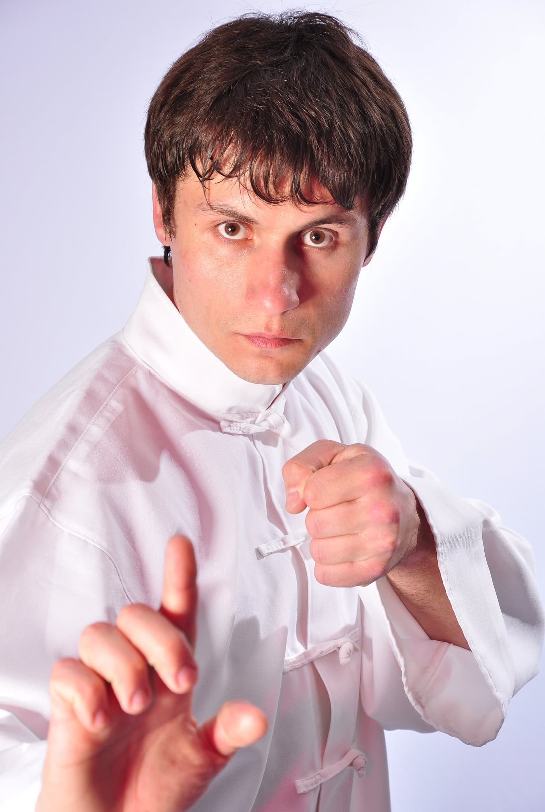
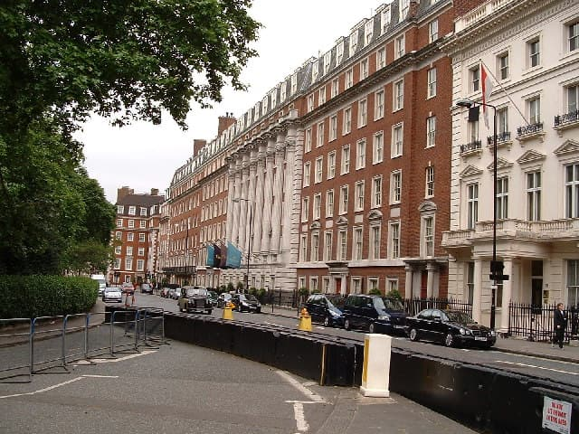
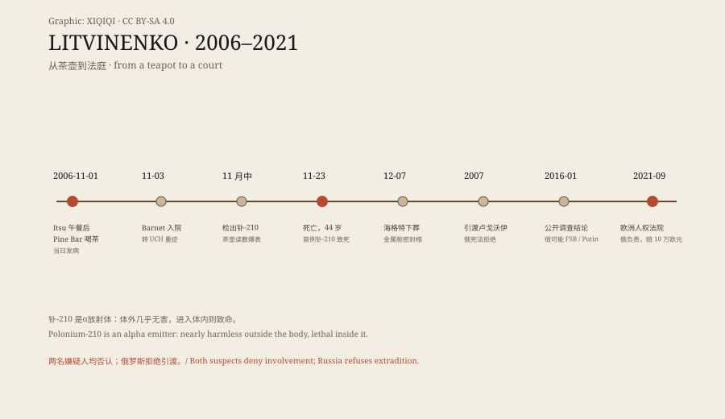

## 一、一个知道太多的人

亚历山大·利特维年科，1962 年生于沃罗涅日，苏联内务部队出身，后进入克格勃军事反情报系统，苏联解体后在联邦安全局（FSB）做打击有组织犯罪的工作。他见过系统内部的样子：保护费、"屋顶"（krysha）、警察与黑帮从竞争走向合作。他自己的解释是：当暴力变成商品，就永远有需求；先是黑帮提供"屋顶"，然后是警察，最后连安全局自己也下场抢市场份额——竞争有时让位给合作，机构自己变成了黑帮。

1998 年 11 月，他和四名同事开了一场戴面具或墨镜的记者会，指控上级下令暗杀寡头别列佐夫斯基；会上还说他们曾被命令杀害律师特列帕什金、绑架商人贾布赖洛夫的兄弟。他被开除、被捕、被判无罪、再被捕。2000 年 10 月他带家人离开莫斯科，经伊斯坦布尔转机，在希思罗申请庇护；2001 年 5 月获准。在伦敦他做记者、写书，并为英国情报机构做顾问——2015 年的公开调查确认他被军情六处招募，提供克里姆林宫高层与俄罗斯黑帮关系的信息。

他写了《炸毁俄罗斯》《卢比扬卡犯罪集团》，指控 FSB 自导自演 1999 年公寓楼爆炸案以把普京推上台；他创造了"黑手党国家"这个词——指国家机器与有组织犯罪不再是对立双方，而是同一门生意的两块招牌。2006 年 10 月，他入籍英国。

*肖像照片：2011-04-27，Joni-Jo，CC BY-SA 4.0（Wikimedia Commons）。利特维年科身着白色制服的肖像。*

## 二、11 月 1 日的两顿饭

2006 年 11 月 1 日中午，他在皮卡迪利的 Itsu 寿司店与意大利熟人马里奥·斯卡拉梅拉午餐；对方声称掌握三周前被枪杀的记者波利特科夫斯卡娅遇刺案的信息，并递给他一份材料。尽管早前有人警告他已被列为暗杀目标，他仍常常不带安保出行、自由混迹伦敦的俄侨社区、在家接待记者。

随后他去格罗夫纳广场的千禧酒店，在 Pine Bar 与两名前特工喝茶：德米特里·科夫通、安德烈·卢戈沃伊。两人是他旧识，这次会面名义上是交换信息。当天晚些时候，他突然病倒。从午餐到茶到发病，间隔只有几个小时——后来调查把这段时间线精确到分钟，因为钋的剂量与接触时刻直接相关。

*现场照片：2005 年 6 月，P Fletcher，CC BY-SA 2.0（Wikimedia Commons）。格罗夫纳广场一侧的千禧酒店外景；Pine Bar 位于其中。*

## 三、茶壶

11 月 3 日他入 Barnet 综合医院，后转大学学院医院重症监护。英国健康保护署在他体内检出大量钋-210——一种稀有的、剧毒的放射性核素。医院后来公布的照片里，他的头发已经掉光：α粒子在体内持续照射毛囊与骨髓，是急性放射综合征的样子。

调查人员在千禧酒店找到一把"热"茶壶：钋-210 读数超出量程。科夫通在汉堡用过的房屋与汽车也留下钋痕迹（据泄露的美国外交电报）。钋的痕迹还被一路追到餐厅、办公室与航班座位——它不像化学毒物那样代谢消失，而是留在接触过的每一处表面，像一条不会断的线。钋-210 是α放射体：一张纸就能挡住它的射线，体外几乎无害；一旦进入体内，它把能量全部沉积在组织里。常规γ筛查对它不敏感，这也是诊断被拖延的原因之一。它不是用来"吓唬"的毒，是用来"确保"的毒。

## 四、二十三天

11 月 22 日，医疗团队报告他因心力衰竭或夜间心脏病发作出现"重大挫折"。11 月 23 日，他死亡，44 岁。吉尼斯纪录把他列为首例有记录的钋-210 急性放射综合征致死。

死前他留下声明，指普京直接下令暗杀他；朋友戈德法布说声明由他按利特维年科口述"用好的英文"写成，读给他听、他逐字同意并签名。普京次日公开回应："利特维年科先生，不幸地，不是拉撒路。"

12 月 1 日尸检；12 月 7 日下葬于海格特公墓西侧。遗体先放入金属舱，再密封棺木——因为遗体本身带放射。葬礼按他的意愿不分教派：东正教神父与伊玛目同场祈祷；随后的私人追思会上，合唱团唱了斯特拉文斯基与拉赫玛尼诺夫的圣乐。他的遗孀玛丽娜此后成立利特维年科正义基金会，持续推动调查；她公开指控莫斯科策划了谋杀，但拒绝向俄方调查提供证据，担心被滥用或歪曲。

## 五、谁下的毒

英国警方锁定卢戈沃伊为主嫌、科夫通为第二嫌疑人。2007 年 5 月英国要求引渡卢戈沃伊；俄罗斯以宪法禁止引渡本国公民为由拒绝。卢戈沃伊称指控"出于政治动机"。

2015 年 1 月公开调查启动；同年 7 月，苏格兰场的律师在庭上总结："证据指向的唯一可信解释，是俄罗斯国家以某种方式参与了利特维年科的谋杀。"2016 年 1 月结论：谋杀由两名嫌疑人实施，他们"很可能"在 FSB 指使下行动，并获普京与时任 FSB 局长帕特鲁舍夫批准。2021 年 9 月，欧洲人权法院在 Carter v Russia 案中裁定俄罗斯对利特维年科之死负责，判赔 10 万欧元。

*原创示意图：从 Pine Bar 茶壶到欧洲人权法院的时间线。稀奇奇编辑部，CC BY-SA 4.0。*

## 六、海格特的墓

墓穴在海格特公墓西侧的绿荫里：木框围出一块长方形，铺白碎石，几株小花，一端立着镶框的照片——照片里是他穿白衣的样子——旁边一支红蜡烛、一束鲜花。四周是常春藤与野生的绿。

一把茶壶的读数、一份密封的棺木、一个拒绝引渡的宪法条款、一份"很可能"的调查结论：这些是这桩谋杀留下的物证链。它也是第一桩把放射性核素当作谋杀武器、并被法庭与国际法院逐层确认的案件：从伦敦的刑事调查，到公开调查，到斯特拉斯堡的判决。墓上的照片不需要放射防护；需要防护的，是那些还在被追问的名字。

---

**来源与许可**：事实来源见台账 S1–S5。文字与原创示意图 CC BY-SA 4.0。肖像、酒店外景与墓穴照片为 Wikimedia Commons 署名作品，许可见台账。调查结论用词为"很可能"（probable），本文保留该限定；两名嫌疑人均否认，俄罗斯拒绝引渡，本文并列呈现。