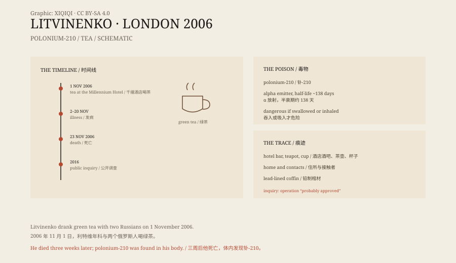

## 一、2006 年 11 月 1 日

伦敦，格罗夫纳广场，千禧酒店。

利特维年科走进酒店的松树酒吧，和两个俄罗斯人见面：安德烈·卢戈沃伊和德米特里·科夫通。他们谈了一些生意上的事，也谈到了利特维年科的工作。

他点了一杯绿茶。茶里没有糖。

几天后，他开始呕吐、腹痛、掉头发。他被送进医院，病情迅速恶化。

## 二、三周

医生一开始以为是食物中毒，或者是某种感染。

他的白细胞下降，血小板减少，喉咙和消化道出血。医生给他做了各种检查，找不到常见的病因。

11 月 23 日，利特维年科死亡。尸检和后续检测发现，他的体内有大量钋-210。这是一种人工产生的放射性同位素，半衰期约一百三十八天，主要通过α粒子释放能量。

钋-210 如果被吃进去，会沉积在肝脏、脾脏和骨髓里，造成严重的辐射损伤。

*原创示意图：钋-210 的衰变特征、进入人体的途径与 2006 年事件时间线。不是现场照片。稀奇奇编辑部，CC BY-SA 4.0。*

## 三、钋

钋不是常见的毒物。

它几乎不自然存在于环境中，需要反应堆或加速器生产。它的放射性很强，但α粒子在空气中只能走几厘米，在皮肤外并不危险。危险的是把它吃进去，或者吸进去。

利特维年科体内的钋，最终被追溯到那杯茶。调查人员在酒店酒吧、茶壶、杯子、他的住所和接触过的人身上，都检测到了钋的痕迹。

## 四、调查

英国警方把卢戈沃伊和科夫通列为嫌疑人。

调查发现，他们在利特维年科喝茶的同一张桌子上，也留下了钋的痕迹。两人从莫斯科飞到伦敦，停留了几天，然后又飞回去。

英国要求俄罗斯引渡两人。俄罗斯拒绝，理由是宪法禁止引渡本国公民。卢戈沃伊后来当选国家杜马议员，获得了政治豁免。

## 五、2016 年的调查

2016 年，英国公布了一份公开调查报告。

报告认为，毒杀行动由俄罗斯联邦安全局策划，卢戈沃伊和科夫通执行，行动“很可能”得到了普京的批准。报告没有直接证据证明普京下令，但根据情报和证人证词，得出了这个结论。

俄罗斯政府否认这一结论，称调查是政治化的。

## 六、现在

利特维年科被安葬在伦敦北部。他的棺材是铅制的，为了防止辐射外泄。

这起案件是已知的第一例钋中毒致死事件。它改变了各国对放射性物质暗杀的警惕，也让伦敦的公共场所第一次经历大规模的辐射检测。

一杯茶，三周，一个死在异国的前特工。案子在法律上有了结论，在政治上仍然没有。

---

**来源与许可**：本文的事实来源见条目底部来源台账 S1–S3。文字与原创示意图采用 CC BY-SA 4.0。文中把事件时间线、医学与物理事实、英国调查结论与俄罗斯的否认分开叙述；2016 年调查的结论是“很可能”得到批准，而不是直接证据证明下令。
