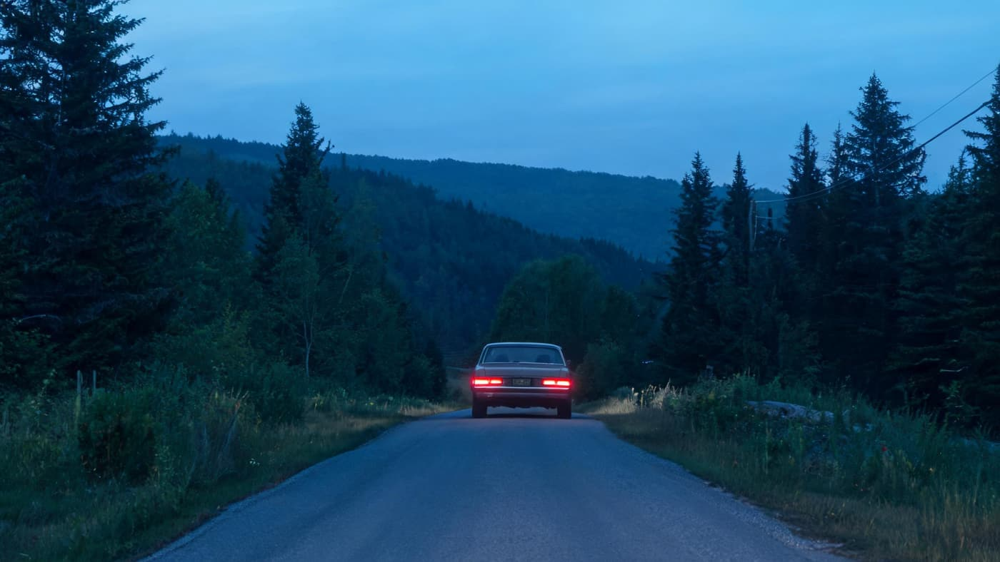
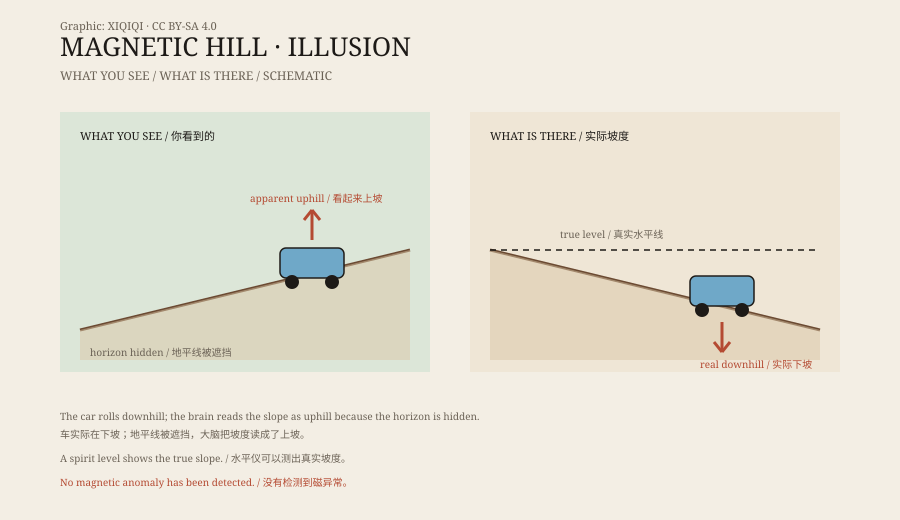

## 1. A road that looks uphill

Moncton is a small city in New Brunswick, Canada.

North of town is a short slope with a sign by the road marking where to park. Visitors drive to the marker, shift into neutral, release the brake, and wait.

At dusk the headlights lie on the road. The slope appears to rise, and the distant tree line sits low, like a horizon pulled crooked.

The car moves. It rolls slowly backward, apparently uphill.

*Reconstruction: a car stopped at the marker, with the misleading slope line. Not a photograph of the site. Oddity Archive, CC BY-SA 4.0.*

The people inside instinctively hit the brake. Then they let go, and the car moves again.

## 2. The car moves by itself

That is the attraction at Magnetic Hill.

No engine, no magnet, and no one pushing. The car is simply following gravity. The problem is that the direction your eyes report and the direction gravity actually pulls do not match.

From the roadside, the road surface clearly appears to rise. The distant tree line and horizon hide the reference points. The brain uses those clues and concludes that the car is moving uphill.

*Original schematic: visual references, the real slope, and the direction the car rolls at Magnetic Hill. Not a precise survey. Oddity Archive, CC BY-SA 4.0.*

## 3. Does water flow uphill?

A simpler test is to pour water on the road.

The water runs in one direction. It looks as if it is flowing “up” the slope. But if you measure the road with a spirit level or survey instrument, you find that it actually slopes downward — in the opposite direction from what the eye suggests.

The water is not defying gravity. It is following the real slope.

The “up” your eyes see and the “down” gravity defines are not the same direction here.

## 4. The optical illusion

Places like this exist around the world and are usually called “gravity hills” or “magnetic hills.”

They share a pattern: a gentle slope plus surrounding references that mislead the eye. Distant hills, trees, guardrails, and walls all affect your sense of “level.” When nearby references are missing, the brain assumes a direction and treats it as true.

So a downhill road looks uphill, and a car rolling backward looks as if it is being pulled up.

## 5. Why it happens

There is no detectable magnetic anomaly at Moncton's Magnetic Hill.

The name is a tourism marketing device, not a physics finding. What is doing the work is terrain, perspective, and human visual habits. Similar “magnetic hills” exist in the United States, Britain, Australia, South Korea, and elsewhere, and the principle is basically the same.

Some attractions deliberately tilt walls, trees, or railings to strengthen the illusion. Moncton's road relies more on natural terrain and a carefully framed view.

## 6. Now

Magnetic Hill is now a Moncton tourist attraction, with a zoo and a water park nearby.

Visitors queue to drive to the marker and experience a few seconds of “anti-gravity.” Then they get out, walk to the roadside, and watch someone else try.

It is not an unsolved mystery. It is more like a public visual experiment: which do you trust, your eyes or your inner ear?

---

**Sources and licenses**: the factual sources are listed in the source ledger S1–S3 at the bottom of this entry. Text and original diagrams are licensed under CC BY-SA 4.0. This article separates the visitor experience, the visual explanation, and the name “magnetic”; there is no detectable magnetic anomaly at the site.
