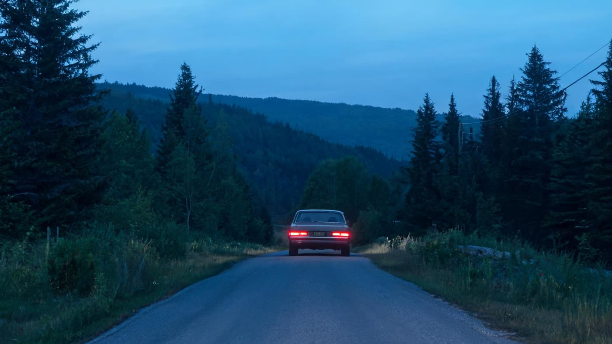
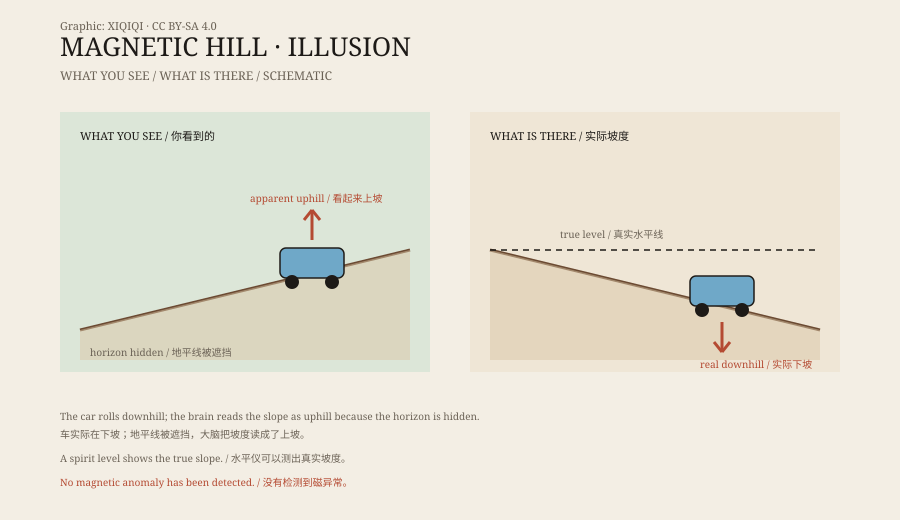

## 1. A road that looks uphill

Moncton is a small city in New Brunswick, Canada.

North of town is a short slope with a sign by the road marking where to park. Visitors drive to the marker, shift into neutral, release the brake, and wait.

At dusk the headlights lie on the road. The slope appears to rise, and the distant tree line sits low, like a horizon pulled crooked.

The car moves. It rolls slowly backward, apparently uphill.

*Reconstruction: a car stopped at the marker, with the misleading slope line. Not a photograph of the site. Oddity Archive, CC BY-SA 4.0.*

The people inside instinctively hit the brake. Then they let go, and the car moves again.

## 2. The car moves by itself

That is the attraction at Magnetic Hill.

No engine, no magnet, and no one pushing. The car is simply following gravity. The problem is that the direction your eyes report and the direction gravity actually pulls do not match.

From the roadside, the road surface clearly appears to rise. The distant tree line and horizon hide the reference points. The brain uses those clues and concludes that the car is moving uphill.

*Original schematic: visual references, the real slope, and the direction the car rolls at Magnetic Hill. Not a precise survey. Oddity Archive, CC BY-SA 4.0.*

## 3. Does water flow uphill?

A simpler test is to pour water on the road.

The water runs in one direction. It looks as if it is flowing “up” the slope. But if you measure the road with a spirit level or survey instrument, you find that it actually slopes downward — in the opposite direction from what the eye suggests.

The water is not defying gravity. It is following the real slope.

The “up” your eyes see and the “down” gravity defines are not the same direction here.

## 4. The optical illusion

Places like this exist around the world and are usually called “gravity hills” or “magnetic hills.”

They share a pattern: a gentle slope plus surrounding references that mislead the eye. Distant hills, trees, guardrails, and walls all affect your sense of “level.” When nearby references are missing, the brain assumes a direction and treats it as true.

So a downhill road looks uphill, and a car rolling backward looks as if it is being pulled up.

## 5. Why it happens

There is no detectable magnetic anomaly at Moncton's Magnetic Hill.

The name is a tourism marketing device, not a physics finding. What is doing the work is terrain, perspective, and human visual habits. Similar “magnetic hills” exist in the United States, Britain, Australia, South Korea, and elsewhere, and the principle is basically the same.

Some attractions deliberately tilt walls, trees, or railings to strengthen the illusion. Moncton's road relies more on natural terrain and a carefully framed view.

## 6. Now

Magnetic Hill is now a Moncton tourist attraction, with a zoo and a water park nearby.

Visitors queue to drive to the marker and experience a few seconds of “anti-gravity.” Then they get out, walk to the roadside, and watch someone else try.

It is not an unsolved mystery. It is more like a public visual experiment: which do you trust, your eyes or your inner ear?

## There's more than one magnetic mountain

Magnetic Hills is not a name for a place, but for a category of places.

Canada, the United States, Australia, the United Kingdom, and Japan have similar sections. Tourists park their cars at the bottom of the slope, hang them open, and they walk back slowly, looking like they're being pulled up by an invisible force. Water falls on the road, and they're “upstream”.

Most of these places have one thing in common: a road that looks clearly tilted around open fields, trees, or mountains. There is no horizontal reference in the horizon.

## How do you do that?

To determine whether a road is a “magnetic mountain”, the approach is simple, but needs to leave the driver's seat.

Pull the car over the flat floor and measure the true slope of the road surface using horizontal measures; record the height of the starting and end points with GPS or measuring poles; close your eyes, or cover the surrounding scenes with a screen, and let the car slide. If you block the line, the car is no longer “uphill”, the problem is not the magnetic, but the eye.

The other way is to look at water. Water doesn't lie. It flows in the direction of real gravity. If it looks up, it's mostly a ditch on the side of the road, a stripe and a long slope.

## Why did you fall for it?

People judge “up” and “down”, not only by the front court system, but also by reference from the horizon.

When the near ground is tilted, and the distant tree or mountain line forms the opposite angle, the brain synthesizes the two in a wrong direction. You think you're looking at an uphill road, and you actually see an image that is twisted by the background.

This illusion is more evident when driving. The body provides a horizontal line, the windshield provides a vision, and the two do not agree, and the brain chooses a more “reasonable” explanation.

## Tourism and physics

Magnetic mountains are mostly tourist destinations.

There are signs on the side of the road that say, "Exist gravity anomalies," some of them sell certificates and souvenirs. Visitors line up to stop the car, watch it walk themselves, and take pictures. No one really believes there's a magnet mine, but everyone wants to play once.

Physics doesn't disappear, it's just wrapped into a game. A delusion, if it's right, and it's a story, can turn a normal path into a site.

## Supplementary Notes

Magnetic Mountain is popular because it provides an "aberration" that can be experienced in person. You don't need to read the paper. You just have to stop the car, let the brakes go, watch it move. The experience is more convincing than the explanation. Even if someone tells you it's a delusion, you're gonna want to try it again.

## Location of the archives

Magnetic mountains are a few of the things that can be defaced on the spot. You just need to bring a horizontal machine, a car, and a friend who wants to close his eyes. The mystery doesn't disappear completely after the experiment, because it's not in physics, but in experience. People like to be fooled once by their own eyes, as long as it's safe.

## Memory

If you go to Magnetic Hill for an experiment, you'd better bring three things: a horizontal instrument, a ball, and a blindfold. The horizontals tell you the true angle of the road, the ball tells you where gravity rolls, the blindfold tells you how important it is. When all three points to the same conclusion, the mystery is gone. But you'll still admit that that road was really fun.

---

**Sources and licenses**: the factual sources are listed in the source ledger S1–S3 at the bottom of this entry. Text and original diagrams are licensed under CC BY-SA 4.0. This article separates the visitor experience, the visual explanation, and the name “magnetic”; there is no detectable magnetic anomaly at the site.
