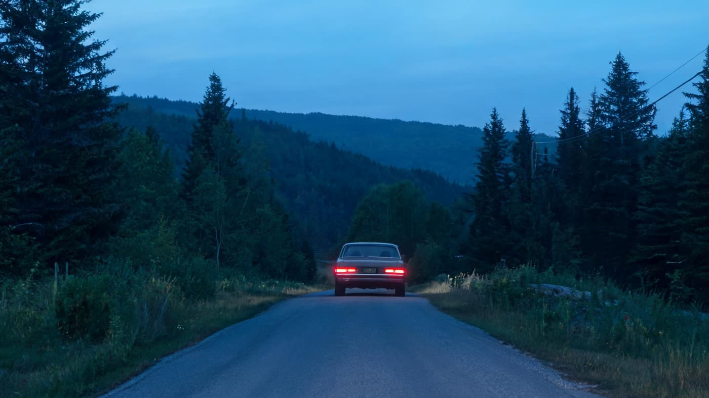

## 一、一条看起来上坡的路

蒙克顿在加拿大新不伦瑞克省，是一座不大的城市。

城北有一条短坡，路边立着牌子，画着停车的位置。游客把车开到标记处，挂空挡，松开刹车，然后等着。

傍晚，车灯照在路面上。坡看起来是往上走的，远处的树线压得很低，像一条被拉歪的地平线。

车会动。它慢慢向后滑，看起来像是往坡上走。

*场景复原：停在标记处的汽车与误导人的坡线。不是现场照片。稀奇奇编辑部，CC BY-SA 4.0。*

车里的人会下意识踩刹车。但脚一松，车又动了。

## 二、车会自己走

这就是“磁力山”的招牌项目。

不是引擎，不是磁铁，也不是有人在后面推。车只是顺着重力走。问题在于，眼睛告诉你的方向和重力实际的方向不一致。

站在路边看，路面明显是向上抬的；远处的树线和地平线又正好把参照物挡住。大脑根据这些线索判断：车在往上走。

*原创示意图：磁力山的视觉参照、真实坡度与车辆滑动方向。不是精确测绘图。稀奇奇编辑部，CC BY-SA 4.0。*

## 三、水也往上流？

有人做过更简单的测试：把水倒在路面上。

水会沿着一个方向流。看起来，它也在往“上”流。但如果你用水平仪或测量工具去测，会发现那段路实际上是向下倾斜的，只是倾斜的方向和视觉判断相反。

水没有违反重力。它只是沿着真实的坡度走。

眼睛看到的“上”，和重力定义的“下”，在这里不是同一个方向。

## 四、眼睛的错觉

这种地方在世界各地都有，通常叫“重力山”或“磁力山”。

它们的共同点是：一段坡度不大、周围参照物又会误导人的路。远处的山、树、护栏、路边的墙，都会影响你对“水平”的判断。当近处的参照物缺失时，大脑会默认一个方向，然后把这个方向当成真的。

于是，下坡看起来像上坡，车向后滑看起来像被吸上去。

## 五、为什么

蒙克顿的磁力山并没有可检测到的磁场异常。

它的名字是旅游营销的产物，不是物理结论。真正起作用的是地形、透视和人的视觉习惯。类似的“磁力山”在美国、英国、澳大利亚、韩国等地都有，原理基本一致。

有的景点会故意把路边的墙、树或栏杆做成倾斜的，让错觉更强。蒙克顿的这段路，更多是利用了天然的地形和视野。

## 六、现在

磁力山现在是蒙克顿的旅游景点，附近还有动物园和水上乐园。

游客排队把车开到标记处，体验那几秒钟的“反重力”。然后他们下车，走到路边，看别人再试一次。

它不是一个未解之谜。它更像一个公开的视觉实验：你的眼睛和你的内耳，谁更可信？

如果去磁力山做实验，最好带三样东西：一个水平仪、一只球和一块遮眼布。水平仪测坡度，球测“水往高处流”的方向，遮眼布用来把视野里的倾斜参照物挡掉。三样东西一对，错觉就散了。

## 时间线

- **背景**：20 世纪起成为景点

## 来源与证据

本条目的事实底座以 1 条独立来源为主。S4（City of Moncton）覆盖磁山的官方说明与重力丘错觉。
原创插图只提供场景复原、结构示意或地图，不作为历史照片使用。正文把可核对记录、后来解释与传说分开叙述；同一件事在不同来源中的版本差异，保留在行文中，不强行合并。

## 档案空白

现有材料能说明现象被记录过，未必能说明它的成因；记录、仪器数据与解释之间仍有一段距离，这段距离就是档案要保留的空白。
这条档案把记录与未答的问题并排放置，不替读者做出超出证据的结论。
就可信度而言，本条目标为“verified”。这个标签描述的是当前证据状态，不是对传说真伪的终审；新档案出现时，标签应随之调整。

## 档案补记

以下补记保留正文没有展开的档案侧面：来源、技术细节与后续影响。
**补记**。 磁力山之所以流行，是因为它提供了一个可以亲自体验的“异常”。你不需要读论文，只需要把车停下，松开刹车，看它动。体验比解释更有说服力。即使有人告诉你这是错觉，你还是会想再试一次。
**档案的位置**。 磁力山是少数可以被当场拆穿的奇闻。你只需要带一个水平仪、一辆车和一个愿意闭眼的朋友。实验做完，神秘感不会完全消失，因为它原本就不在物理里，而在体验里。人喜欢被自己的眼睛骗一次，只要这次欺骗是安全的。
**旅游与物理**。 磁力山大多成了旅游点。

路边立着牌子，写着“体验重力异常”，有的还卖证书和纪念品。游客排队把车停下，看它“自己走”，然后拍照。没有人真的相信那里有磁铁矿，但大家愿意玩一次。

物理没有消失，只是被包装成了游戏。一个视错觉，只要位置合适、故事讲得好，就能让一条普通的路变成景点。

---

**来源与许可**：本文的事实来源见条目底部来源台账 S1–S3。文字与原创示意图采用 CC BY-SA 4.0。文中把旅游体验、视觉解释与“磁力”这一名称分开叙述；磁力山没有可检测的磁异常。
