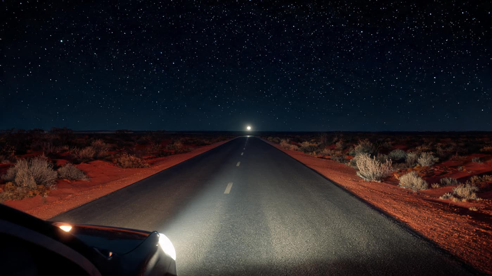
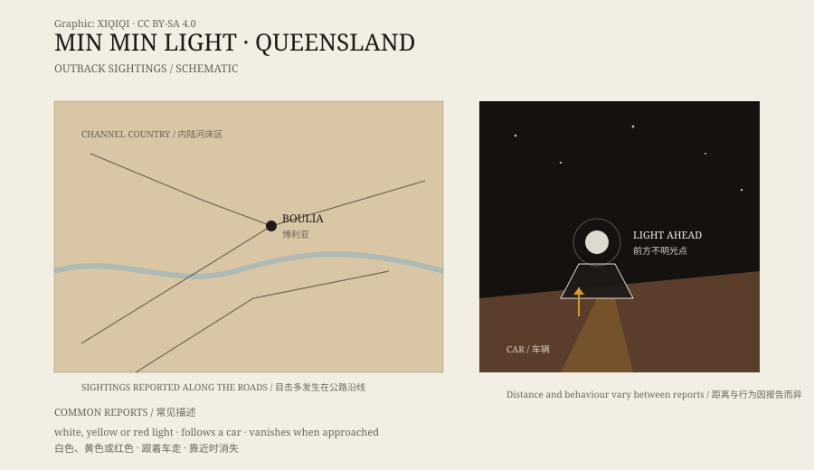

## 1. The night road at Boulia

Boulia is a small town in western Queensland, surrounded by the Channel Country: dry riverbeds, red soil, low scrub, and very long distances between towns.

At night, headlights reach only a short way ahead. The road is straight, the sky is low, and the stars are dense. Apart from the engine, there is almost no sound.

The Min Min light appears on roads like this.

The first time you see it, you assume it is a car. A white glare like high beams, sitting in the middle of the road, its distance impossible to judge. Ease off the accelerator and it slows; press down and it moves ahead. Just as you prepare to overtake, it goes out. The road is empty, and there is only your own light.

*Reconstruction: a night road in outback Queensland, with a white light hovering ahead. Not a photograph of a sighting. Oddity Archive, CC BY-SA 4.0.*

## 2. What it looks like

Witnesses do not all describe the same thing.

Some see a white ball of light, like a low-hanging star. Some see something yellow, like a car's high beams. Some say it turns red, or suddenly splits into two. It usually appears near the horizon, close to the road surface or slightly above it.

It makes no sound. It does not flicker, and it does not light up the ground around it. You see the light itself, but not what is behind it.

*Original schematic: the sighting region in outback Queensland and the reported “light follows the car” behaviour. Not a precise map. Oddity Archive, CC BY-SA 4.0.*

## 3. Where the name comes from

“Min Min” is not a word for the light. It comes from a small place near Boulia that no longer exists, where travellers once stopped for the night at a hotel or staging post.

There are several stories about how the name became attached to the light. One says someone saw the light nearby and linked it to the place. Another says the earliest story happened at a waterhole, where the light followed a person. The details are blurred, but the name stayed.

## 4. Following the car

What makes the Min Min light unsettling is that it seems to react.

Drive, and it keeps its distance ahead. Slow down, and it slows. Stop, and it may stop too, or vanish. Some drivers say it followed them for tens of kilometres; others stopped to approach it and watched it disappear.

That sense of interaction is hard to dismiss as a simple mistake. But night roads are also good at deceiving people: distant headlights, atmospheric refraction, and reflections on the road all shift position as you move.

## 5. Explanations

Several explanations are common.

First, distant vehicle lights. In flat inland country, headlights can carry a long way and appear raised above the road after refraction through the atmosphere.

Second, mirages and temperature inversions. Layers of cool and warm air bend distant scenery and lights, producing images in the wrong place.

Third, marsh gas or bioluminescence. Wetlands and stagnant water can release gas, and some microbes and insects emit light. This struggles to explain why the light would follow a car.

Fourth, simple visual error. With few reference points at night, the eye can read a stationary point of light as moving.

Each explanation fits some reports. None explains every detail. That is why the Min Min light remains part of outback lore.

## 6. Now

Boulia's tourist material often mentions the Min Min light. Locals tell the story not only because they believe it, but because it belongs to the country: the road is long, the night is dark, and there ought to be something out there.

For researchers, it is a problem in optics. For drivers, it is a light that should not be on the road ahead.

## Night Road in Bolia

Min Min Guang is a legend from western Queensland, Australia.

The town of Bulia is inland, surrounded by plains, bush and dirt roads. People who drive at night say they see a light spot in the distance and follow the car. Sometimes it is in front, sometimes to the side, and sometimes it suddenly disappears and appears again in another direction.

The light is usually white or yellowish, not large, like a car light. It doesn't light up the road and it doesn't make any sound.

## The Name
The name "Min Min" comes from a place near Bulia.

Some say it comes from the local Min Min hotel; others say it comes from a word in an Aboriginal language. Different theories coexist, none of which can be completely confirmed.

The exact origin of the name is not important. Importantly, it turns the light of a place into something that can be talked about. When tourists come to Bulia, they will ask “Where can I see the Minmin light?”; locals will tell me which way to drive and when is the easiest time to see it.

## Car Lights

The most common explanation is car lights.

In the flat outback, distant car lights will be refracted in the air layer. During temperature inversions, lights can be bent in unexpected directions and appear to be moving. Two cars, one car and reflective signs on the roadside can also create the effect of "light spots following you".

Another explanation is an optical illusion. When people drive at night, their eyes will look for bright spots; if a distant light changes its relative position as the car moves, it will be felt as "it is moving."

## Inland Light

Min Minguang’s story is inseparable from the environment of the Australian outback.

The road there is straight, there are few cars, it is dark, and the field of vision can extend to dozens of kilometers. A distant light will be magnified in such an environment. Without the distraction of city lights, every bit of light looks special.

The story also reminds drivers: Don’t chase lights at night. There is no end to the road in the outback, and the fuel gauge is more realistic than legend.

## Supplementary Note

In Min Minguang’s story, there is a detail that is rarely mentioned: the place where light appears is often at a distance that can be illuminated by car lights but cannot be clearly seen by humans. This distance is just enough for the brain to complete the shape. Too close and the light is car lights; too far and the light is stars. The middle section is where the legend grows.

## Archive Location
Min Min Guang is a "local legend" type file. It doesn't have a national name or an international case number. Its power comes from place: a road, a town, a group of people driving at night. Leave that place and half the story is lost.

## Further Notes
For drivers, the most important thing about sensitive light is not what it is, but where it appears. The light is in the distance and the road is under your feet. People who chase light tend to forget to look at the gas gauge and the road shoulder. The legend can be heard, but the steering wheel cannot be loosened. This is the most practical folk wisdom on outback roads.

---

**Sources and licenses**: the factual sources are listed in the source ledger S1–S3 at the bottom of this entry. Text and original diagrams are licensed under CC BY-SA 4.0. This article keeps the sightings, the place-name story, and the common explanations separate, and does not identify the light as a known creature or craft.
