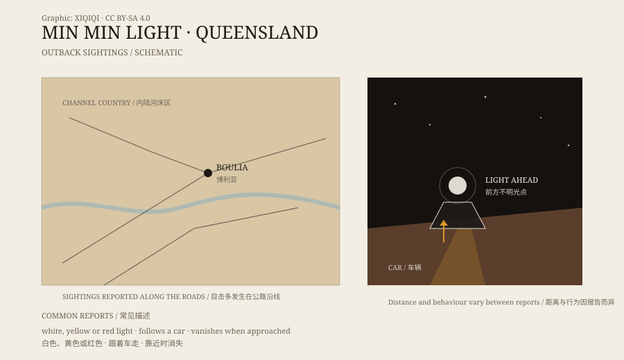

## 1. The night road at Boulia

Boulia is a small town in western Queensland, surrounded by the Channel Country: dry riverbeds, red soil, low scrub, and very long distances between towns.

At night, headlights reach only a short way ahead. The road is straight, the sky is low, and the stars are dense. Apart from the engine, there is almost no sound.

The Min Min light appears on roads like this.

## 2. What it looks like

Witnesses do not all describe the same thing.

Some see a white ball of light, like a low-hanging star. Some see something yellow, like a car's high beams. Some say it turns red, or suddenly splits into two. It usually appears near the horizon, close to the road surface or slightly above it.

It makes no sound. It does not flicker, and it does not light up the ground around it. You see the light itself, but not what is behind it.

*Original schematic: the sighting region in outback Queensland and the reported “light follows the car” behaviour. Not a precise map. Oddity Archive, CC BY-SA 4.0.*

## 3. Where the name comes from

“Min Min” is not a word for the light. It comes from a small place near Boulia that no longer exists, where travellers once stopped for the night at a hotel or staging post.

There are several stories about how the name became attached to the light. One says someone saw the light nearby and linked it to the place. Another says the earliest story happened at a waterhole, where the light followed a person. The details are blurred, but the name stayed.

## 4. Following the car

What makes the Min Min light unsettling is that it seems to react.

Drive, and it keeps its distance ahead. Slow down, and it slows. Stop, and it may stop too, or vanish. Some drivers say it followed them for tens of kilometres; others stopped to approach it and watched it disappear.

That sense of interaction is hard to dismiss as a simple mistake. But night roads are also good at deceiving people: distant headlights, atmospheric refraction, and reflections on the road all shift position as you move.

## 5. Explanations

Several explanations are common.

First, distant vehicle lights. In flat inland country, headlights can carry a long way and appear raised above the road after refraction through the atmosphere.

Second, mirages and temperature inversions. Layers of cool and warm air bend distant scenery and lights, producing images in the wrong place.

Third, marsh gas or bioluminescence. Wetlands and stagnant water can release gas, and some microbes and insects emit light. This struggles to explain why the light would follow a car.

Fourth, simple visual error. With few reference points at night, the eye can read a stationary point of light as moving.

Each explanation fits some reports. None explains every detail. That is why the Min Min light remains part of outback lore.

## 6. Now

Boulia's tourist material often mentions the Min Min light. Locals tell the story not only because they believe it, but because it belongs to the country: the road is long, the night is dark, and there ought to be something out there.

For researchers, it is a problem in optics. For drivers, it is a light that should not be on the road ahead.

---

**Sources and licenses**: the factual sources are listed in the source ledger S1–S3 at the bottom of this entry. Text and original diagrams are licensed under CC BY-SA 4.0. This article keeps the sightings, the place-name story, and the common explanations separate, and does not identify the light as a known creature or craft.
