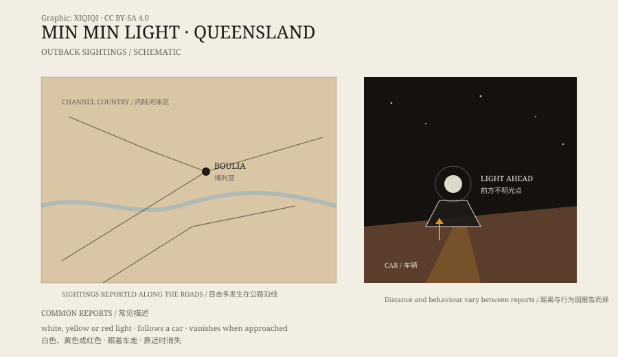

## 一、博利亚的夜路

博利亚是昆士兰西部的一个小镇，周围是 Channel Country：干涸的河床、红色的土、低矮的灌木，城镇之间隔着很长的路。

夜里开车，车灯只能照到前方一小段。路是直的，天很低，星星很多。除了发动机的声音，几乎听不到别的。

敏敏光就出现在这样的路上。

第一次看见它的人，多半会以为前面有车。远光灯一样的一团白，停在路中间，距离感很难判断。你松油门，它也慢；你踩下去，它跟着往前挪。等你准备超车，它忽然灭了，路面空了，只剩下自己的灯。

*场景复原：昆士兰内陆夜路、车灯与前方悬停的白光。不是目击照片。稀奇奇编辑部，CC BY-SA 4.0。*

## 二、光的样子

目击者的描述不完全一样。

有人说它是一团白色的光，像一颗低空悬着的星；有人说是黄色的，像汽车的远光灯；有人说它会变红，或者突然分成两团。它通常出现在地平线附近，贴着路面，或者略微高一点。

它不响，不晃，也不照亮周围的地面。你只能看见光本身，看不清光后面有什么。

*原创示意图：昆士兰内陆的目击区域与“光随车移动”的描述。不是精确地图。稀奇奇编辑部，CC BY-SA 4.0。*

## 三、名字的来历

“敏敏”不是形容光的词。它来自博利亚附近一个已经消失的小地方，那里曾经有一个旅馆或驿站，路过的人在那里过夜。

关于名字的由来，有几种说法：有人在附近看见光，把地名和光连在了一起；也有人说，最早的故事发生在水坑边，光是跟着人走的。细节已经模糊，但名字留了下来。

## 四、跟着车

敏敏光最让人不安的地方，是它似乎会对人作出反应。

你开车，它在前方保持距离；你减速，它也慢下来；你停车，它可能停住，也可能消失。有司机说，它跟着车走了几十公里；也有人停下车想走近看，光却不见了。

这种“会互动”的感觉，很难用一句“看错了”解释。但夜路本身也容易骗人：远处的车灯、空气中的折射、路面的反光，都会随着你的移动而改变位置。

## 五、解释

常见的解释有几种。

第一，是远处车辆的车灯。在平坦的内陆，车灯可以穿过很长的距离，被大气折射后抬高，看起来像悬在路上的光。

第二，是海市蜃楼或温度逆温。冷热空气层会把远处的景物和灯光弯曲，形成位置不对的影像。

第三，是沼泽气体或生物发光。湿地和死水会释放气体，某些微生物和昆虫也会发光。但这种解释很难说明光为什么会跟着车移动。

第四，是纯粹的视觉误差。夜里缺少参照物，人眼会把一个固定的光点判断成在移动。

每一种解释都能对应一部分目击，但没有一种能解释所有细节。敏敏光因此一直是内陆传说的一部分。

## 六、现在

博利亚的旅游资料里，敏敏光是一个常被提起的话题。当地人讲它，不全是因为相信，也因为它是这片荒野的一部分：路太长，夜太黑，总得有点什么在路上。

对研究者来说，它是一道光学题；对开车的人来说，它是一盏不该出现在前方的灯。

## 博利亚的夜路

敏敏光是澳大利亚昆士兰州西部的一个传说。

布利亚镇在内陆，周围是平原、灌木和土路。夜里开车的人说，会看见远处有一个光点，跟着车走。它有时在前方，有时在侧面，有时突然消失，又在另一个方向出现。

光通常是白色或淡黄色，不大，像一盏车灯。它不照亮路面，也不发出声音。

## 名字

“Min Min”这个名字，来自布利亚附近的一个地方。

有人说，它来自当地的 Min Min 旅馆；有人说，它来自原住民语言里的一个词。不同的说法并存，没有一个能被完全确认。

名字的确切来源并不重要。重要的是，它把一个地方的光，变成了一个可以被谈论的东西。游客来布利亚，会问“哪里能看到敏敏光”；当地人会说，往哪条路开，什么时候最容易看见。

## 车灯

最常见的解释是车灯。

在平坦的内陆，远处的车灯会在空气层里折射。温度逆温时，灯光可以被弯到意想不到的方向，看起来像在移动。两辆车、一辆车和路边的反光牌，也能制造出“光点跟着你”的效果。

另一个解释是视错觉。人在夜里开车，眼睛会寻找亮点；一个远处的灯，随着车的移动改变相对位置，就会被感觉成“它在动”。

## 内陆的光

敏敏光的故事，和澳大利亚内陆的环境分不开。

那里路直、车少、天黑，视野可以延伸到几十公里。一个远处的灯，在这样的环境里会被放大。没有城市灯光干扰，任何一点亮都显得特别。

故事也提醒司机：夜里不要追光。内陆的路没有尽头，油表比传说更实际。

## 补记

敏敏光的故事里，有一个很少被提到的细节：光出现的地方，往往是车灯能照到、但人看不清楚的距离。这个距离刚好够大脑补全形状。太近，光就是车灯；太远，光就是星星。中间那段，才是传说生长的地方。

## 档案的位置

敏敏光是“地方传说”类档案。它没有一个全国性的名字，也没有一个国际级的案例编号。它的力量来自地方：一条路、一个镇、一群夜里开车的人。离开那个地方，故事就失去一半。

## 余记

对司机来说，敏敏光最重要的不是它是什么，而是它出现在哪。光在远处，路在脚下。追光的人容易忘记看油表和路肩。传说可以听，方向盘不能松。这是内陆公路最实际的民间智慧。

---

**来源与许可**：本文的事实来源见条目底部来源台账 S1–S3。文字与原创示意图采用 CC BY-SA 4.0。文中把目击描述、地名来历和常见解释分开叙述，不把“光”直接认定为某种未知生物或飞行器。
