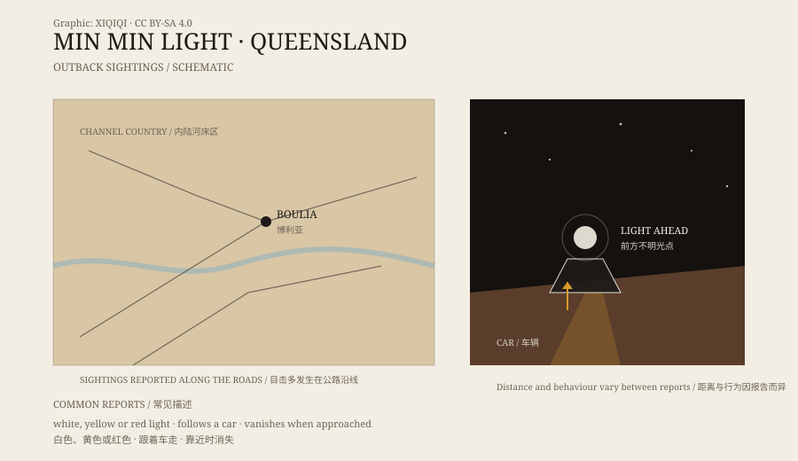

## 一、博利亚的夜路

博利亚是昆士兰西部的一个小镇，周围是 Channel Country：干涸的河床、红色的土、低矮的灌木，城镇之间隔着很长的路。

夜里开车，车灯只能照到前方一小段。路是直的，天很低，星星很多。除了发动机的声音，几乎听不到别的。

敏敏光就出现在这样的路上。

## 二、光的样子

目击者的描述不完全一样。

有人说它是一团白色的光，像一颗低空悬着的星；有人说是黄色的，像汽车的远光灯；有人说它会变红，或者突然分成两团。它通常出现在地平线附近，贴着路面，或者略微高一点。

它不响，不晃，也不照亮周围的地面。你只能看见光本身，看不清光后面有什么。

*原创示意图：昆士兰内陆的目击区域与“光随车移动”的描述。不是精确地图。稀奇奇编辑部，CC BY-SA 4.0。*

## 三、名字的来历

“敏敏”不是形容光的词。它来自博利亚附近一个已经消失的小地方，那里曾经有一个旅馆或驿站，路过的人在那里过夜。

关于名字的由来，有几种说法：有人在附近看见光，把地名和光连在了一起；也有人说，最早的故事发生在水坑边，光是跟着人走的。细节已经模糊，但名字留了下来。

## 四、跟着车

敏敏光最让人不安的地方，是它似乎会对人作出反应。

你开车，它在前方保持距离；你减速，它也慢下来；你停车，它可能停住，也可能消失。有司机说，它跟着车走了几十公里；也有人停下车想走近看，光却不见了。

这种“会互动”的感觉，很难用一句“看错了”解释。但夜路本身也容易骗人：远处的车灯、空气中的折射、路面的反光，都会随着你的移动而改变位置。

## 五、解释

常见的解释有几种。

第一，是远处车辆的车灯。在平坦的内陆，车灯可以穿过很长的距离，被大气折射后抬高，看起来像悬在路上的光。

第二，是海市蜃楼或温度逆温。冷热空气层会把远处的景物和灯光弯曲，形成位置不对的影像。

第三，是沼泽气体或生物发光。湿地和死水会释放气体，某些微生物和昆虫也会发光。但这种解释很难说明光为什么会跟着车移动。

第四，是纯粹的视觉误差。夜里缺少参照物，人眼会把一个固定的光点判断成在移动。

每一种解释都能对应一部分目击，但没有一种能解释所有细节。敏敏光因此一直是内陆传说的一部分。

## 六、现在

博利亚的旅游资料里，敏敏光是一个常被提起的话题。当地人讲它，不全是因为相信，也因为它是这片荒野的一部分：路太长，夜太黑，总得有点什么在路上。

对研究者来说，它是一道光学题；对开车的人来说，它是一盏不该出现在前方的灯。

---

**来源与许可**：本文的事实来源见条目底部来源台账 S1–S3。文字与原创示意图采用 CC BY-SA 4.0。文中把目击描述、地名来历和常见解释分开叙述，不把“光”直接认定为某种未知生物或飞行器。
