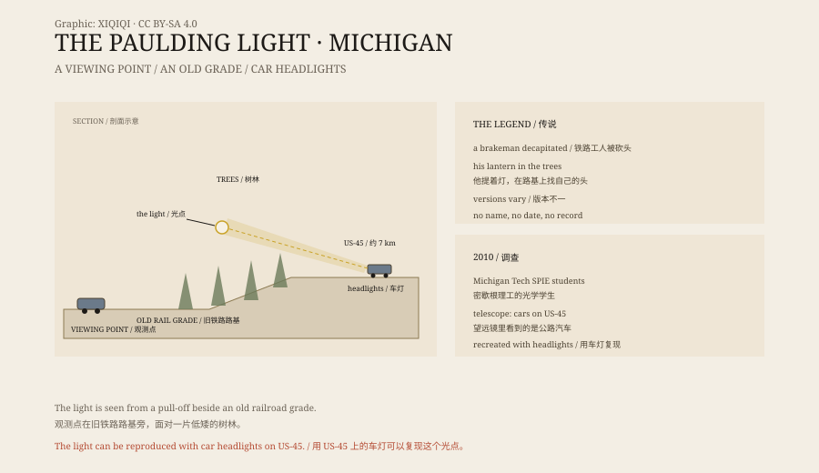

## 1. Paulding

Paulding is a small town in Michigan's Upper Peninsula, surrounded by forest, swamp and a few highways.

An old railroad grade runs along the edge of town; it is now used as a snowmobile trail. Low trees and brush grow on both sides. There is a gravel pull-off where cars can park.

After dark, people stand in the pull-off and look into the trees. After a few minutes, a light appears.

## 2. The legend

The most common story is that a railroad worker was killed on the track years ago and his head was cut off. His ghost walks the grade with a lantern, looking for it.

Another version says the ghost is a hunter who was murdered nearby. Someone else will tell you it is a car that went into the swamp, with its headlights still on.

None of these stories has a name, a date or a record. They are ghost stories handed down from one generation to the next, not a case that can be checked.

## 3. 2010

In 2010 a group of students at Michigan Technological University decided to find out.

They belonged to the university's chapter of SPIE, a student optics society. The group was led by Jeremy Bos, a PhD student in electrical engineering.

They spent several nights at the pull-off with a telescope and a camera. When they pointed the telescope at the light, they did not see a lantern. They saw cars on a highway. They could even read an Adopt-a-Highway sign at the roadside.

## 4. Headlights

The light comes from US-45, about seven kilometres away.

That stretch of highway runs over a rise. Headlights come over the crest, pass through the trees and the lower atmosphere, and are refracted and scattered. From the Paulding pull-off, the trees block most of the beam and leave only a blurred bright spot, apparently hanging in the forest.

The students tested it. They had a car drive along the specific stretch with its headlights on, and the people at the pull-off saw the same light.

They also found that the light's movement, dimming and disappearance matched the rhythm of the traffic.

## 5. Why people still believe

Not everyone accepts the explanation.

Some say they have seen the light when there was no traffic. Some have photographed irregular patches of light. Others insist that the light moves toward the viewer.

Some of these reports may be misidentifications, some may be camera noise, some may come from other light sources. But so far no case has ruled out car headlights, and no case has produced independent physical evidence of anything else.

The ghost story is more interesting than the optics. That is part of why it survives.

## 6. Now

The Paulding Light is now a tourist attraction.

On summer nights the pull-off is full of cars. People bring chairs, cameras and torches and sit by the road to wait.

The light usually appears. It comes from a highway several kilometres away, produced by headlights, a slope and the air between. Knowing that does not stop people from coming to look.

*Original schematic: the viewing point, the old railroad grade and US-45, with the path of the headlights. Not a photograph of the site. Oddity Archive, CC BY-SA 4.0.*

---

**Sources and licenses**: the factual sources are listed in the source ledger S1–S3 at the bottom of this entry. Text and original diagrams are licensed under CC BY-SA 4.0. This article separates the location, the legend, the 2010 investigation and the headlight explanation; the Paulding Light can be reproduced with car headlights, but some witnesses do not accept the explanation. The illustration is a scene reconstruction, not a photograph of the site.
