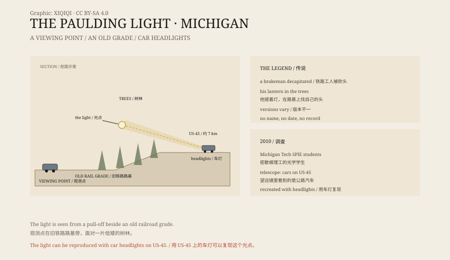

## 1. Paulding

Paulding is a small town in Michigan's Upper Peninsula, surrounded by forest, swamp and a few highways.

An old railroad grade runs along the edge of town; it is now used as a snowmobile trail. Low trees and brush grow on both sides. There is a gravel pull-off where cars can park.

After dark, people stand in the pull-off and look into the trees. After a few minutes, a light appears.

On summer nights the pull-off holds a few cars. People sit in folding chairs with torches and cameras at their feet. Someone sets up a telescope; others just watch. The woods are black, the grade blacker. Then a white point appears between the trunks, faint, steady, drifting left, and goes out.

*Reconstruction: the pull-off, the old railroad grade, and the white light between the trees. Not a photograph of the site. Oddity Archive, CC BY-SA 4.0.*

## 2. The legend

The most common story is that a railroad worker was killed on the track years ago and his head was cut off. His ghost walks the grade with a lantern, looking for it.

Another version says the ghost is a hunter who was murdered nearby. Someone else will tell you it is a car that went into the swamp, with its headlights still on.

None of these stories has a name, a date or a record. They are ghost stories handed down from one generation to the next, not a case that can be checked.

## 3. 2010

In 2010 a group of students at Michigan Technological University decided to find out.

They belonged to the university's chapter of SPIE, a student optics society. The group was led by Jeremy Bos, a PhD student in electrical engineering.

They spent several nights at the pull-off with a telescope and a camera. When they pointed the telescope at the light, they did not see a lantern. They saw cars on a highway. They could even read an Adopt-a-Highway sign at the roadside.

## 4. Headlights

The light comes from US-45, about seven kilometres away.

That stretch of highway runs over a rise. Headlights come over the crest, pass through the trees and the lower atmosphere, and are refracted and scattered. From the Paulding pull-off, the trees block most of the beam and leave only a blurred bright spot, apparently hanging in the forest.

The students tested it. They had a car drive along the specific stretch with its headlights on, and the people at the pull-off saw the same light.

They also found that the light's movement, dimming and disappearance matched the rhythm of the traffic.

## 5. Why people still believe

Not everyone accepts the explanation.

Some say they have seen the light when there was no traffic. Some have photographed irregular patches of light. Others insist that the light moves toward the viewer.

Some of these reports may be misidentifications, some may be camera noise, some may come from other light sources. But so far no case has ruled out car headlights, and no case has produced independent physical evidence of anything else.

The ghost story is more interesting than the optics. That is part of why it survives.

## 6. Now

The Paulding Light is now a tourist attraction.

On summer nights the pull-off is full of cars. People bring chairs, cameras and torches and sit by the road to wait.

The light usually appears. It comes from a highway several kilometres away, produced by headlights, a slope and the air between. Knowing that does not stop people from coming to look.

*Original schematic: the viewing point, the old railroad grade and US-45, with the path of the headlights. Not a photograph of the site. Oddity Archive, CC BY-SA 4.0.*

## Paul Martin

Paul Ding is in the U.S. Upper Peninsula, Michigan, near the Wisconsin border.

It's a place where forests, swamps and logging roads intersect. At night, looking at a remote road, there's a light point above the trees. It moves, splits, merges, sometimes like a lamp, sometimes like a fire.

The locals say it's a woman with a light, or a dead railroad worker. There are a lot of stories in common: light in the woods, not on the road.

## Year 2010

In 2010, a television show group came to investigate.

They drove back and forth on the road with cameras, spectrometers and a car. Finally, they found that the location of the light point was related to the direction of the distant lights. When a car turns from a distance, the lights pass through the cracks in the woods, they form a moving light.

The show explains the lights. But the story is not over. The locals still say that light sometimes happens when there is no car; tourists are still willing to wait on the side of the road.

## Geometry of the lights

The lights explain that the road was established because of the terrain.

Roads are on a slope, with a gap in the woods, and a far higher path. Carlights come in through the gap, filtering through fog, branches and leaves, and they turn into a blurry light. Cars move, light moves, and traffic turns, light splits or disappears.

It's hard to judge distance in the night. A distant lamp is seen as a small light above the trees. Without a reference, the light loses its measure.

## Legendary location

Pauldin's light has become part of the place.

There are signs on the side of the road, there are visual maps on the website, and there's people in the bar. Even if the lights are repeated, the story is alive. Because the story does not provide an answer, it is a place for the night: you can drive over, turn off the engine, and a light.

## Supplementary Notes

Pauldin's light is the most vulnerable to being filmed as "evidence." The cell phone camera is exposed at night, turning the lights into light, turning the distant light into a flash of light. The picture looks more mysterious than the naked eye. Technology does not make a lie; it just changes the proportion of view.

## Location of the archives

Pauldin's light is typical of a "misperception" type of archive. It has a reasonable explanation, and it has a story that is still popular. It doesn't kill the story, because it does not provide a truth, but a place to go. People need something to wait for.

## Memory

Pauldin's legend has a very practical effect: to give a normal road a destination. People drive over, park on the side of the road, and wait for a light. Even when the lights are the last to see, the road is not wasted. The story sometimes gives no answer but a reason to go out.

---

**Sources and licenses**: the factual sources are listed in the source ledger S1–S3 at the bottom of this entry. Text and original diagrams are licensed under CC BY-SA 4.0. This article separates the location, the legend, the 2010 investigation and the headlight explanation; the Paulding Light can be reproduced with car headlights, but some witnesses do not accept the explanation. The illustration is a scene reconstruction, not a photograph of the site.
