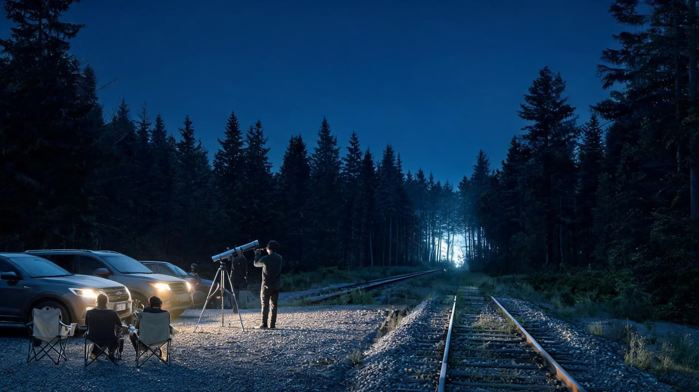
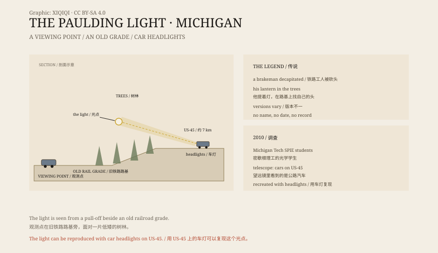

## 一、波尔丁

波尔丁在密歇根州的上半岛，周围是森林、沼泽和几条公路。

小镇边上有一条旧铁路路基，后来改成了雪地车道。路基两侧是低矮的树和灌木。路边有一块空地，可以停车。

天黑以后，人们站在空地上，往树林深处看。几分钟后，一个光点出现。

夏天夜里，空地上停着几辆车，人坐在折叠椅上，脚边放着手电和相机。有人架起望远镜，有人只是看。树林很黑，路基比周围更黑。忽然，树缝里亮起一点白，不亮，也不闪，慢慢往左移，然后暗下去。

*场景复原：波尔丁观测点、旧铁路路基与树林间的白色光点。不是现场照片。稀奇奇编辑部，CC BY-SA 4.0。*

## 二、传说

最常见的说法是：很多年前，一名铁路工人在轨道上出事，头被切断。他的鬼魂提着灯，沿着路基找自己的头。

另一个版本说，那是一个在附近被杀的猎人。还有人说，是一辆掉进沼泽的汽车，车灯一直亮着。

这些故事都没有具体的人名、日期或记录。它们更像是一代代讲下来的鬼故事，而不是一起可以查证的事故。

## 三、2010 年

2010 年，密歇根理工大学的几名学生决定弄清楚。

他们属于学校的 SPIE 分会，一个光学工程的学生组织。带队的是电子工程博士生杰里米·博斯。

他们带着望远镜和相机，在夜里守了几个晚上。望远镜对准光点后，他们看到的不是灯笼，而是公路上的汽车。他们甚至能看清路边一块“认养公路”标志牌。

## 四、车灯

光点来自大约七公里外的 US-45 公路。

那一段公路有一个缓坡。车灯从坡上照过来，穿过树林和低空的大气层，发生折射和散射。站在波尔丁的观测点看过去，灯光被树挡住一部分，只剩下一个模糊的亮点，像是悬在林子里。

学生们做了实验：让一辆车在特定路段开过，打开车灯。观测点上的人看到了同样的光。

他们还发现，光点的移动、变暗、消失，都和车流的节奏对得上。

## 五、为什么还有人相信

不是所有人都接受这个解释。

有人说，他们在没有车的时候也看到过光；有人拍到过形状不规则的光斑；也有人坚持，光会朝观测者靠近。

这些说法有些可能是误判，有些可能是相机噪点，有些可能来自其他光源。但到目前为止，没有一个案例能排除车灯，也没有一个案例能提供独立的物理证据。

鬼故事比光学解释更有意思。这是它一直流传的原因之一。

## 六、现在

波尔丁光现在是一个旅游点。

夏天晚上，停车场里停满车。人们带着椅子、相机和手电筒，坐在路边等。

光通常会出现。它来自几公里外的公路，由车灯、坡度和空气一起制造出来。知道了这一点，也不影响人们继续来看。

*原创示意图：观测点、旧铁路路基与 US-45 公路的位置关系，以及车灯光线的路径。不是现场照片。稀奇奇编辑部，CC BY-SA 4.0。*

---

**来源与许可**：本文的事实来源见条目底部来源台账 S1–S3。文字与原创示意图采用 CC BY-SA 4.0。文中把地点、传说、2010 年调查与车灯解释分开叙述；波尔丁光可以被车灯复现，但仍有目击者不接受这一解释。插图是场景复原，不是现场照片。
