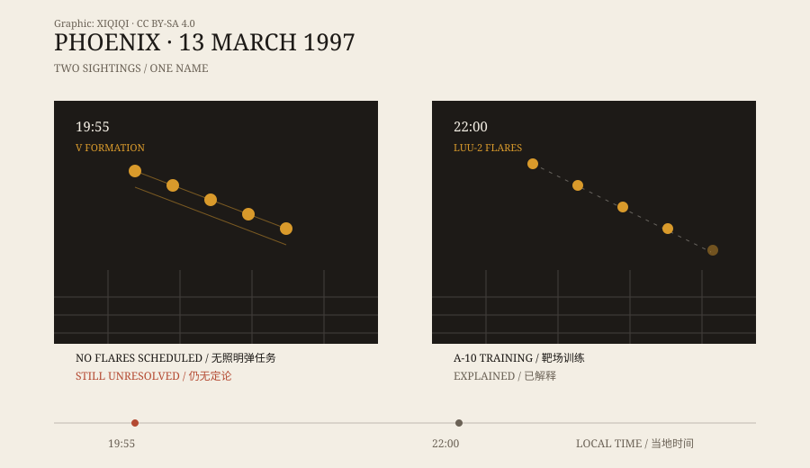

## 1. 7:55 p.m.

Thursday, 13 March 1997. It was already dark.

In Henderson, Nevada, a man driving home saw several lights arranged in a V. He pulled over and called the police. The lights were large, he said, moving slowly and making no sound.

Around the same time, people in northwestern Arizona began calling too. The reports ran south along a corridor: Prescott, Phoenix, Tucson. In the end, hundreds of people said they had seen the same thing.

It flew low. Some described a slow formation longer than a football field; others said it blocked the stars behind it. It crossed Phoenix from north to south, then disappeared.

## 2. 10 p.m., another row of lights

Around ten o'clock, lights appeared over Phoenix again.

This time someone had a camcorder. In the footage, a row of warm yellow points hangs at the edge of the city. After a while the outermost light goes out, then the next one. The video was on the television news the following day and became the most famous image of the “Phoenix Lights.”

Many people treat the two sightings as one event. They were two hours apart, in different places, and did not look the same. Later investigations dealt with them separately.

*Original schematic: the two sightings on the evening of 13 March 1997. On the left, the V formation at 7:55 p.m.; on the right, the flares around 10 p.m. Not a photograph. Oddity Archive, CC BY-SA 4.0.*

## 3. The governor and the press conference

Arizona's governor at the time was Fife Symington. In 1997 he held a press conference at which an aide came on stage dressed as an alien. The room was light-hearted. Reporters laughed.

Years later, Symington changed his account. In 2007 he said in interviews and a documentary that he had seen the object himself that night: a huge, dark, triangular craft moving slowly overhead. He said he was a pilot and knew what aircraft looked like.

The statement matters, but it is still a statement. It does not prove what the object was. It shows that one of the people who saw something later chose to say so in public.

## 4. The flares

The military first said no aircraft from local bases had been flying that night. Later, the Air National Guard offered a different account.

That evening, A-10 attack aircraft of the Maryland Air National Guard were training at the Barry Goldwater Range in southern Arizona. Around ten o'clock the pilots dropped LUU-2 illumination flares. The flares hang under parachutes, burn for several minutes, glow as they descend, and go out one by one.

The timing, the location, and the lights going out in sequence all match the 10 p.m. footage. The military said that was the “V” people saw.

The explanation covers the ten o'clock lights. It does not cover the 7:55 sighting. No training mission was flying at that time.

## 5. Two sightings, one name

So “Phoenix Lights” became a name for two different things.

The ten o'clock lights were most likely flares. The 7:55 lights have never had a consistent explanation. Some said an aircraft formation, some said signal flares, some said something else. There was no radar record and no physical evidence — only hundreds of witness reports and one blurry video.

That is what makes the case awkward: the most widely seen footage happens to be the part that is easiest to explain, while the part that is hardest to explain has no clear image at all.

## 6. Afterwards

After the Phoenix event, unofficial research groups in Arizona began collecting witness testimony. Every March, people there still bring up that night.

For the witnesses, it was the strangest thing they had ever seen. For researchers, it is a question that was split in two: one half answered, one half not.

---

**Sources and licenses**: the factual sources are listed in the source ledger S1–S3 at the bottom of this entry. Text and original diagrams are licensed under CC BY-SA 4.0. This article distinguishes the two sightings that night: the ten o'clock lights have a military flare explanation, while the 7:55 sighting remains unresolved.
