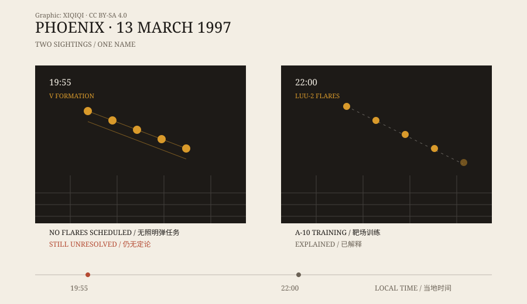

## 一、晚上七点五十五分

1997 年 3 月 13 日，星期四。天已经黑了。

内华达州亨德森，一个男人开车回家，看见天上有几盏灯排成 V 字。他停下车，打电话报警。他说那些灯很大，很慢，没有声音。

差不多同一时间，亚利桑那州西北部也有人打电话。目击报告沿着一条走廊往南延伸：普雷斯科特、凤凰城、图森。后来统计，那一晚有数百人报告看到同样的东西。

它飞得很低。有人描述它像一支缓慢移动的编队，长度超过一个足球场；有人说它遮住了背后的星星。它从北往南，穿过凤凰城上空，然后消失。

## 二、十点钟，另一排灯

晚上十点左右，凤凰城再次出现灯光。

这一次，有人架起了摄像机。画面里，一排暖黄色的光点悬在城市边缘。过了一会儿，最边上的一盏熄灭，接着是下一盏。录像在第二天的电视新闻里播出，成了“凤凰城光点”最著名的画面。

很多人把两段目击当成同一件事。其实它们相隔两个小时，位置和形态也不完全一样。后来的调查把它们分开处理。

*原创示意图：1997 年 3 月 13 日晚上的两段目击。左边是七点五十五分的 V 字编队，右边是十点左右的照明弹。不是现场照片。稀奇奇编辑部，CC BY-SA 4.0。*

## 三、州长和那场记者会

时任亚利桑那州州长是法夫·赛明顿。1997 年，他在一场记者会上让助手穿着外星人服装上台。场面很轻松，记者们笑了。

多年以后，赛明顿改变了说法。2007 年，他在采访和纪录片里说，那一晚他本人也看见了：一个巨大的、深色的三角形物体，从头顶缓慢飞过。他说自己是飞行员，知道飞机是什么样子。

这段证词很重要，但它仍然是证词。它不能证明那是什么，只能说明当时看到的人里，有一个后来成了公开的目击者。

## 四、照明弹

军方最初说，那一晚没有战机从本地基地起飞。后来，空军国民警卫队给出另一种说法。

当晚，马里兰州空军国民警卫队的 A-10 攻击机正在亚利桑那州南部的巴里·戈德华特靶场训练。飞行员在十点左右投下了 LUU-2 照明弹。这种照明弹挂在降落伞下，燃烧几分钟，一边下降一边发光，最后逐盏熄灭。

时间、位置、逐盏熄灭的样子，都和十点那一段录像对得上。军方说，那就是人们看到的“V 字”。

这个解释能覆盖十点的灯光，却覆盖不了七点五十五分的那一段。那个时间段，靶场没有飞行任务。

## 五、两段目击，一个名字

于是“凤凰城光点”变成了一个装了两件事的名字。

十点的光，大概率是照明弹。七点五十五分的光，至今没有一致的解释。有人说是飞机编队，有人说是信号弹，有人说是别的东西。没有雷达记录，没有实物，只有几百份目击报告和一段模糊的录像。

这也是它难办的地方：最流传的画面，恰好是最容易解释的那一段；最难解释的那一段，偏偏没有清楚的影像。

## 六、后来

凤凰城事件之后，亚利桑那州出现了非官方的调查组织，收集目击者证词。每年三月，当地还会有人提起那一夜。

对目击者来说，那是他们见过的最奇怪的东西。对研究者来说，那是一道被拆开的题：一半有答案，一半没有。

---

**来源与许可**：本文的事实来源见条目底部来源台账 S1–S3。文字与原创示意图采用 CC BY-SA 4.0。本文区分了当晚的两段目击：十点的灯光有军方照明弹解释，七点五十五分的目击仍无定论。
