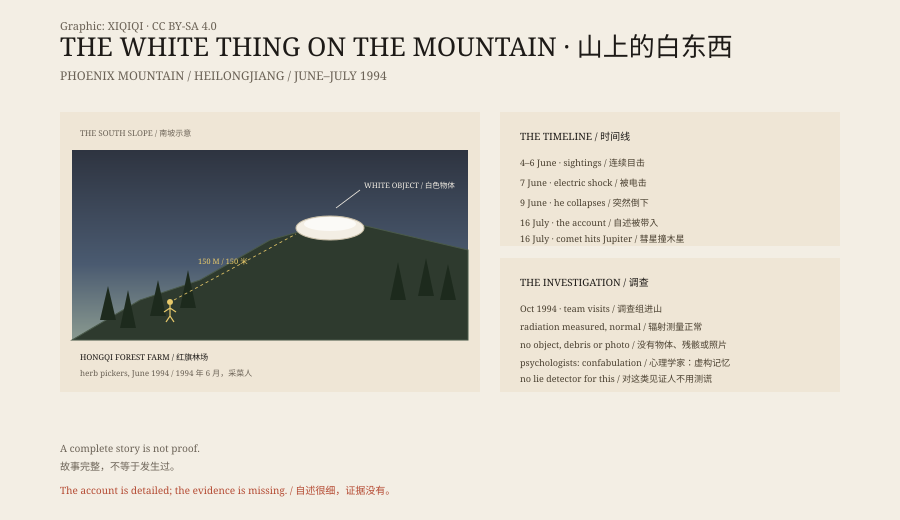

## 1. June 1994

Hongqi Forest Farm, Wuchang, Heilongjiang. Phoenix Mountain rises to the south.

From 4 to 6 June 1994, Meng Zhaoguo and the herb pickers who went up the mountain said there was a white object on the south slope.

It was not a tree, not snow, not a rock. It was sitting there.

## 2. 7 June

Meng and his relative Li Honghai decided to take a closer look.

They said that at about 150 metres from the object, they felt an electric shock and heard a strange sound. They turned back.

That evening the forest farm talked of nothing else. Some said it was a plastic shelter, some said aircraft wreckage, some said it was an alien object.

## 3. 9 June

On 9 June, Meng led a group up the mountain.

According to his later account, he was searching the slope with binoculars when he saw something shaped like a person. The thing raised an arm toward him, and he fell.

The others saw him convulse and lose consciousness. After they carried him down, some noticed that he flinched at iron and would avoid metal tools.

When Meng woke, he could not remember what had happened on 9 June. Red marks and scars had appeared on his abdomen and thigh. He said he had pulled a piece of elastic material out of his skin.

## 4. 16 July

On the night of 16 July, Meng said, a figure more than two metres tall with six fingers appeared in his house, led him through a wall and into a huge white object.

Inside, the figure showed him a transparent block. In it, a sphere was being struck by fragments. The figure said it was Jupiter and a comet.

On 16 July 1994, fragments of Comet Shoemaker-Levy 9 began hitting Jupiter. It was being reported by astronomers around the world.

Meng said the figure also told him that if humans did not take care of the environment, the Earth would end the same way.

## 5. The Investigation

In October 1994 the China UFO Research Association sent an investigation team to Phoenix Mountain.

They had professional equipment measure radiation levels in Meng's house. Nothing unusual was found. On the slope they found no white object, no wreckage, no photograph and no sample that could be taken away.

The investigators split. Some thought Meng was lying. Others thought he lacked the education to invent such a detailed story.

In 2005 CCTV's *Approaching Science* covered the case. Psychologists suggested that Meng may have had a special psychological experience and then filled the gaps in his memory. It was not deliberate deception, they said, but a kind of confabulation, in which a person comes to believe an imagined account.

A polygraph expert said a lie detector would be meaningless for a witness like this. He might sincerely believe what he was saying.

## 6. The Story

Later tellings added a female alien, sexual contact and a pregnancy.

These claims have no reliable physical evidence and are not in the CCTV investigation. They made the story more exciting and pushed it further from the facts.

Meng had five years of primary school, lived on the forest farm and had never been more than a hundred kilometres from home. Could one man invent such a story? That was the question the investigators argued over.

But a story being complete does not make it true.

The south slope of Phoenix Mountain is still there. The white thing did not come back.

*Original schematic: the June–July 1994 timeline, the south-slope sighting and the investigation. Not a photograph of the site. Oddity Archive, CC BY-SA 4.0.*

## China '1994 UFO Hot

The Phoenix incident is not isolated.

In the same period, air power and mysticism were popular. A forest worker said he saw white things on the hill, and he could easily be put into this national narrative.

Mount Phoenix is located at the Red Flag Forest of the 5th Ping Town Forestry Department in Heilongjiang Province, and is part of the Zhang Guangtao Ridge of the Long White Mountains. The mountains are home to primitive forests, swamps, and logging roads.

## Memory and hypnosis

In 2005, psychologists were asked to analyse Mon-square narratives of the country in the light of " Approaching Science " .

The psychologist explained that he might have experienced a strong psychological event and then, in repeats, questions from others and media attention, filled his memory with imagination. This is not a conscious lie, but a normal way of working memory.

People are prone to live hallucinations when they are high-tension, sleepless or untimely. After that, if people around them keep asking for details, these hallucinations are organized into a coherent story. The more stories they tell, the more they believe that they have been there.

## Physical evidence

The team measured radiation in the Monzae country and did not detect any abnormalities.

No white objects were found on the hillside, no wreckage, no photographs, no samples. Mon-gong said, "Flexy stuff from the skin," and it was not preserved.

The only ones left were the red marks and scars on the body, and his own account. Red marks could be interpreted as skin disease, scratches or burns; scars could be interpreted as old wounds. They could not prove contact with an alien, nor could they be completely negative.

## The mountains and the stories

The south slope of Phoenix is still there.

The white thing didn't come back, and the forest life didn't change. Mon Shigeo continued to live nearby, occasionally interviewed. The story was written in books, programmes and online articles, with more and more versions.

Can a man make up a story like this? The investigator argued that year. But what is more interesting is: why does a person need a story like this? In a remote forest field, an ordinary worker suddenly becomes the centre of national attention. The story gives him a place.

## Supplementary Notes

After the Phoenix incident, there were a lot of “witnesses.” Some said they had seen white light, others said there were other objects in the mountain. Most of these statements were not documented or investigated. When a story was established, it attracted more stories, which were common to legends.

## Location of the archives

Phoenix is a typical of the “personal testimony” file. It has no physical evidence, no photographs, only the memory of the storyteller and the records of a group of investigators. The file is not responsible for judging whether he is lying, but for separating self-narration, peer observation, findings and psychological analysis.

---

**Sources and licenses**: the factual sources are listed in the source ledger S1–S3 at the bottom of this entry. Text and original diagrams are licensed under CC BY-SA 4.0. This article separates Meng's account, the witnesses' observations, the investigation and the psychological explanations; no physical evidence confirms an alien contact. The illustration is a scene reconstruction, not a photograph of the site.
