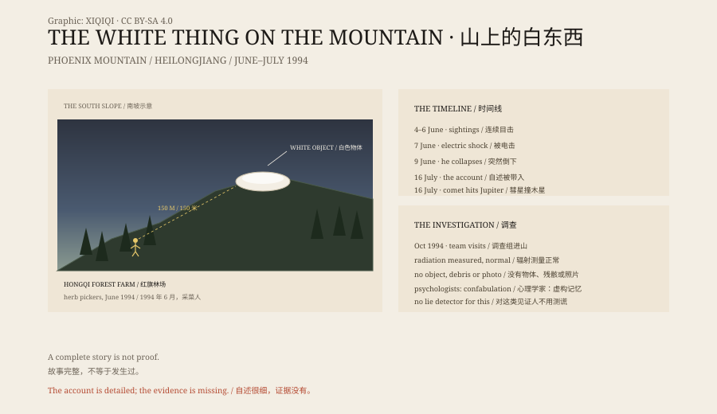

## 1. June 1994

Hongqi Forest Farm, Wuchang, Heilongjiang. Phoenix Mountain rises to the south.

From 4 to 6 June 1994, Meng Zhaoguo and the herb pickers who went up the mountain said there was a white object on the south slope.

It was not a tree, not snow, not a rock. It was sitting there.

## 2. 7 June

Meng and his relative Li Honghai decided to take a closer look.

They said that at about 150 metres from the object, they felt an electric shock and heard a strange sound. They turned back.

That evening the forest farm talked of nothing else. Some said it was a plastic shelter, some said aircraft wreckage, some said it was an alien object.

## 3. 9 June

On 9 June, Meng led a group up the mountain.

According to his later account, he was searching the slope with binoculars when he saw something shaped like a person. The thing raised an arm toward him, and he fell.

The others saw him convulse and lose consciousness. After they carried him down, some noticed that he flinched at iron and would avoid metal tools.

When Meng woke, he could not remember what had happened on 9 June. Red marks and scars had appeared on his abdomen and thigh. He said he had pulled a piece of elastic material out of his skin.

## 4. 16 July

On the night of 16 July, Meng said, a figure more than two metres tall with six fingers appeared in his house, led him through a wall and into a huge white object.

Inside, the figure showed him a transparent block. In it, a sphere was being struck by fragments. The figure said it was Jupiter and a comet.

On 16 July 1994, fragments of Comet Shoemaker-Levy 9 began hitting Jupiter. It was being reported by astronomers around the world.

Meng said the figure also told him that if humans did not take care of the environment, the Earth would end the same way.

## 5. The Investigation

In October 1994 the China UFO Research Association sent an investigation team to Phoenix Mountain.

They had professional equipment measure radiation levels in Meng's house. Nothing unusual was found. On the slope they found no white object, no wreckage, no photograph and no sample that could be taken away.

The investigators split. Some thought Meng was lying. Others thought he lacked the education to invent such a detailed story.

In 2005 CCTV's *Approaching Science* covered the case. Psychologists suggested that Meng may have had a special psychological experience and then filled the gaps in his memory. It was not deliberate deception, they said, but a kind of confabulation, in which a person comes to believe an imagined account.

A polygraph expert said a lie detector would be meaningless for a witness like this. He might sincerely believe what he was saying.

## 6. The Story

Later tellings added a female alien, sexual contact and a pregnancy.

These claims have no reliable physical evidence and are not in the CCTV investigation. They made the story more exciting and pushed it further from the facts.

Meng had five years of primary school, lived on the forest farm and had never been more than a hundred kilometres from home. Could one man invent such a story? That was the question the investigators argued over.

But a story being complete does not make it true.

The south slope of Phoenix Mountain is still there. The white thing did not come back.

*Original schematic: the June–July 1994 timeline, the south-slope sighting and the investigation. Not a photograph of the site. Oddity Archive, CC BY-SA 4.0.*

---

**Sources and licenses**: the factual sources are listed in the source ledger S1–S3 at the bottom of this entry. Text and original diagrams are licensed under CC BY-SA 4.0. This article separates Meng's account, the witnesses' observations, the investigation and the psychological explanations; no physical evidence confirms an alien contact. The illustration is a scene reconstruction, not a photograph of the site.
