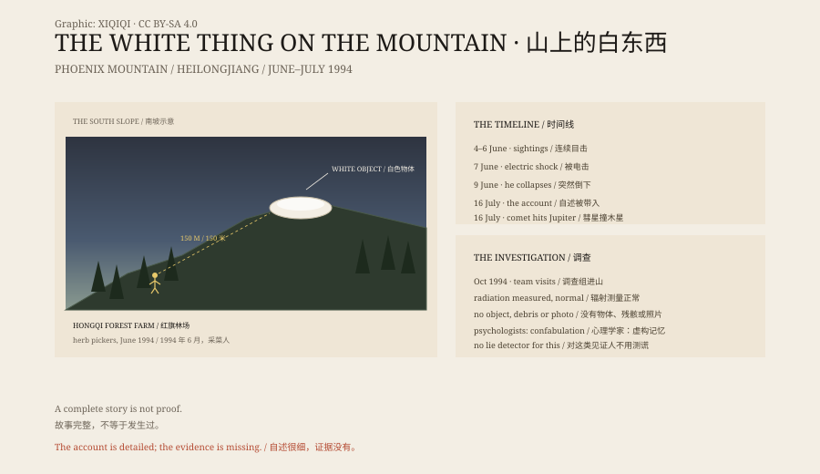

## 一、1994 年 6 月

黑龙江省五常市，山河屯林业局红旗林场。凤凰山在南边。

1994 年 6 月 4 日到 6 日，孟照国和上山采野菜的人说，凤凰山南坡有一个白色的东西。

它不是树，不是雪，也不是石头。它在那里停着。

## 二、6 月 7 日

孟照国和亲属李洪海决定上去看看。

两人说，走到离那个东西大约一百五十米时，身上像被电了一下，耳朵里听到叫声。他们退了回来。

那天晚上，林场的人都在议论。有人说那是塑料棚，有人说那是飞机残骸，有人说那是外星人的东西。

## 三、6 月 9 日

6 月 9 日，孟照国带着一群人上山。

据他自己后来讲，他用望远镜往山坡上搜索时，看见一个像人的东西。那东西朝他这边一挥手，他就倒下了。

同行的人看见他突然抽动、失去意识。把他抬下山后，有人发现他对铁很敏感，碰到铁器就躲。

孟照国醒来后，不记得 6 月 9 日发生了什么。他的腹部和大腿上出现了红印和疤痕。他说，自己从皮肤里抠出过一块有弹性的东西。

## 四、7 月 16 日

7 月 16 日夜里，孟照国说，一个两米多高、六根手指的人形出现在他家里，带他穿墙出去，进了一个巨大的白色物体。

在物体里，那人给他看了一个透明的方块：里面有一颗球，后面跟着碎块，正在相撞。那人说，那是木星和彗星。

1994 年 7 月 16 日，苏梅克-列维 9 号彗星的碎片开始撞上木星。这是当时全球天文界都在报道的事。

孟照国说，那人还告诉他：如果人类不爱护环境，地球也会这样消失。

## 五、调查

1994 年 10 月，中国 UFO 研究会组织调查组来到凤凰山。

他们请人用专业设备测量了孟照国家里的辐射值，没有发现异常。山坡上没有找到那个白色物体，也没有残骸、照片或任何可以带走的样本。

调查者分成了两派。有人认为孟照国在说谎，有人认为他没有能力编出这么完整的细节。

2005 年，央视《走近科学》做了一期节目。心理学家给出的解释是：他可能经历了一段特殊的心理状态，然后在记忆里把空白补全了。这不是有意欺骗，而是一种“虚构”——人会把想象当成记忆。

测谎专家说，对这类见证人，测谎没有意义。他可能真诚地相信自己说的是真的。

## 六、故事

在后来的流传里，还有女外星人、性接触和怀孕的说法。

这些说法没有可靠的物证，也不在央视调查的记录里。它们让故事更刺激，也让故事离事实更远。

孟照国只有小学五年级文化，住在林场，最远去过一百公里外的镇子。一个人能不能编出这样的故事？这是调查者当年反复争论的问题。

但一个故事讲得完整，不等于它发生过。

凤凰山南坡还在。那个白色的东西，没有回来。

*原创示意图：1994 年 6–7 月的时间线、南坡目击点与调查结论。不是现场照片。稀奇奇编辑部，CC BY-SA 4.0。*

---

**来源与许可**：本文的事实来源见条目底部来源台账 S1–S3。文字与原创示意图采用 CC BY-SA 4.0。文中把孟照国的自述、同行者的观察、调查结果与心理学解释分开叙述；没有物证能确认外星接触。插图是场景复原，不是现场照片。
