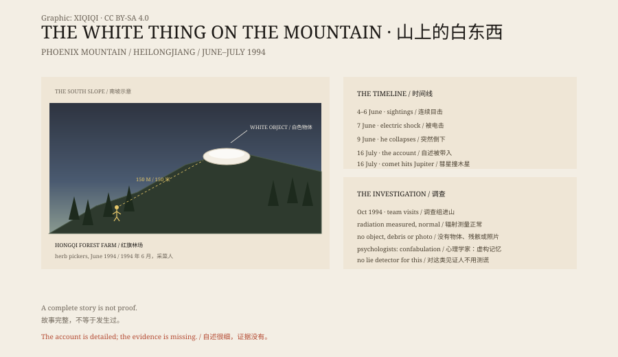

## 一、1994 年 6 月

黑龙江省五常市，山河屯林业局红旗林场。凤凰山在南边。

1994 年 6 月 4 日到 6 日，孟照国和上山采野菜的人说，凤凰山南坡有一个白色的东西。

它不是树，不是雪，也不是石头。它在那里停着。

## 二、6 月 7 日

孟照国和亲属李洪海决定上去看看。

两人说，走到离那个东西大约一百五十米时，身上像被电了一下，耳朵里听到叫声。他们退了回来。

那天晚上，林场的人都在议论。有人说那是塑料棚，有人说那是飞机残骸，有人说那是外星人的东西。

## 三、6 月 9 日

6 月 9 日，孟照国带着一群人上山。

据他自己后来讲，他用望远镜往山坡上搜索时，看见一个像人的东西。那东西朝他这边一挥手，他就倒下了。

同行的人看见他突然抽动、失去意识。把他抬下山后，有人发现他对铁很敏感，碰到铁器就躲。

孟照国醒来后，不记得 6 月 9 日发生了什么。他的腹部和大腿上出现了红印和疤痕。他说，自己从皮肤里抠出过一块有弹性的东西。

## 四、7 月 16 日

7 月 16 日夜里，孟照国说，一个两米多高、六根手指的人形出现在他家里，带他穿墙出去，进了一个巨大的白色物体。

在物体里，那人给他看了一个透明的方块：里面有一颗球，后面跟着碎块，正在相撞。那人说，那是木星和彗星。

1994 年 7 月 16 日，苏梅克-列维 9 号彗星的碎片开始撞上木星。这是当时全球天文界都在报道的事。

孟照国说，那人还告诉他：如果人类不爱护环境，地球也会这样消失。

## 五、调查

1994 年 10 月，中国 UFO 研究会组织调查组来到凤凰山。

他们请人用专业设备测量了孟照国家里的辐射值，没有发现异常。山坡上没有找到那个白色物体，也没有残骸、照片或任何可以带走的样本。

调查者分成了两派。有人认为孟照国在说谎，有人认为他没有能力编出这么完整的细节。

2005 年，央视《走近科学》做了一期节目。心理学家给出的解释是：他可能经历了一段特殊的心理状态，然后在记忆里把空白补全了。这不是有意欺骗，而是一种“虚构”——人会把想象当成记忆。

测谎专家说，对这类见证人，测谎没有意义。他可能真诚地相信自己说的是真的。

## 六、故事

在后来的流传里，还有女外星人、性接触和怀孕的说法。

这些说法没有可靠的物证，也不在央视调查的记录里。它们让故事更刺激，也让故事离事实更远。

孟照国只有小学五年级文化，住在林场，最远去过一百公里外的镇子。一个人能不能编出这样的故事？这是调查者当年反复争论的问题。

但一个故事讲得完整，不等于它发生过。

凤凰山南坡还在。那个白色的东西，没有回来。

*原创示意图：1994 年 6–7 月的时间线、南坡目击点与调查结论。不是现场照片。稀奇奇编辑部，CC BY-SA 4.0。*

## 时间线

- **1994 年 6 月 4 日**：1994 年 6 月 4 日到 6 日，孟照国和上山采野菜的人说，凤凰山南坡有一个白色的东西
- **2005 年**：2005 年，央视《走近科学》做了一期节目

## 来源与证据

本条目的事实底座以 2 条独立来源为主。S1（中央电视台）覆盖1994 年 6 月 4–9 日经过、7 月 16 日自述、调查与心理学解释。
S2（中央电视台）补充节目背景、凤凰山 UFO 事件的公开报道。
原创插图只提供场景复原、结构示意或地图，不作为历史照片使用。正文把可核对记录、后来解释与传说分开叙述；同一件事在不同来源中的版本差异，保留在行文中，不强行合并。

## 档案空白

现有材料能说明现象被记录过，未必能说明它的成因；记录、仪器数据与解释之间仍有一段距离，这段距离就是档案要保留的空白。
这条档案把记录与未答的问题并排放置，不替读者做出超出证据的结论。
就可信度而言，本条目标为“disputed”。这个标签描述的是当前证据状态，不是对传说真伪的终审；新档案出现时，标签应随之调整。

## 档案补记

以下补记保留正文没有展开的档案侧面：来源、技术细节与后续影响。
**档案的位置**。 凤凰山是“个人证词”类档案的典型。它没有物证，没有照片，只有一个讲述者的记忆和一群调查者的记录。档案不负责判断他是否说谎，只负责把自述、同行者观察、调查结果和心理分析分开。分开之后，读者可以看到故事是怎么一层层长出来的。
**补记**。 凤凰山事件之后，当地出现过不少“目击者”。有人说自己也看见过白光，有人说山里还有别的物体。这些说法大多没有记录，也没有调查。一个故事成立之后，会吸引更多故事，这是传说传播的常见现象。
**物证**。 调查组在孟照国家里测过辐射，没有发现异常。

山坡上没有找到白色物体，没有残骸，没有照片，没有样本。孟照国说的“从皮肤里抠出的弹性东西”，也没有保存下来。

唯一留下的，是身体上的红印和疤痕，以及他自己的叙述。红印可以被解释为皮肤病、抓伤或烫伤；疤痕可以被解释为旧伤。它们不能证明外星接触，也不能完全否定。

---

**来源与许可**：本文的事实来源见条目底部来源台账 S1–S3。文字与原创示意图采用 CC BY-SA 4.0。文中把孟照国的自述、同行者的观察、调查结果与心理学解释分开叙述；没有物证能确认外星接触。插图是场景复原，不是现场照片。
