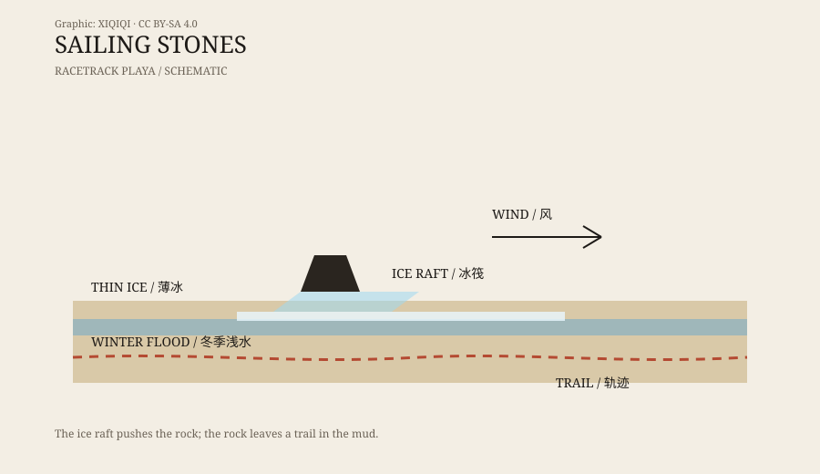

## 1. Trails on the lakebed

Death Valley National Park, California. The Racetrack Playa.

It is a dry lakebed about four kilometres long and two kilometres wide, surrounded by mountains. In summer it is white with heat; in winter the ground can freeze. Dark stones lie scattered across the surface, from a few hundred grams to more than a hundred kilograms.

The strange part is not the stones. It is the trails behind them.

Some trails are straight, some curve, some loop back on themselves. They vary in depth and can run for hundreds of metres. The stone sits at the end of the trail, as if it walked there and stopped.

People have recorded these trails since 1915. For decades, no one saw the stones move.

## 2. Decades of guesses

Many explanations were proposed.

Wind was one. The playa is open and windy, and the stones might be pushed by gusts. But the stones are heavy, and wind alone seemed unlikely to move them.

Ice was another. In winter the playa can flood and freeze, and ice might carry the stones. This turned out to be the right direction, but at the time there was no direct evidence.

Earthquakes, magnetism, animals, and pranksters were also suggested. Each explanation fit part of the evidence. None fit all of it.

Researchers marked stones, measured wind, and took photographs, but rarely captured a stone in motion. The Racetrack is remote, winter is cold, and the conditions are hard to catch.

## 3. The winter of 2014

In 2014, a research team finally got the chance.

They placed GPS-tagged stones on the playa and set up time-lapse cameras for the winter. From December 2013 to January 2014, a shallow pond covered the lakebed. At night the temperature dropped and a thin sheet of ice formed. During the day the sun broke the ice apart.

Then the wind came. Not a gale, just enough to push the ice.

The ice broke into thin plates that drifted like rafts. Stones were frozen into the ice or trapped beneath it. The wind pushed the rafts, the rafts carried the stones, and the stones cut trails into the soft mud.

The process was slow, but the cameras recorded it. The stones moved at roughly a few metres per minute.

## 4. The mechanism

The mechanism sounds simple, but several conditions must line up.

First, the playa must flood. The water cannot be too deep, or the stones will be submerged; it cannot be too dry, or there will be no ice.

Second, the night must be cold enough to freeze. The ice must be strong enough to trap or hold the stones.

Third, the day must bring a little wind. It does not need to be strong, only strong enough to push the ice rafts.

Fourth, the ice must break up. A single sheet is too heavy to move; smaller plates can be driven by the wind.

The stones do not slide on mud. They are pushed by ice rafts. The shape of the trail depends on wind direction, the pattern of ice breakup, and the shape of the stone.

*Original schematic: how thin ice, wind, and stones produce trails. Not to scale. Oddity Archive, CC BY-SA 4.0.*

## 5. Why it is not supernatural

The stones at the Racetrack have no magic, and no aliens moved them.

They are real stones. The trails are real. The mechanism is physical: water, ice, wind, and mud. The reason it took decades to explain is that the conditions are rare, the place is remote, and almost no one was there on the coldest days of winter.

What makes the case interesting is that it moved from “unsolved mystery” to “solved mystery.” Even with the answer, the sight of a stone at the end of a long trail still looks as if it walked there by itself.

## 6. Visiting today

The Racetrack is a protected part of the national park.

Visitors can drive to the area on designated roads, but they must not drive onto the playa, move the stones, or take anything away. The trails are fragile. A footprint or a tyre track can last for years.

The stones are still there. Most of the time they do not move. In the right few days of winter, they travel a short distance, slowly.

---

**Sources and licenses**: the factual sources are listed in the source ledger S1–S3 at the bottom of this entry. Text and original diagrams are licensed under CC BY-SA 4.0. The movement mechanism at the Racetrack has direct observational support; this article separates earlier guesses from the 2014 observations.
