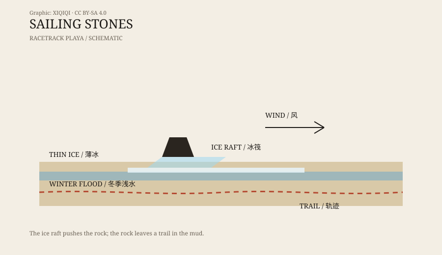

## 一、湖床上的轨迹

加州死亡谷国家公园，赛马场盐湖。

这是一片干涸的湖床，长约 4 公里，宽约 2 公里，四周是山。夏天热得发白，冬天地面会结冰。湖床上散落着深色的石头，大的有上百公斤，小的只有几百克。

奇怪的不是石头本身，而是它们身后的轨迹。

有的轨迹是直的，有的是弧线，有的绕了一圈又转回来。轨迹深浅不一，最长可达几百米。石头停在轨迹的末端，像是自己走到那里，然后停下。

从 1915 年开始，就有人记录这些轨迹。几十年来，没人看到石头移动的过程。

## 二、几十年的猜测

关于石头为什么会动，出现过很多解释。

有人说是风。湖床空旷，风很大，石头可能被风吹动。但问题是，石头太重，风不大可能直接吹动它们。

有人说是冰。冬天湖床会积水、结冰，石头可能被冰带着走。这个方向后来被证明是对的，但当时没有直接证据。

有人说是地震、磁场、动物、甚至恶作剧。每一种解释都能说通一部分，但都不能解释所有轨迹。

研究者给石头做过标记，测过风速，拍过照片，但很少拍到移动的瞬间。赛马场盐湖太偏远，冬天太冷，条件太难凑齐。

## 三、2014 年的冬天

2014 年，一个研究团队终于等到了机会。

他们在湖床上放了 GPS 标记的石头，架起延时相机，整个冬天盯着。2013 年 12 月到 2014 年 1 月，湖床积了浅水。夜里气温下降，水面结了一层薄冰。白天太阳出来，冰层开始破裂。

风来了。不是狂风，只是足以推动冰层的风。

冰层裂成一块块薄片，像木筏一样在水面上漂。石头被冻在冰里，或者卡在冰下。风推着冰筏，冰筏带着石头，石头在湖床的软泥上划出轨迹。

整个过程很慢，但相机拍到了。石头移动的速度，大约是每分钟几米。

## 四、机制

这个机制听起来简单，但需要几个条件同时满足。

第一，湖床要积水。水不能太深，否则石头会被淹没；也不能太干，否则没有冰。

第二，夜里要冷到结冰。薄冰必须足够结实，能把石头冻住或卡住。

第三，白天要有一点风。风不需要很大，只要能推动冰筏。

第四，冰要裂开。整块冰太重，推不动；裂成小块，才能被风带着走。

石头不是在泥上“滑”，而是被冰筏推着走。轨迹的形状，取决于风向、冰的破裂方式和石头的形状。

*原创示意图：薄冰、风与石头如何形成轨迹。不是实测比例。稀奇奇编辑部，CC BY-SA 4.0。*

## 五、为什么不是超自然

赛马场盐湖的石头没有魔力，也没有被外星人移动。

它们是真的石头，轨迹是真的轨迹，机制是物理的：水、冰、风、泥。之所以几十年没被解释，是因为条件罕见，地点偏远，而且没有人刚好在冬天最冷的那几天守在湖边。

这个案例有意思的地方在于：它曾经是一个“未解之谜”，后来变成了一个“已解之谜”。但即使答案出来了，看到石头和轨迹的那一刻，还是会觉得它们像自己走出来的。

## 六、今天去看

赛马场盐湖是受保护的国家公园区域。

游客可以沿着指定道路进入，但不能开车上湖床，不能移动石头，也不能带走任何东西。轨迹很脆弱，一个脚印或一道车辙，可能保留很多年。

石头还在那里。它们大多数时候不动，只是在冬天最合适的几天里，慢慢地走一小段。

## 湖床上的轨迹

赛马场干湖在美国加州死谷国家公园。

湖床平坦，面积很大，下雨时会积水，干旱时变成一层泥壳。石头上留着长长的轨迹，有的直线，有的转弯，有的互相交叉。

这些轨迹几十年没有变化，看起来像石头自己走过。

## 2014 年

2014 年，研究者用 GPS 和相机记录了石头的移动。

冬天，湖床结了一层薄冰。白天，冰融化，形成一块块浮冰。风把浮冰推着走，浮冰把石头夹住，一起移动。石头在泥里留下轨迹，浮冰融化后，轨迹留在原地。

这个机制不需要超自然力量，只需要冰、风和水。

## 为什么以前没发现

赛马场干湖很偏远，冬天很冷，夏天很热。

石头移动的条件很窄：需要先下雨，形成浅水；需要夜里结冰；需要白天融化；需要风。研究者等了很久，才等到一次完整的记录。

以前的观察者看到的只是轨迹，没有看到移动的过程。轨迹很慢，石头一年可能只移动几米，人不可能一直守着。

## 今天去看

今天，赛马场干湖是国家公园的一部分。

游客可以去看石头和轨迹，但不能带走石头。公园会提醒人，不要踩踏泥壳，不要推石头。轨迹是自然遗产，不是玩具。

“会航行的石头”听起来像奇迹。它的答案，是一层薄冰和一阵风。

## 补记

赛马场干湖的石头，移动得很慢。研究者用 GPS 记录了一年，才发现它们只在特定的冬天走动。一个人如果只来一次，看到的只是静止的石头。自然的节奏，有时比人的耐心慢得多。

## 档案的位置

会走的石头是“自然机制”类档案。它曾经是超自然的候选，后来被冰、风和 GPS 解释。解释没有让它变得无聊，反而让它更精确：石头不是在“自己走”，而是在一层薄冰上被风推着走。

## 余记

“会航行的石头”这个名字，是记者起的。研究者更愿意叫“冰筏移动”。两个名字说的是同一件事，但一个卖报纸，一个写论文。名字的选择，决定了读者先看到奇迹，还是先看到机制。

石头不会自己走。它们只是搭上了一层薄冰，被风推着，走了一小段路。

---

**来源与许可**：本文的事实来源见条目底部来源台账 S1–S3。文字与原创示意图采用 CC BY-SA 4.0。赛马场盐湖的移动机制已有直接观测支持；本文区分了历史猜测与 2014 年的观测结果。
