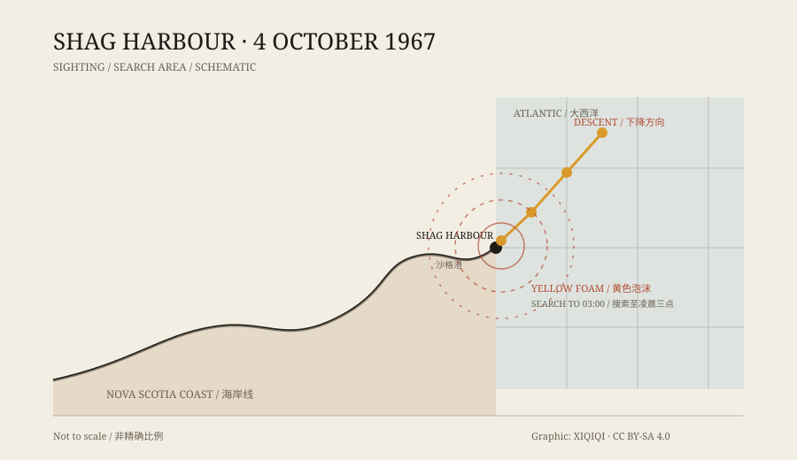

## 1. Shag Harbour

Shag Harbour sits on the south shore of Nova Scotia, a village that lives off lobster fishing. It is small, the winter wind is hard, and the sea is usually the colour of lead.

Wednesday, 4 October 1967. Around 11:20 p.m., several residents were still outside.

## 2. The descent

They saw something coming from the north.

It flew low, barely above the treetops, carrying several yellow lights. It made no sound and moved slowly at a shallow angle, as if it meant to land on the water. Some thought it was an aircraft in trouble; others thought it was a flare.

It came down to the surface and disappeared.

The witnesses ran to the wharf, rounded up fishermen, and went out in boats. There was a patch of yellow foam on the water, bright in the dark, as if something had just gone under and stirred it up. The patch was not large, but its shape was regular.

*Original schematic: the direction of the sighting, the entry point, and the search area on the night of 4 October 1967. Not a precise chart. Oddity Archive, CC BY-SA 4.0.*

## 3. The search

The RCMP came down to the shore. The coast guard arrived by boat. The search went on until about three in the morning. No wreckage, no oil, no people.

If an aircraft had gone into the sea, there should have been debris, a fuel slick, or at least a visible disturbance. If a boat had capsized, there should have been a distress call, a name, a family asking questions. That night there was nothing.

## 4. The official file

The RCMP wrote a report. The report used the word “UFO.”

This was not a tabloid phrase. It was a record in a Canadian government file. The Department of National Defence checked its records and confirmed that no military aircraft was missing and no exercise was underway.

Of the many “unidentified flying object” reports on file, only a small number were explicitly recorded as UFOs in official documents. Shag Harbour is one of them.

## 5. Underwater

A few days later, Royal Canadian Navy divers went down.

The bottom was mud and rock, with very little visibility. The divers found no metal, no engine, and nothing that did not belong in the harbour.

Another story came later: that the object had not stopped at Shag Harbour but travelled underwater to Shelburne Harbour, tens of kilometres away, where other people saw lights. That account comes from later testimony, not from the first file, and has no physical evidence.

## 6. The usual explanations

An aircraft? No matching missing flight.

A meteor? A meteor burns up high, does not fly level just above the water, and does not leave yellow foam.

A lighthouse or a ship's light? The position and motion do not fit.

A flare? No military exercise was recorded that night.

A submarine? No evidence — and submarines do not fly.

Each explanation covers part of the case and leaves the rest. The file stayed open in the archive.

## 7. Afterwards

The people of Shag Harbour did not forget. A local society collected testimony, clippings, and official documents. Every October, someone in the village still brings up that night.

For a small fishing village, it is a story that can last generations. For the archive, it is a single page without a conclusion: on a certain night, an unidentified object fell into the sea, and the search found nothing.

---

**Sources and licenses**: the factual sources are listed in the source ledger S1–S3 at the bottom of this entry. Text and original diagrams are licensed under CC BY-SA 4.0. “UFO” here is the term used in the official file at the time; it does not mean an alien spacecraft. Later stories are not presented as established fact.
