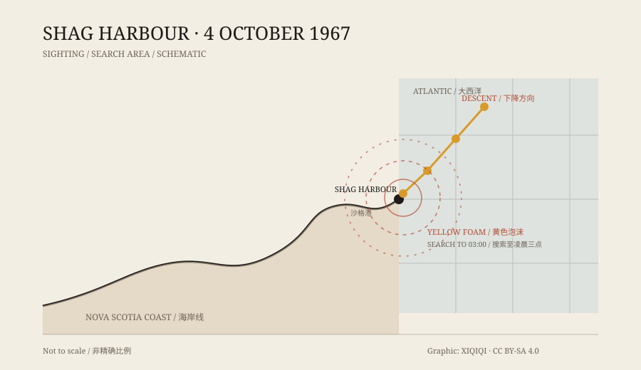

## 1. Shag Harbour

Shag Harbour sits on the south shore of Nova Scotia, a village that lives off lobster fishing. It is small, the winter wind is hard, and the sea is usually the colour of lead.

Wednesday, 4 October 1967. Around 11:20 p.m., several residents were still outside.

## 2. The descent

They saw something coming from the north.

It flew low, barely above the treetops, carrying several yellow lights. It made no sound and moved slowly at a shallow angle, as if it meant to land on the water. Some thought it was an aircraft in trouble; others thought it was a flare.

It came down to the surface and disappeared.

The witnesses ran to the wharf, rounded up fishermen, and went out in boats. There was a patch of yellow foam on the water, bright in the dark, as if something had just gone under and stirred it up. The patch was not large, but its shape was regular.

*Original schematic: the direction of the sighting, the entry point, and the search area on the night of 4 October 1967. Not a precise chart. Oddity Archive, CC BY-SA 4.0.*

## 3. The search

The RCMP came down to the shore. The coast guard arrived by boat. The search went on until about three in the morning. No wreckage, no oil, no people.

If an aircraft had gone into the sea, there should have been debris, a fuel slick, or at least a visible disturbance. If a boat had capsized, there should have been a distress call, a name, a family asking questions. That night there was nothing.

## 4. The official file

The RCMP wrote a report. The report used the word “UFO.”

This was not a tabloid phrase. It was a record in a Canadian government file. The Department of National Defence checked its records and confirmed that no military aircraft was missing and no exercise was underway.

Of the many “unidentified flying object” reports on file, only a small number were explicitly recorded as UFOs in official documents. Shag Harbour is one of them.

## 5. Underwater

A few days later, Royal Canadian Navy divers went down.

The bottom was mud and rock, with very little visibility. The divers found no metal, no engine, and nothing that did not belong in the harbour.

Another story came later: that the object had not stopped at Shag Harbour but travelled underwater to Shelburne Harbour, tens of kilometres away, where other people saw lights. That account comes from later testimony, not from the first file, and has no physical evidence.

## 6. The usual explanations

An aircraft? No matching missing flight.

A meteor? A meteor burns up high, does not fly level just above the water, and does not leave yellow foam.

A lighthouse or a ship's light? The position and motion do not fit.

A flare? No military exercise was recorded that night.

A submarine? No evidence — and submarines do not fly.

Each explanation covers part of the case and leaves the rest. The file stayed open in the archive.

## 7. Afterwards

The people of Shag Harbour did not forget. A local society collected testimony, clippings, and official documents. Every October, someone in the village still brings up that night.

For a small fishing village, it is a story that can last generations. For the archive, it is a single page without a conclusion: on a certain night, an unidentified object fell into the sea, and the search found nothing.

## The fall of 1967

The incident in the port of Sharq took place on the night of October 4, 1967.

The site is on the southern coast of Nova Scotia, Canada, near the sea of the port of Shag. Witnesses say that an object with light fell from the sky and did not explode, did not sink, but drifted for a while and disappeared.

The caller was a local resident, and the Royal Canadian Mounted Police and the Coast Guard were both present. The search lasted several days, and no debris was found, nor did any of the witnesses find the “foams” or “fragments”.

## The Cold War Sea

The North Atlantic in 1967 was a cold war listening area.

Any unidentified underwater object is taken seriously on the eastern coast of Canada, with naval bases, anti-submarine patrol aircraft, and sonic net. This is why the incident at Sharg Harbour was studied repeatedly: it was not seen by a single fisherman, but by police, military, and multiple civilians.

But “take seriously” does not mean “identify.” The Navy has limited search coverage, the topography of the sea floor is complex, and night visibility is poor. If an object is rapidly sinking or taken away by current, it leaves the search area within hours.

## No debris

The most famous sentence of the port of Sharq is, "Nothing is found."

No metal fragments, no oil, no radiation anomalies, no underwater debris. No sound sweeps the sea floor, no big objects. This leaves the event unproven or negative.

Some say that the object was later taken away by the United States Navy; some say that it was a crash plane; some say that it was a bait for Soviet submarines; none of these claims are documented.

## Archives and memory

The incident at Sharq port was later written into the Canadian UFO file and filmed as a documentary.

Its vitality lies not in what the light is, but in where it happened: a quiet fishing village, suddenly, came to the police, soldiers and journalists. For the first time, the villagers discovered that the sea surface at their door might be linked to national security.

Today, the port of Sharg is a fishing port. The sea is wide and the sky is blue. The light of that night is not back, and the file does not answer.

## Supplementary Notes

The most clear thing in the Sharq Port file is not that object, but the search process. The police, fishermen, coast guards and the navy record what they see. These records complement and contradict each other. The more an event is investigated, the more it leaves behind many different versions.

## Location of the archives

Sharg Harbour is a typical “official witness” type of file. It contains multiple testimonies from police, military, fishermen, and journalists, without physical evidence. Multiple testimonies make the events credible, and the absence of physical evidence makes it impossible to close the case.

## Memory

The official file of the port of Sharq was later partially made public. The documents contained search routes, eyewitness time and telephone records, and the conclusion that “no remains were found.” They did not provide answers, but provided a skeleton that could be verified. The story was not about suspicion, but about someone turning one page of the original record.

After the search, calm was restored to the sea. The light of that night left no traces, leaving only a few pages of reports and a village memory.

---

**Sources and licenses**: the factual sources are listed in the source ledger S1–S3 at the bottom of this entry. Text and original diagrams are licensed under CC BY-SA 4.0. “UFO” here is the term used in the official file at the time; it does not mean an alien spacecraft. Later stories are not presented as established fact.
