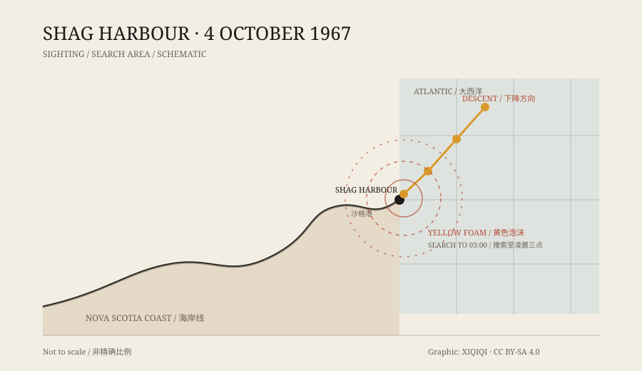

## 一、沙格港

沙格港在加拿大新斯科舍省的南岸，是个靠龙虾捕捞过日子的村子。人口不多，冬天风大，海面常年是铅灰色。

1967 年 10 月 4 日，星期三。夜里十一点二十分左右，几个居民还在外面。

## 二、下降

他们看见一个东西从北边过来。

它飞得很低，比树梢高不了多少，带着几盏黄灯。它没有声音，速度不快，角度很平，像是要落在海面上。有人以为是一架出了故障的飞机，有人以为是信号弹。

它一直降到海面，然后不见了。

目击者跑到码头，喊上渔民，开船出海。海面上有一片黄色泡沫，在黑暗里很显眼，像有什么东西刚刚沉下去，把水搅动了。泡沫的范围不大，但形状规整。

*原创示意图：1967 年 10 月 4 日夜里的目击方向、入水点和搜索范围。不是精确海图。稀奇奇编辑部，CC BY-SA 4.0。*

## 三、搜索

皇家骑警到了岸边。海岸警卫队的船也来了。搜索持续到凌晨三点左右，没有找到残骸，没有油污，也没有人。

如果是飞机坠海，海面应该浮着碎片、油膜，或者至少有一道明显的痕迹。如果是船翻了，应该有呼救、有名字、有家属来问。那一夜，什么都没有。

## 四、官方文件

皇家骑警写了一份报告。报告里用了“UFO”这个词。

这不是小报的说法，是加拿大官方档案里的记录。国防部也调了资料，确认当时没有军用飞机失踪，也没有演习。

在大量“不明飞行物”报告里，真正被官方文件明确记成“UFO”的并不多。沙格港是其中之一。

## 五、水下

几天后，加拿大皇家海军的潜水员下水搜索。

海底是泥沙和礁石，能见度很低。潜水员没有找到金属残骸、没有找到发动机、也没有找到任何不属于港口的东西。

后来又有人提出另一种说法：那个东西没有停在沙格港，而是沿着海底去了几十公里外的谢尔本港，那里也有人看见灯光。这个说法来自后来的证词，不在最初的档案里，也没有实物支持。

## 六、能想到的解释

飞机？没有匹配的失踪记录。

流星？流星会在高空烧完，不会贴着海面平飞，也不会留下黄色泡沫。

灯塔或船灯？位置和运动方式对不上。

照明弹？当晚没有军事演习的记录。

潜艇？没有证据，而且潜艇不会在空中飞。

每一个解释都能说通一部分，但都剩下另一部分。案子就这样留在了档案里。

## 七、后来

沙格港的居民没有忘记这件事。当地成立了事件协会，收集当年的证词、剪报和官方文件。每年十月，村里还会有人提起那一夜。

对一个小渔村来说，这是一件足以讲几代人的事。对档案来说，它只是一页没有结论的记录：某年某月某日，一个不明物体落入海中，搜索无果。

---

**来源与许可**：本文的事实来源见条目底部来源台账 S1–S3。文字与原创示意图采用 CC BY-SA 4.0。文中的“UFO”指当时官方档案使用的说法，不等于外星飞船；本文没有把后来流传的说法当成已证实的事实。
