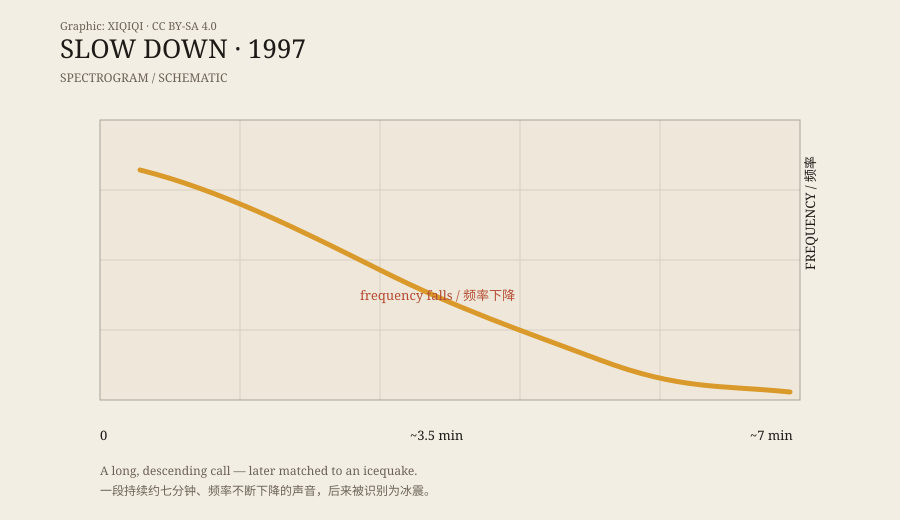

## 1. Seven minutes

In 1997, hydrophones deployed by NOAA in the equatorial Pacific recorded a very long sound.

About seven minutes. It was not an explosion, and it was not a whale song. It started low and kept going lower, the frequency falling until it disappeared into the background noise.

It sounded like something huge sinking slowly, or like a sigh stretched out for minutes.

The researchers gave it a descriptive name: Slow Down.

## 2. The name

The name comes from the shape.

Not from the action of slowing down, but from the way the sound moves on a spectrogram: a line running from upper left to lower right. The frequency falls; the time stretches.

Unlike Bloop, Slow Down did not gather many monster legends. Its name is not cartoonish or frightening. It sounds more like a technical note than a creature label.

But it still ended up on lists of “unexplained deep-sea sounds.”

## 3. The sloping line

A hydrophone does not record a “sound file.” It records pressure changes underwater over time. Researchers convert the data into a spectrogram: time on the horizontal axis, frequency on the vertical axis, and colour or brightness for energy.

Slow Down's spectrogram is distinctive. It is not a blur of noise. It is a clear, downward-sloping line. The energy is concentrated at low frequencies and falls away over time.

That descent is not typical of animal calls. Whale songs vary, but usually repeat phrases. Ship machinery is relatively steady. Earthquakes and icequakes can produce long, complex frequency changes.

Slow Down's falling curve matches some icequake signatures.

*Original schematic: the frequency of Slow Down falling over time. Not a measured spectrogram. Oddity Archive, CC BY-SA 4.0.*

## 4. Icequakes

An icequake is not a single sound.

Icebergs calving, ice shelves cracking, blocks of ice rolling, and ice scraping the seafloor all produce sound. Their frequency, duration, and rhythm vary, but they share a pattern: high energy, strong low-frequency content, and long propagation.

Slow Down's seven-minute length first made it seem like a long call from an animal. But icequakes can last a long time too. A huge mass of ice breaking and adjusting can produce sound continuously, forming a long, changing signal.

NOAA's later analysis concluded that Slow Down most likely came from an icequake, not an unknown creature.

## 5. How it differs from Bloop

Bloop and Slow Down are often discussed together, but they sound different.

Bloop is shorter and louder, like a heavy impact. Slow Down is longer and slower, like a low groan fading away.

Bloop's name sounds like a monster; Slow Down's name sounds like a technical note. The spread was different too: Bloop became an internet legend, while Slow Down mostly stayed on lists of unexplained sounds.

But both point in the same direction: ice.

## 6. The shape of a sound

What stays with me about Slow Down is not what it “might be,” but what it “looks like.”

On a spectrogram, it is a clean downhill line. You do not need to hear it to see that it is going down. That shape is how researchers separated it from animal calls, ship noise, and earthquake signals.

Sounds have shapes. We usually listen with our ears, not our eyes.

---

**Sources and licenses**: the factual sources are listed in the source ledger S1–S3 at the bottom of this entry. Text and original diagrams are licensed under CC BY-SA 4.0. The icequake explanation for Slow Down is supported by research; this article separates the recording, the spectral features, and the later identification.
