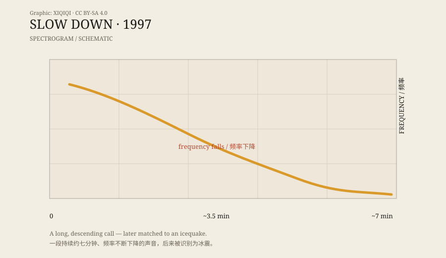

## 1. Seven minutes

In 1997, hydrophones deployed by NOAA in the equatorial Pacific recorded a very long sound.

About seven minutes. It was not an explosion, and it was not a whale song. It started low and kept going lower, the frequency falling until it disappeared into the background noise.

It sounded like something huge sinking slowly, or like a sigh stretched out for minutes.

The researchers gave it a descriptive name: Slow Down.

## 2. The name

The name comes from the shape.

Not from the action of slowing down, but from the way the sound moves on a spectrogram: a line running from upper left to lower right. The frequency falls; the time stretches.

Unlike Bloop, Slow Down did not gather many monster legends. Its name is not cartoonish or frightening. It sounds more like a technical note than a creature label.

But it still ended up on lists of “unexplained deep-sea sounds.”

## 3. The sloping line

A hydrophone does not record a “sound file.” It records pressure changes underwater over time. Researchers convert the data into a spectrogram: time on the horizontal axis, frequency on the vertical axis, and colour or brightness for energy.

Slow Down's spectrogram is distinctive. It is not a blur of noise. It is a clear, downward-sloping line. The energy is concentrated at low frequencies and falls away over time.

That descent is not typical of animal calls. Whale songs vary, but usually repeat phrases. Ship machinery is relatively steady. Earthquakes and icequakes can produce long, complex frequency changes.

Slow Down's falling curve matches some icequake signatures.

*Original schematic: the frequency of Slow Down falling over time. Not a measured spectrogram. XIQIQI Editorial, CC BY-SA 4.0.*

## 4. Icequakes

An icequake is not a single sound.

Icebergs calving, ice shelves cracking, blocks of ice rolling, and ice scraping the seafloor all produce sound. Their frequency, duration, and rhythm vary, but they share a pattern: high energy, strong low-frequency content, and long propagation.

Slow Down's seven-minute length first made it seem like a long call from an animal. But icequakes can last a long time too. A huge mass of ice breaking and adjusting can produce sound continuously, forming a long, changing signal.

NOAA's later analysis concluded that Slow Down most likely came from an icequake, not an unknown creature.

## 5. How it differs from Bloop

Bloop and Slow Down are often discussed together, but they sound different.

Bloop is shorter and louder, like a heavy impact. Slow Down is longer and slower, like a low groan fading away.

Bloop's name sounds like a monster; Slow Down's name sounds like a technical note. The spread was different too: Bloop became an internet legend, while Slow Down mostly stayed on lists of unexplained sounds.

But both point in the same direction: ice.

## 6. The shape of a sound

What stays with me about Slow Down is not what it “might be,” but what it “looks like.”

On a spectrogram, it is a clean downhill line. You do not need to hear it to see that it is going down. That shape is how researchers separated it from animal calls, ship noise, and earthquake signals.

A smooth descent looks more like a physical process: a bubble contracting, a piece of ice cracking, or a body of water changing shape. Animal calls rarely slide downward so neatly.

Sounds have shapes. We usually listen with our ears, not our eyes.

## Timeline

- **1997**: In 1997, hydrophones deployed by NOAA in the equatorial Pacific recorded a very long sound.

## Sources and evidence

The factual base of this entry rests on 1 independent source(s). S2 (NOAA Pacific Marine Environmental Laboratory) covers the relevant institutional record.
The original illustrations are scene reconstructions, diagrams, or maps, not historical photographs. The text separates documented record, later interpretation, and folklore; where sources disagree, the disagreement is left visible rather than smoothed away.

## Limits of the record

The records show that something was reported or measured; they do not necessarily show what caused it. The distance between observation, instrument data, and explanation is the space this archive keeps open.
The archive keeps the recording and the unanswered question side by side.
In credibility terms, this entry is marked 'verified'. The label describes the present state of evidence, not a final verdict on the story; it should change when new archival material appears.

## Archival note

The following note preserves archival sides of the story that the main text does not expand: provenance, technical detail, and aftermath.
The most reliable explanation still points to ice earthquakes or cetaceans.

Icebergs in the South Pacific break off, and the sound produced when they break can travel great distances. Large cetaceans also emit low-frequency calls, some of which change slowly in frequency. Both can leave sloping lines on the spectrogram.

But "the most reliable" does not mean "proven". Without video, without satellite imagery from the same time, without triangulation from a second independent array, the researchers could only rank the possibilities.
Slow Down's seven minutes is just enough time for one person to sit down and listen to it. It's not as brief as an explosion, nor as repetitive as a whale song. It's a continuously changing line that sounds like something is slowly moving away. People will understand this change as action, and action as life. This is the instinct of hearing and the beginning of the story.

This recording did not appear a second time. It's like a half-written line parked in a 1997 database, waiting for a confirmation that won't come.
The name "Slow Down" is remembered earlier than the data.

A name changes the listener's expectations. If it were called "South Pacific Low Frequency Event 1997-3," few people would click on it; if it were called "Slow Down," people would imagine something huge slowing down on the ocean floor.

This is the second layer of sound transmission: first there is an unexplainable signal, then there is a nice name, and finally there is a story that is much bigger than the signal.

---

**Sources and licenses**: the factual sources are listed in the source ledger S1–S3 at the bottom of this entry. Text and original diagrams are licensed under CC BY-SA 4.0. The icequake explanation for Slow Down is supported by research; this article separates the recording, the spectral features, and the later identification.
