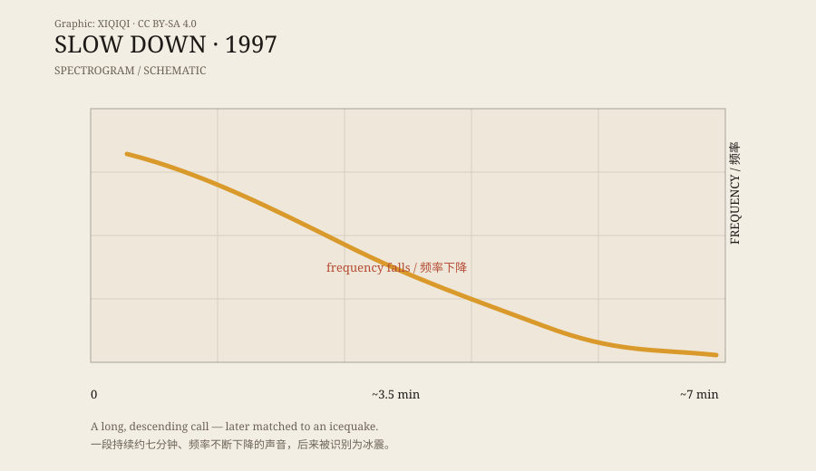

## 一、七分钟

1997 年，NOAA 在赤道太平洋布设的水听器，录到了一段很长的声音。

大约七分钟。不是一声爆炸，也不是一段鲸歌。它从一开始就比较低，然后一路往下走，频率越来越低，最后消失在背景噪声里。

听上去，像某个巨大的东西在缓慢下沉，或者像一声被拉得很长的叹息。

研究者给它起了一个描述性的名字：Slow Down。

## 二、名字

Slow Down 的名字来自它的形状。

不是“慢下来”这个动作，而是声音在频谱图上的走向：一条从左上往右下延伸的线。频率在下降，时间在拉长。

和 Bloop 不同，Slow Down 没有那么多“巨兽”传说。它的名字不够卡通，也不够吓人。它更像一个技术描述，而不是一个怪物标签。

但它同样被列进了“未知深海声音”的名单。

## 三、频谱图上的斜线

水听器录到的不是“声音文件”，而是水下压力随时间的变化。研究者把数据转换成频谱图：横轴是时间，纵轴是频率，颜色或亮度表示能量。

Slow Down 的频谱图很特别。它不是一团模糊的噪声，而是一条清晰的、向下倾斜的线。能量集中在低频，随着时间的推移逐渐降低。

这种“下降”不是动物叫声的典型特征。鲸歌会变化，但通常有重复的乐句；船只的机械声比较稳定；地震和冰震则可能产生长而复杂的频率变化。

Slow Down 的下降曲线，和冰震的某些特征对得上。

*原创示意图：Slow Down 的频率随时间下降。不是实测频谱。稀奇奇编辑部，CC BY-SA 4.0。*

## 四、冰震

冰震不是一种单一的声音。

冰山崩解、冰架断裂、冰块翻转、冰体刮擦海底，都会产生声音。这些声音的频率、时长和节奏各不相同，但它们有一个共同点：能量很大，低频成分丰富，可以传播很远。

Slow Down 的七分钟长度，一开始让人觉得它像某种生物的长 call。但冰震也可以持续很久。巨大的冰体在断裂和调整的过程中，会连续产生声音，形成一条长长的、变化的信号。

NOAA 后来的分析认为，Slow Down 最可能的来源也是冰震，而不是未知生物。

## 五、和 Bloop 的区别

Bloop 和 Slow Down 经常被放在一起讨论，但它们听起来不一样。

Bloop 更短、更响，像一声沉重的撞击；Slow Down 更长、更慢，像一段逐渐消失的低频呻吟。

Bloop 的名字更像怪物，Slow Down 的名字更像技术笔记。传播效果也不同：Bloop 成了网络传说，Slow Down 更多出现在“未解声音”列表里。

但它们最后指向了同一个方向：冰。

## 六、声音的形状

Slow Down 让我印象最深的，不是它“可能是什么”，而是它“看起来像什么”。

在频谱图上，它是一条干净的下坡线。你不需要听懂声音，也能看出它在往下走。研究者就是靠这种形状，把它和生物叫声、船只噪声、地震信号区分开来。

声音是有形状的。只是我们平时用耳朵听，很少用眼睛看。

---

**来源与许可**：本文的事实来源见条目底部来源台账 S1–S3。文字与原创示意图采用 CC BY-SA 4.0。Slow Down 的冰震解释已有研究支持；本文区分了录音事实、频谱特征和后来的识别。
