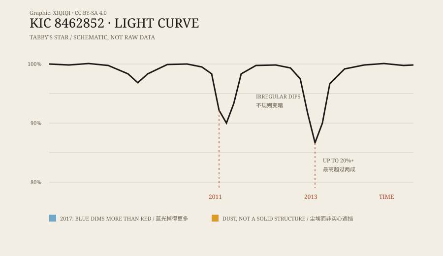

## 1. The people reading the data

In 2009, the Kepler space telescope went into orbit. It stared at a patch of sky in Cygnus and measured the brightness of more than a hundred thousand stars, looking for the tiny dips caused by planets passing in front of them.

The data was public. Volunteers in the Planet Hunters project helped scan the light curves for anything that did not look like an ordinary planetary transit.

In 2015, a team led by Tabetha Boyajian published a paper describing a star catalogued as KIC 8462852. Its brightness changes did not look like those of almost any star people had seen before.

It became known as Tabby's Star.

## 2. Dimming without a schedule

Most stellar light curves have a rhythm. A planet goes around, the brightness drops a little, then returns. Two stars eclipsing each other repeat on a regular period.

Tabby's Star did not.

It would fade over several days, recover, and then drop again later. In 2011 and 2013, Kepler recorded two especially deep dips, the deepest more than twenty percent. There was no fixed period, and no two dips had the same shape.

For a stable star, that is unusual.

*Original schematic: the irregular dimming of Tabby's Star during the Kepler mission. The curve is illustrative, not raw data. Oddity Archive, CC BY-SA 4.0.*

## 3. The alien megastructure

In 2015, the astronomer Jason Wright suggested a possibility: if a star were surrounded by enormous solar collectors — say, a swarm of segmented satellites — they could block different fractions of its light and produce irregular dips.

In the paper, this was only one candidate explanation, and it was explicitly labelled as unusual. Once it reached the media, it became “aliens built a giant structure.”

Boyajian herself stayed cautious. The data was strange, she said, but strange did not mean alien. The more common scientific approach is to look for a natural explanation first.

## 4. What the colours showed

If the thing blocking the light were a solid object, it should block all colours equally: blue and red would dim together.

Dust behaves differently. Dust grains scatter short wavelengths more strongly, so blue light drops more than red. In other words, the star should look redder as it fades.

After 2017, ground-based telescopes observed several new dimming events at multiple wavelengths. The results supported dust: when the star faded, blue light did drop more.

A huge opaque structure would struggle to explain that colour change. Dust can.

## 5. Where the dust comes from

That part is not fully assembled.

Some researchers suggest a family of comets or small bodies breaking up near the star and leaving a trail of dust. Others propose debris from a planetary collision, or a dusty disk that was already there.

The difficulty is that dust should emit infrared radiation, and early observations did not show as much infrared as expected. Later work has tried to explain the mismatch through grain size, orbit, and distribution, but no model has satisfied everyone.

## 6. Now

Tabby's Star is still monitored by ground-based telescopes. Its dimming is not a one-time news story but an ongoing record.

The case leaves a clear set of layers: the dimming is real and the data is public; the “alien megastructure” was an early hypothesis, not a conclusion; dust is currently the strongest explanation, but its exact source is still being studied.

A single star's light has kept this many people looking up for this long. That is rare in itself.

---

**Sources and licenses**: the factual sources are listed in the source ledger S1–S3 at the bottom of this entry. Text and original diagrams are licensed under CC BY-SA 4.0. This article separates the observations, the popular story, and the later research; the “alien megastructure” was a historical candidate hypothesis.
