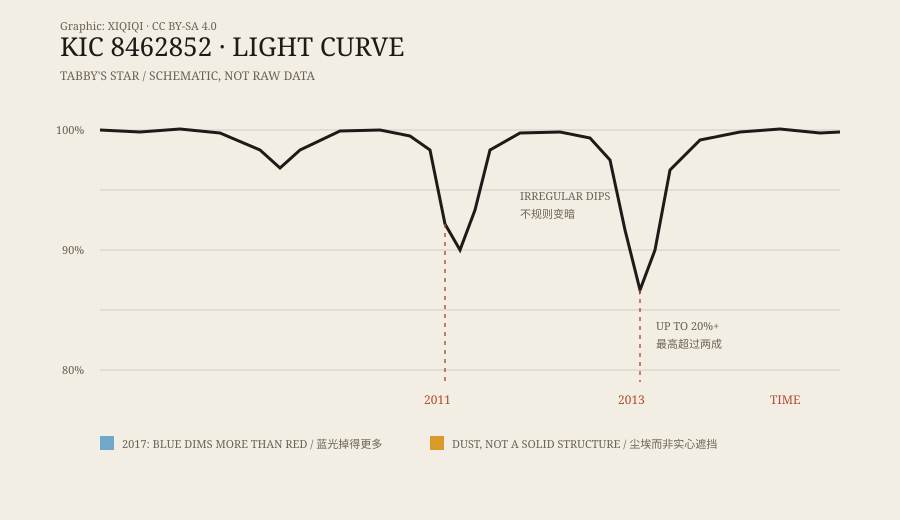

## 一、看数据的人

2009 年，开普勒望远镜升空。它盯着天鹅座的一片天区，连续记录十几万颗恒星的亮度，想找的是行星从恒星前面经过时留下的微小暗号。

数据是公开的。一批志愿者在“行星猎人”项目里帮忙看曲线，专门找那些不像行星凌日的异常。

2015 年，一个由塔贝莎·博亚吉安带领的团队发表论文，描述了一颗编号 KIC 8462852 的恒星。它的亮度变化，和人们见过的绝大多数恒星都不一样。

后来，人们用她的名字称呼它：塔比星。

## 二、没有规律的暗

大多数恒星的光变是有节奏的。行星绕一圈，亮度掉一点，再回来；双星互相遮挡，也会按周期重复。

塔比星不是。

它会在几天里慢慢变暗，然后恢复；过一阵子，又突然掉下去。2011 年和 2013 年，开普勒记录到两次特别深的下降，最深的一次超过两成。曲线没有固定周期，每次的形状也不一样。

对一颗稳定的恒星来说，这很不寻常。

*原创示意图：塔比星在开普勒观测期间的不规则变暗。曲线为示意，不是原始数据。稀奇奇编辑部，CC BY-SA 4.0。*

## 三、外星建筑

2015 年，天文学家杰森·赖特提出一种可能性：如果一颗恒星周围有巨大的太阳能收集装置，比如一圈分段的卫星，从地球上看，它可能会挡住不同比例的光，形成不规则的暗。

这个想法在论文里只是一个候选解释，而且被明确标为“不寻常”。但它一进入媒体，就变成了“外星人建了巨型建筑”。

博亚吉安本人一直很谨慎。她说，数据确实奇怪，但奇怪不等于外星人。科学上更常见的做法，是先找自然解释。

## 四、颜色给出的线索

如果挡光的是一个实心物体，它应该不分颜色地挡住星光：蓝光、红光一起变暗。

如果是尘埃，情况不一样。尘埃颗粒对短波的散射更强，蓝光会比红光掉得更多。换句话说，恒星变暗的时候，颜色会偏红。

2017 年之后，地面望远镜在几次新的变暗事件中做了多波段观测。结果支持尘埃：变暗时，蓝光确实掉得更多。

一个巨大的不透明建筑，很难解释这种颜色变化。尘埃可以。

## 五、尘埃从哪里来

答案还没有完全拼好。

有研究者认为，是一群彗星或小型天体在靠近恒星时碎裂，撒出了一条尘埃带。也有人提出，是行星碰撞留下的碎片，或者恒星附近本来就有一圈尘埃盘。

麻烦在于，尘埃会发出红外辐射，而早期观测没有看到预期中那么强的红外信号。后来的研究尝试用尘埃颗粒的大小、轨道和分布来解释这个矛盾，但还没有一个让所有人满意的模型。

## 六、现在

塔比星仍然被地面望远镜持续监测。它的光变不是一次性的新闻，而是一段还在继续的记录。

这件事留下了一个清晰的分层：变暗是真实的，数据是公开的；“外星建筑”是早期的猜测，不是结论；尘埃是目前最有力的解释，但尘埃的具体来源仍在研究。

一颗星的光，能让这么多人抬头看这么久，本身已经很少见。

---

**来源与许可**：本文的事实来源见条目底部来源台账 S1–S3。文字与原创示意图采用 CC BY-SA 4.0。文中区分了观测数据、媒体流传的说法和后来的研究结论；“外星建筑”只是历史上的一个候选假设。
