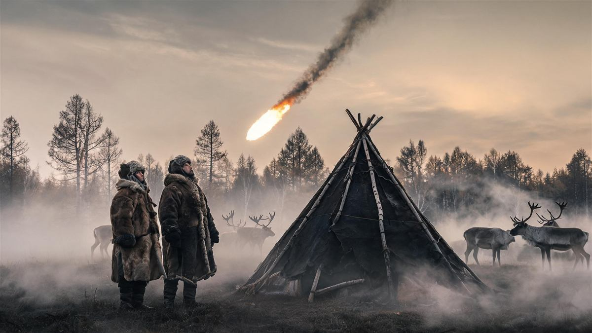
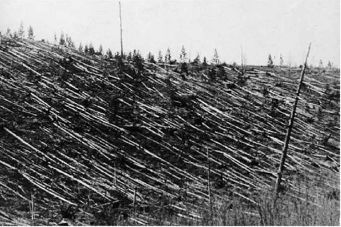
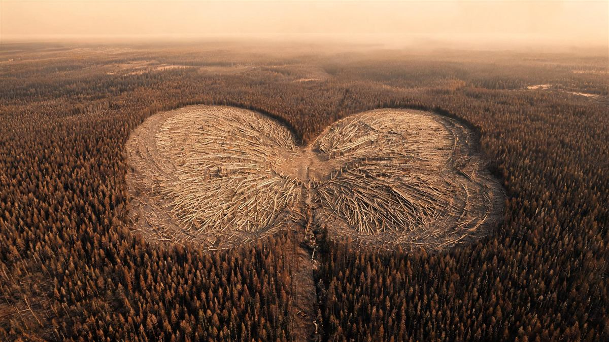
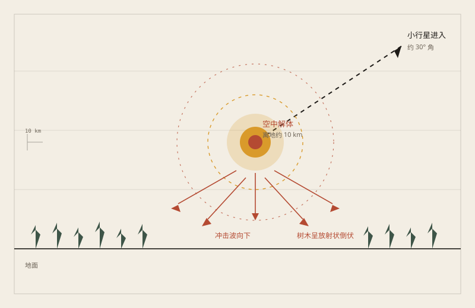
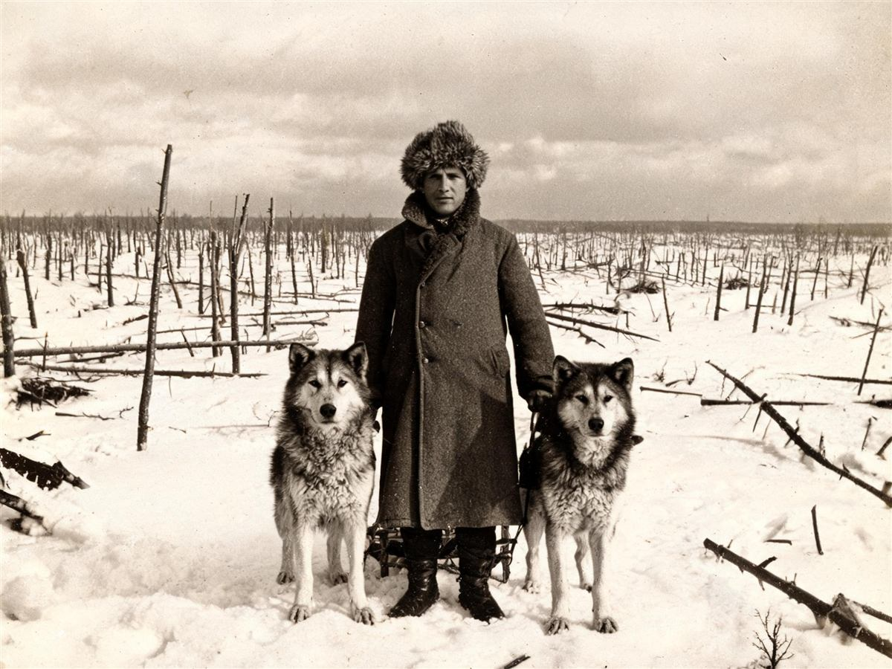
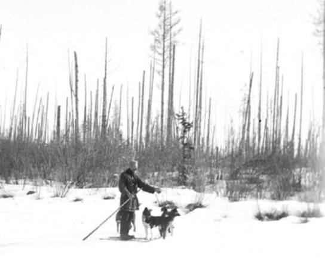
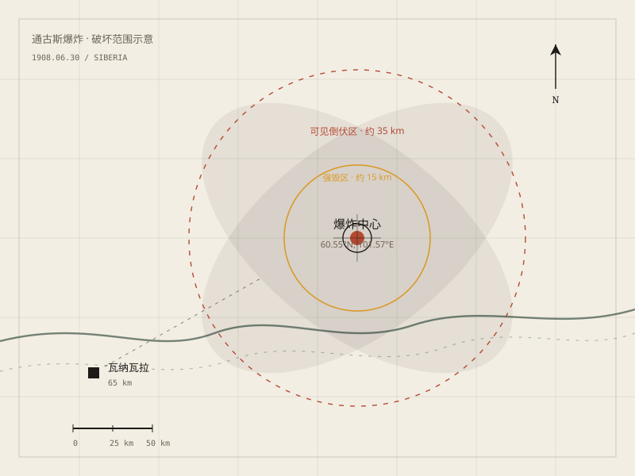

## 1. 7:17 in the morning

June 30, 1908. Seven seventeen in the morning, central Siberia.

Semyonov, a merchant in the trading post of Vanavara, was standing in his doorway. He later recalled that the sky to the north brightened first, brighter than sunrise. Then a wave of heat pushed him off his feet. A few seconds later came a sound he would hear only once in his life.

Sixty kilometres away, the water in the river shivered. Farther off, in Irkutsk, a seismograph drew a short, steep line. Even farther, barographs across Europe recorded the same instant of pressure.

Near the Tunguska River, the Evenki saw something more direct: a fireball brighter than the sun, coming down from the south, dragging a long tail, and breaking apart above the forest. Some thought the world was ending. Some dropped their reindeer and ran. An old man later told the expedition that when the fireball passed, it felt as if two hands had clamped over his ears.

The forest went down. Not burned down. Pushed down. From the air, the fallen trees looked like an enormous pair of butterfly wings, spreading out from the blast centre.

*Reconstruction illustration: the fireball over a camp. Not a historical photograph.*

## 2. Fire from the sky

For several days after the explosion, Europe talked about one thing: the nights were too bright.

London newspapers reported that you could read at night without a lamp. The sky over Edinburgh glowed yellow-green until dawn. Swedish photographers found an impossible brightness on their plates. Some said it was the aurora. Some said volcanic ash. Some said the sun had gone wrong.

No one thought the cause was thousands of kilometres away in Siberia.

Russia was in turmoil. Scientific expeditions had to wait their turn. It was not until 1921 that the mineralogist Leonid Kulik organised the first serious party. He followed the stories the locals told him, north, until he reached a forest he had never seen before.

## 3. Nineteen years later

In 1927, Kulik finally stood at the edge of the blast.

What he found was not a crater. It was a forest lying on its side. Trunks flat against the ground, roots in the air, as if a giant hand had pressed down from above. Stranger still, the trees near the centre were still standing. They had been stripped of bark and branches, reduced to blackened poles.

Kulik wrote that he had never seen anything like it. He had expected a crater. He found a swamp and a few standing dead trees.

He refused to give up. For years he dug, searched, and even tried to drain the swamp. No meteorite. No crater. No decent fragment.

*Historical photograph: the fallen forest, taken by Kulik's expedition in the 1920s. Leonid Kulik / Soviet Academy of Sciences, via NASA History.*

*Reconstruction illustration: from the air, the fallen forest looks like a butterfly. Not a historical photograph.*

## 4. No crater

The problem was concrete: if a rock falls from the sky, it should leave a hole. Tunguska had no hole.

Later calculations gave an answer that is not intuitive: the object may never have reached the ground. It broke apart five to ten kilometres up. A body entering the atmosphere at high speed is compressed and heated by the air in front of it, and it releases most of its energy before impact. The shock wave went down and pushed the forest over. The heat went up and lit the sky.

That explains a lot. No crater, because the explosion happened in the air. No meteorite, because most of the object was vaporised. Standing trees with stripped bark, because the shock wave came almost straight down.

It also explains why the trees near the centre did not fall. They were in the middle of the downdraft, pushed vertically rather than sideways.

*Original diagram: how an airburst flattens a forest. Oddity Archive, CC BY-SA 4.0.*

## 5. What came down

So what was it?

The most common explanation is a stony asteroid about fifty to sixty metres across, entering the atmosphere at more than ten kilometres per second and breaking apart above Tunguska. The energy it released was roughly a thousand times that of the Hiroshima bomb.

Others have proposed a comet. A comet is icy, breaks apart more easily at altitude, and would explain the lack of fragments. But a comet is also loose and fragile, and it is not obvious that it could produce such a powerful shock wave.

There are more exotic guesses: antimatter, a microscopic black hole, an alien spacecraft. They are exciting. They have no reliable evidence and leave nothing testable behind.

The safest statement is this: a small body exploded in the air. Whether it was an asteroid or a comet is still unsettled.

*Reconstruction illustration: the expedition reaches the site nineteen years later. Not a historical photograph.*

*Historical photograph: the “telegraph pole” trees near the blast centre, 1929. Leonid Kulik / Soviet Academy of Sciences, via NASA History.*

## 6. Will it happen again

Tunguska was not unique.

In 2013, an asteroid about twenty metres across exploded over Chelyabinsk, Russia. It shattered thousands of windows and injured more than a thousand people. Its energy was a fraction of Tunguska's, and it was still enough for a city to remember.

Astronomers now track most near-Earth asteroids, but small bodies like the Tunguska object are still hard to find in advance. They are too small, too dark, and they only become bright when they enter the atmosphere.

More than a century has passed. The forest has grown back. The fallen trees have rotted; new trees have pushed up between them. From a satellite, the area looks much like the forest around it.

Only the old people still tell the story: the sky split open, the fire came from the north, and then there was a very long sound.

*Original map: the approximate extent of the 1908 Tunguska blast. Oddity Archive, CC BY-SA 4.0.*

---

**Sources and licenses**: the factual sources, historical photographs, and original diagrams are listed in the source ledger S1–S8 at the bottom of this entry. Text, original maps, and reconstruction illustrations are licensed under CC BY-SA 4.0. Reconstruction illustrations are not historical photographs and should not be treated as evidence.
