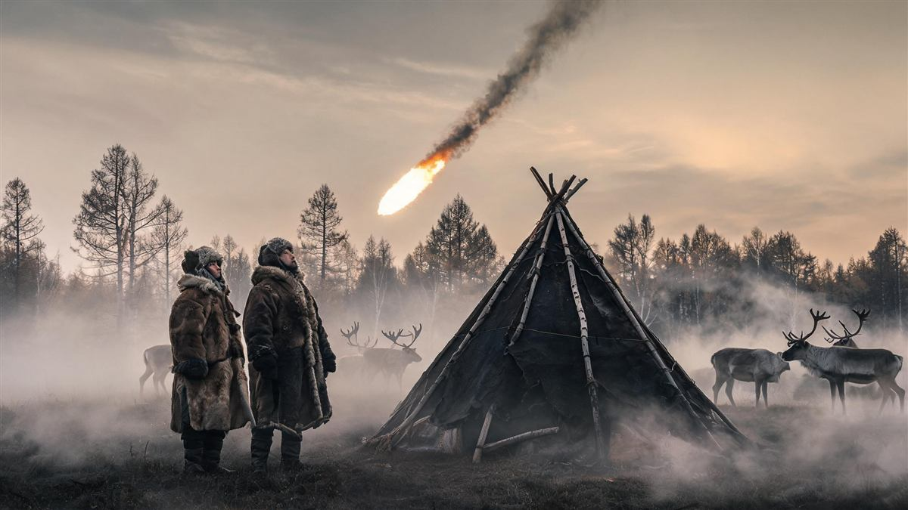
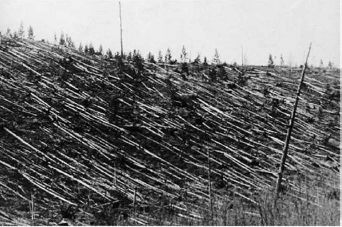
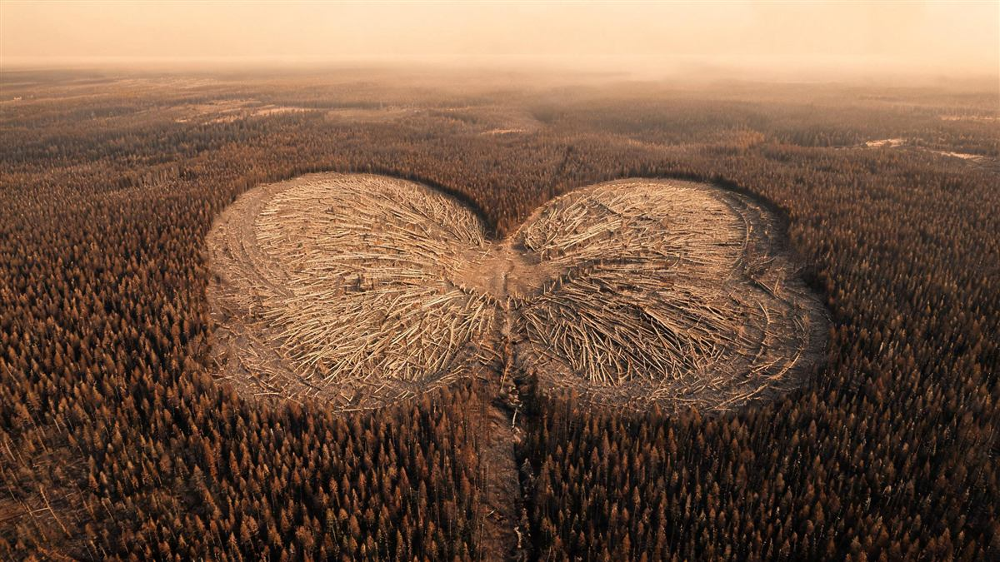
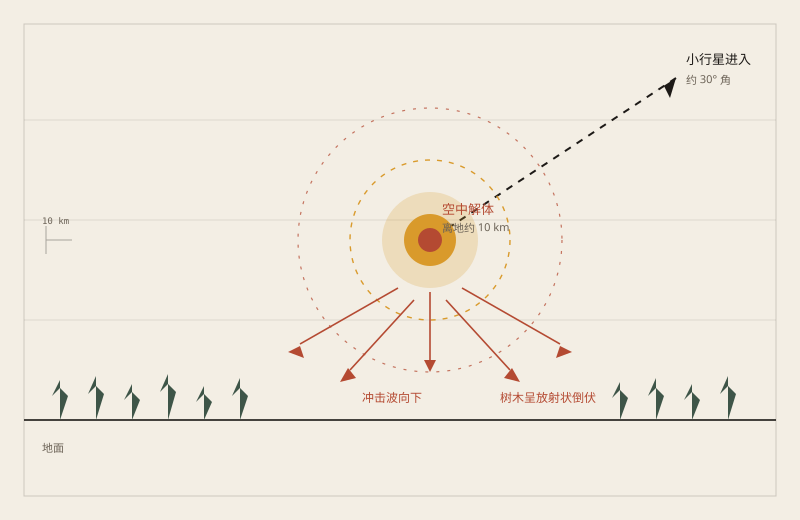
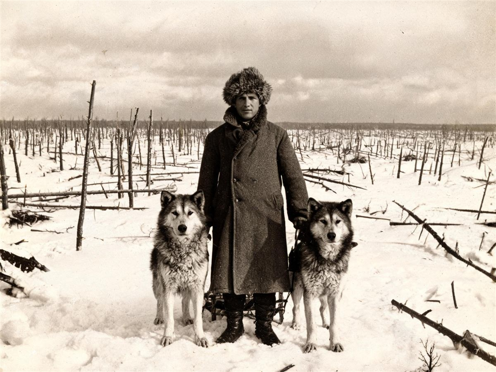
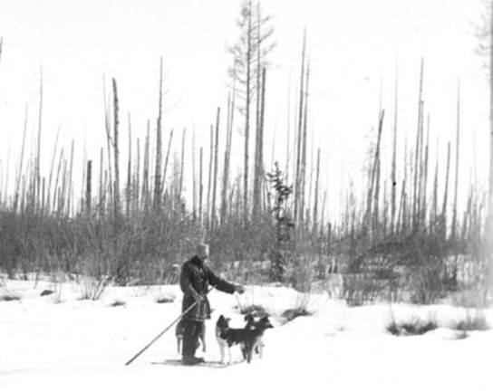
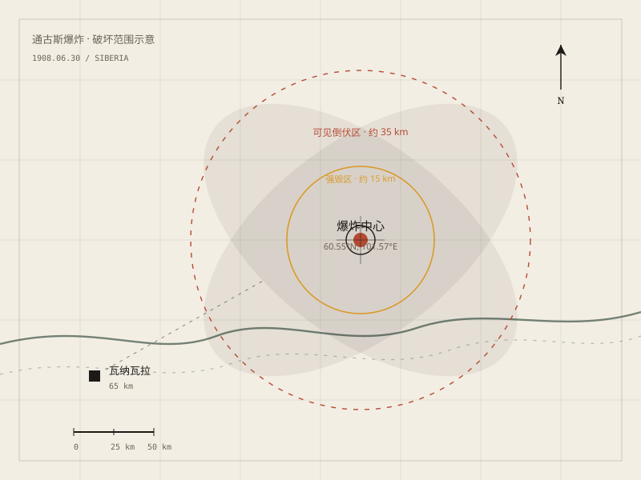

## 一、早上七点十七分

1908 年 6 月 30 日，早上七点十七分，西伯利亚中部。

瓦纳瓦拉的商人谢苗诺夫正站在自家店铺门口。他后来回忆，北边的天空先亮了一下，亮得不像日出。紧接着，一股热浪从背后推过来，他整个人被掀到门外的地上。几秒钟后，是一声他这辈子只听过一次的巨响。

六十公里外，河水被震得晃了一下。更远的伊尔库茨克，地震仪画出一条短而陡的线。再远一点，欧洲的气压计也记录了同一瞬间的扰动。

那天早上，通古斯河附近的鄂温克人看到的东西更直接：一团比太阳还亮的火球，从南边压下来，拖着一条长长的尾巴，最后在森林上方炸开。有人以为世界要结束了，有人扔下驯鹿就跑。一个老人后来对考察队说，火球经过时，他感觉自己的耳朵被两只手同时捂住。

森林倒下了。不是被烧倒的，是被推倒的。后来的人从空中看，倒下的大树像一片巨大的蝴蝶翅膀，以爆炸点为中心，朝两侧铺开。

*场景复原插图：火球掠过营地。不是历史照片。*

## 二、天空来的火

爆炸之后的几天，整个欧洲都在谈论一件事：夜晚太亮了。

伦敦的报纸说，晚上不用点灯也能看报。爱丁堡的天空整夜泛着一种奇怪的黄绿色。瑞典的摄影师发现，底片上出现了不该有的亮度。有人说那是北极光，有人说那是火山灰，也有人说是太阳出了毛病。

没有人想到，原因在几千公里外的西伯利亚。

当时的俄国正处在动荡里，科学考察要排队。直到 1921 年，矿物学家列昂尼德·库利克才组织起第一支像样的队伍。他沿着当地人提供的线索，往北走，走到一片他从未见过的森林。

## 三、十九年后

1927 年，库利克终于站在爆炸点的边缘。

他看到的不是陨石坑，而是一片倒伏的森林。树干贴着地面，树根朝天，像被一只巨手从上方按下去。更奇怪的是，爆炸中心附近的树没有倒，它们还站着，但树皮被剥光，树枝被折断，像一根根烧焦的电线杆。

库利克在日记里写，他从来没有见过这样的景象。他原本以为会找到一个巨大的陨石坑，结果只找到一片沼泽和几棵站着的枯树。

他不甘心。接下来的几年，他继续挖，继续找，甚至把沼泽里的水抽干。没有陨石，没有坑，没有一块像样的碎片。

*历史照片：1920 年代，库利克考察队拍摄的倒伏森林。Leonid Kulik / 苏联科学院考察队，经 NASA History 转载。*

*场景复原插图：从空中看，倒伏区像一只展开的蝴蝶。不是历史照片。*

## 四、没有坑

问题变得很具体：如果天上掉下来一块石头，它应该在地上留下一个坑。通古斯没有。

后来的计算给出了一个不太直观的答案：那块东西可能根本没有落到地面。它在五到十公里的高空就炸开了。高速进入大气层的天体，在空气里被急剧压缩、加热，然后在到达地面之前释放掉大部分能量。冲击波向下压，把森林推倒；热量向上走，把天空照亮。

这解释了很多事：没有坑，因为爆炸发生在空中；没有陨石，因为大部分物质被气化；树站着但被剥皮，因为冲击波是从上方垂直压下来的。

也解释了为什么爆炸点附近的树没有倒：它们正好在冲击波的下洗气流中心，受力方向是垂直的，反而没有被横向推倒。

*原创示意图：空爆如何推倒森林。稀奇奇编辑部，CC BY-SA 4.0。*

## 五、天上下来的东西

那么，掉下来的到底是什么？

最常见的解释是一颗石质小行星，直径大约五十到六十米，以每秒十几公里的速度进入大气层，在通古斯上空解体。它释放的能量，大约相当于一千颗广岛原子弹。

也有人提出彗星假说。彗星含冰，更容易在高空解体，也更容易解释为什么找不到碎片。但彗星假说也有麻烦：彗星物质太松散，未必能产生那么强的冲击波。

还有更边缘的猜测：反物质、微型黑洞、外星飞船。它们听起来很刺激，但没有可靠证据，也没有留下可检验的痕迹。

目前最稳妥的说法是：一颗小天体在空中爆炸，具体是小行星还是彗星，还没有定论。

*场景复原插图：十九年后，考察队走进现场。不是历史照片。*

*历史照片：1929 年，爆炸中心附近站立的“电线杆树”。Leonid Kulik / 苏联科学院考察队，经 NASA History 转载。*

## 六、它还会再来吗

通古斯不是孤例。

2013 年，一颗大约二十米的小行星在俄罗斯车里雅宾斯克上空爆炸，震碎了几千扇窗户，造成一千多人受伤。它的能量只有通古斯的几十分之一，但已经足够让一座城市记住它。

天文学家现在能追踪大部分近地小行星，但像通古斯这样的小天体，仍然很难提前发现。它们太小，太暗，直到进入大气层，才亮起来。

一百多年过去了，通古斯的森林已经重新长起来。倒下的树腐烂了，新的树从旧树之间钻出来。从卫星上看，那片森林和周围没有太大区别。

只有当地的老人还会讲那天早上的事：天空裂开了，火从北边来，然后是一声很长的响。

*原创地图：1908 年通古斯爆炸的大致范围。稀奇奇编辑部，CC BY-SA 4.0。*

---

**来源与许可**：本文的事实来源、历史照片和原创图表编号见条目底部来源台账 S1–S8。文字、原创地图与场景复原插图采用 CC BY-SA 4.0；场景复原插图不是历史照片，不作为事实证据。
